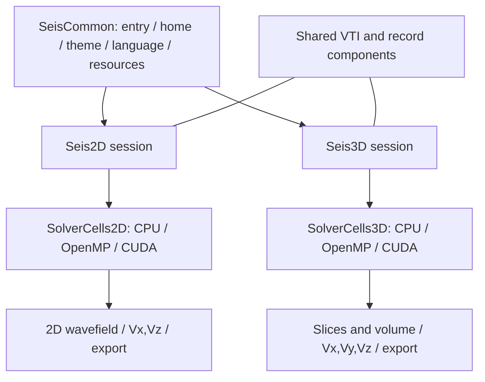

# SeisWave Lab · Cartesian

**A 2D / 3D Cartesian elastic-wave simulation workbench**


[中文](README.md) · [Theory and workflow](docs/PROJECT_MANUAL.md) · [Documentation](docs/README.md) · [Building](docs/build/BUILDING.md) · v2.0.0

Model materials, place sources and receivers, run finite-difference simulations, inspect spatial wavefields and analyze seismic records in one application. The 2D X–Z and 3D workspaces own independent sessions and share themes, localization, material I/O and record-processing components. Both support **CPU/OpenMP and CUDA**.

Documentation organized on **2026-10-24**. Screenshots and measurements retain their original **2026-10-19** dates and conditions. Detailed guides currently use Chinese.


The home grids are geometric illustrations; actual model dimensions and survey geometry are configured in the workspaces.

[Background](#background) · [Numerical method](#numerical-method) · [Architecture](#architecture) · [Implementation](#implementation) · [Interface](#interface) · [Applications](#applications) · [Build and run](#build-and-run) · [Validation and performance](#validation-and-performance) · [Documentation](#documentation) · [References](#references)

## Background

Seismic forward modeling computes propagation from Vp, Vs, density, sources and boundary conditions, then samples receiver time series. This workbench connects the material model, evolving wavefield and receiver records so that changes to parameters and geometry can be inspected together.

The scope is **isotropic linear elasticity on a regular Cartesian grid with a flat surface**. The separate Curvilinear project handles terrain-following grids and curved surfaces; both applications use the same theme family.

| Workspace | Fields and acquisition | Typical experiment |
| --- | --- | --- |
| Seis2D | X–Z plane strain, two velocity and three stress fields; Vx/Vz records | Layered sections, interactive sources and P–SV propagation |
| Seis3D | Three velocity and six stress fields; Vx/Vy/Vz records | Spatial propagation, scattering and receiver spreads |

## Numerical method

The solver uses the first-order velocity–stress elastic system:

$$
\rho\,\partial_t\mathbf v=\nabla\!\cdot\boldsymbol\sigma+\mathbf f,\qquad
\partial_t\boldsymbol\sigma=
\lambda(\nabla\!\cdot\mathbf v)\mathbf I+
\mu\bigl(\nabla\mathbf v+(\nabla\mathbf v)^T\bigr)+\mathbf Q.
$$

Materials are converted with $\mu=\rho V_s^2$ and $\lambda=\rho(V_p^2-2V_s^2)$. Units are m, m/s and kg/m³, with positive-down Z. The 2D solver uses the corresponding plane-strain reduction.

| Component | Implementation |
| --- | --- |
| Spatial derivatives | Staggered Cartesian fields; eighth-order differences in smooth interiors |
| Time stepping | Second-order leapfrog with half-step velocity and integer-step stress |
| Sources | Ricker wavelets; 2D single/continuous excitation; 3D explosive and directional force mechanisms |
| Boundaries | Existing 2D PML/free-surface schemes; 3D slab-stored unsplit CPML |
| 3D modes | Free top plus five absorbing faces, six absorbing faces, or slip-reflecting walls |
| Stability and resolution | Time-step bounds from spacing, maximum Vp and stencil; spatial resolution checked against the source bandwidth |
| Sampling | 2D step-stride sampling; 3D stride or uniformly timed interpolated acquisition |

References 1–2 explain the staggered-grid approach and high-order differences; reference 3 covers CPML. **Interior stencil order does not establish global eighth-order accuracy.** The 3D flat free surface has a second-order closure. Full equations, weights, CFL limits and time staggering are documented in [the manual](docs/PROJECT_MANUAL.md).

## Architecture



| Module | Responsibilities | Entry points |
| --- | --- | --- |
| SeisCommon | Routing, home, device-check entry, themes, localization, resources and shared I/O | [SeisWaveLab.cpp](src/SeisCommon/SeisWaveLab.cpp), [public interfaces](include/SeisCommon/) |
| Seis2D | Model, drafts, sources, PML, capture and record viewer | [Simulation2D.cpp](src/Seis2D/Simulation2D.cpp), [SolverCells2D.h](src/Seis2D/SolverCells2D.h) |
| Seis3D | Session, materials, CPML, survey, slices and volume rendering | [Simulation3D.cpp](src/Seis3D/Simulation3D.cpp), [SolverCells3D.h](src/Seis3D/SolverCells3D.h) |

Each dimension owns its fields, geometry and records. Its CPU and CUDA backends share the corresponding `SolverCells` formulas. CPU display uploads host data to OpenGL; CUDA uses interop. See [the architecture guide](docs/development/CODE_ARCHITECTURE.md).

```text
SeisWaveLab_Cartesian_Workspace/
├─ SeisWaveLab_Cartesian/          Git repository
│  ├─ CMakeLists.txt, cmake/       Standalone build and dependency settings
│  ├─ src/SeisCommon/             Shared application and I/O
│  ├─ src/Seis2D/, src/Seis3D/     Sessions, CPU and cuda/ implementations
│  ├─ include/                   Public interfaces for the three modules
│  ├─ shaders/, resource_CUDA_V1/  Runtime shaders, fonts and resources
│  ├─ resources/icons/            PNG / ICO originals
│  ├─ tests/, benchmarks/         Regression and measurement tools
│  └─ docs/                      Theory, guides, architecture and images
└─ out/                          Generated files outside the Git repository
   ├─ build/                     Separate outer and standalone caches
   ├─ bin/RelWithDebInfo/, bin/Debug/
   └─ screenshots/, benchmarks/, documentation/, blog/
```

Source, original resources and maintained documentation belong in Git. Build caches, executables, runtime data and release ZIPs go to the outer `out`. Private 2D `.inc` fragments are included once by `Simulation2D.cpp`. See [repository layout](docs/development/REPOSITORY_LAYOUT.md).

## Implementation

The workflow is **model → apply parameters → deploy sources/receivers → run and capture → inspect and export**.

- Material presets, editing and VTI loading feed geometry/material checks and elastic-parameter construction.
- Active values and unapplied drafts remain separate; updates rebuild the required state and recompute stability/boundary parameters.
- Auto prefers CUDA, with CPU/OpenMP fallback on device, initialization or interop failure.
- Raw capture is retained independently of display copies used for gain, AGC, selection and navigation.
- Background 3D VTI import uses chunked reads and a private material buffer after full prevalidation, then uploads Z planes. The UI polls progress and installs GL resources. Validation can be cancelled while preserving the old model. See [import validation](docs/reviews/VTI_ASYNC_IMPORT_2026_10_19.md).

| Product | Format |
| --- | --- |
| 2D/3D physical model | One VTI containing Vp, Vs, density, origin and spacing; 2D uses NX×1×NZ |
| External 2D model exchange | Vp/Vs/density SEG-Y property groups |
| Receiver time series | Raw Vx/Vz or Vx/Vy/Vz SEG-Y components |
| Current 3D scalar wavefield | Separate VTI snapshot with component, time and units |

Models and snapshots are not complete restart checkpoints. Display gain, AGC and preview decimation do not modify raw exported records. See [VTI conventions](docs/user/VTI_Model_Format.md) and [VTK exchange](docs/user/VTK_Model_Export.md).

## Interface

### 2D model, wavefield and parameters


The absorber lies outside the physical grid; B toggles visibility. Left click excites a source, with continuous excitation when enabled. Wheel zooms; middle/right drag pans. Controls and parameter tabs dock on the left and support grouped folding.

### 3D slices, volume and records


The ordinary defaults are 300×50×300 physical nodes, 100×5=500 receiver positions and 1000 samples per shot. The illustrated workflow is a separate 200³, 150-receiver demonstration.


The viewer supports all receivers, rows and individual traces. Display processing remains separate from raw acquisition.


There are 45 native 2560×1494 workflow captures, plus this independent 1280×900 import-regression frame. Original dates, hashes and conditions are preserved; waveforms are not synthesized. See [the gallery](docs/user/Seis3D_Screenshot_Gallery.md).

## Applications

| Scenario | Experiment and output |
| --- | --- |
| Teaching | Relate P/S propagation, interface conversions and boundary effects to receiver records |
| Synthetic geological models | Explore layers, faults, gradients and anomalies through wavefields and gathers |
| Survey experiments | Vary source/receiver geometry and sampling, then compare coverage and multicomponent records |
| Numerical and parallel studies | Compare backends, grids, time steps and boundary settings with recorded error/timing data |
| External analysis | Continue with VTI, SEG-Y and geometry CSV in visualization or seismic-processing tools |

Arbitrary curved free surfaces, Q attenuation, anisotropy, migration, inversion and multi-GPU decomposition are outside the current scope. Quantitative use requires model-specific checks for convergence, dispersion, boundary reflection and source normalization.

## Build and run

The validated route is Windows x64, MSVC, CMake 3.26+, Ninja, CUDA Toolkit and OpenGL 4.3. Host code uses C++20; CUDA uses C++17. The recorded local toolkit is 12.8. Runtime CPU fallback is supported; source configuration still requires CUDA Toolkit. GLFW/GLEW/GLM are external SDKs, while ImGui Docking, ImPlot and stb are in the repository.

From this Git repository in an MSVC x64 developer terminal:

```powershell
cmake -S . -B ../out/build/standalone/RelWithDebInfo -G Ninja -DCMAKE_BUILD_TYPE=RelWithDebInfo -DLIB_ROOT=D:/CPP_lib
cmake --build ../out/build/standalone/RelWithDebInfo --target SeisWaveLab --parallel 4
..\out\bin\RelWithDebInfo\SeisWaveLab_Cartesian.exe
```

Override SDK paths with `SEISWAVE_GLM_ROOT`, `SEISWAVE_GLEW_ROOT` and `SEISWAVE_GLFW_ROOT`; choose `CMAKE_CUDA_ARCHITECTURES` for the intended GPU deployment. See [building and distribution](docs/build/BUILDING.md).

| Configuration | Outer workspace cache | Program/resources |
| --- | --- | --- |
| Debug | out/build/x64-Debug | out/bin/Debug |
| VS x64-Release, using RelWithDebInfo | out/build/x64-Release | out/bin/RelWithDebInfo |
| Standalone inner repository | out/build/standalone/&lt;configuration&gt; | out/bin/&lt;configuration&gt; |

Keep caches separate. The CMake target is `SeisWaveLab`; the only main executable is `SeisWaveLab_Cartesian.exe`. Preserve runtime DLLs, resource folders and notices beside it.

## Validation and performance

Backend agreement, stability/physical accuracy, display behavior and file interchange have separate evidence. See [backend validation](docs/development/BACKEND_VALIDATION.md) and [asynchronous import checks](docs/reviews/VTI_ASYNC_IMPORT_2026_10_19.md).

The **2026-10-19** benchmark used 32 CPU workers, five repeats, 2D grids of 256²/1024²/2048² and 3D grids of 48³/96³/160³. CUDA with completion every eight steps measured 9.41–60.61× in 2D and 40.68–256.00× in 3D relative to this project's CPU implementation. Timings exclude display and disk I/O; these are not interface FPS or hardware peak-performance claims. [Full report and raw data](docs/performance/CPU_CUDA_REPORT.md) · [Reproduction](benchmarks/README.md).

To enable and build regression targets from the same repository root:

```powershell
cmake -S . -B ../out/build/standalone/RelWithDebInfo -G Ninja -DCMAKE_BUILD_TYPE=RelWithDebInfo -DLIB_ROOT=D:/CPP_lib -DSEISSIM_BUILD_SOLVER_TESTS=ON -DSEIS3D_BUILD_WORKSPACE_CHECKS=ON
cmake --build ../out/build/standalone/RelWithDebInfo --parallel 4
ctest --test-dir ../out/build/standalone/RelWithDebInfo -C RelWithDebInfo --output-on-failure
```

Some checks require CUDA or graphics; distinguish skips from passes. This documentation revision does not rerun performance measurements.

## Documentation

| Goal | Entry |
| --- | --- |
| Equations, boundaries and sampling | [Theory and workflow](docs/PROJECT_MANUAL.md) |
| Use each workspace | [2D guide](docs/user/Seis2D_User_Guide.md) · [3D guide](docs/user/Seis3D_User_Guide.md) |
| Find modules and data flow | [Architecture](docs/development/CODE_ARCHITECTURE.md) · [Repository layout](docs/development/REPOSITORY_LAYOUT.md) |
| Exchange models and records | [VTI model](docs/user/VTI_Model_Format.md) · [VTK exchange](docs/user/VTK_Model_Export.md) |
| Generate documentation/Hexo bundles | [Tools](docs/tools/README.md) · [Math configuration](docs/build/HEXO_MATH.md) |
| Literature and validation records | [References](docs/REFERENCES.md) · [Index](docs/README.md) |

Maintained sources live in Git; generated offline Markdown and Hexo bundles live under the outer `out/documentation` and `out/blog`. Bundle generation and live deployment are separate actions.

## References

1. Virieux (1986), velocity–stress staggered-grid P–SV modeling. [DOI: 10.1190/1.1442147](https://doi.org/10.1190/1.1442147).
2. Levander (1988), fourth-order staggered-grid P–SV modeling. [DOI: 10.1190/1.1442422](https://doi.org/10.1190/1.1442422).
3. Komatitsch and Martin (2007), unsplit CPML. [DOI: 10.1190/1.2757586](https://doi.org/10.1190/1.2757586) · [Authors' method notes](https://specfem.org/komatitsch.free.fr/README_seismic_cpml.html).
4. SEG Technical Standards Committee (2002), SEG Y rev 1. [Official standards](https://seg.org/publications/seg-technical-standards/).
5. VTK Project, XML ImageData. [Official format documentation](https://docs.vtk.org/en/v9.6.1/vtk_file_formats/vtkxml_file_format.html).

[Full bibliography and its relationship to this implementation](docs/REFERENCES.md).

## License and acknowledgments

Author: **XIAO YU**. Project-authored material is covered by [LICENSE](LICENSE); see [contributing](CONTRIBUTING.md). Thanks to the ImGui, ImPlot, GLFW, GLEW, GLM, stb and toolchain communities. Third-party code, fonts, icons and runtimes have their own terms; see [THIRD_PARTY_NOTICES](THIRD_PARTY_NOTICES.md).
