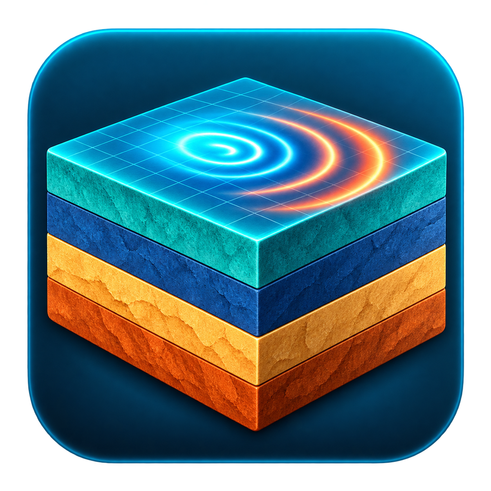
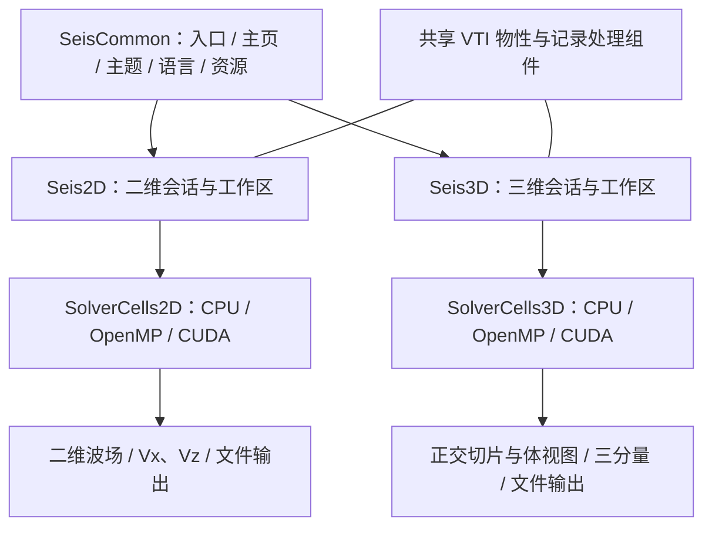

# SeisWave Lab · Cartesian

**二维 / 三维直角坐标弹性波模拟工作台**



[English](README.en.md) · [完整说明](docs/PROJECT_MANUAL.md) · [操作指南](docs/README.md) · [构建说明](docs/build/BUILDING.md) · v2.0.0

将介质建模、震源激发、有限差分正演、空间波场观察和接收记录分析放在同一个交互式工作台中。二维 X–Z 剖面与三维体网格各自维护计算会话，共用主题、语言、物性文件和记录处理组件；计算核心支持 **CPU/OpenMP 与 CUDA**。

文档整理：**2026-10-24**。本文使用的界面截图及性能、导入实测保留 **2026-10-19** 的原始日期和条件。


主页网格为程序绘制的几何示意；实际计算尺寸、物性和观测排列在工作区中设置。

[项目背景](#项目背景) · [方法原理](#方法原理) · [项目架构](#项目架构) · [实现方法](#实现方法) · [界面效果](#界面效果) · [应用场景](#应用场景) · [构建与运行](#构建与运行) · [验证与性能](#验证与性能) · [文档导航](#文档导航) · [参考文献](#参考文献)

## 项目背景

地震正演从介质的纵波速度 Vp、横波速度 Vs、密度及震源条件出发，计算波在空间中的传播，并在接收位置形成时间序列。仅查看模型或最终道集，往往难以同时核对波前、边界反射和源检几何。本项目把这些过程连接起来，方便观察参数变化与波场、记录之间的关系。

项目面向**规则网格、平面地表下的各向同性线弹性波实验**。二维适合剖面建模与 P–SV 传播分析；三维用于观察空间传播、异常体散射及多测线接收。曲面地表与贴体网格由独立的 Curvilinear 项目维护，两个软件沿用同系列界面主题。

| 工作区 | 物理场与观测 | 主要用途 |
| --- | --- | --- |
| 二维 Seis2D | X–Z 平面，2 个速度、3 个应力分量；Vx/Vz 接收记录 | 分层模型、交互激发、波型与边界实验 |
| 三维 Seis3D | X–Y–Z 空间，3 个速度、6 个应力分量；Vx/Vy/Vz 接收记录 | 空间波场、正交切片、体视图与观测系统实验 |

## 方法原理

### 物理模型

以速度—应力形式求解各向同性线弹性方程。三维控制方程可写为：

$$
\rho\,\partial_t\mathbf v=\nabla\!\cdot\boldsymbol\sigma+\mathbf f,\qquad
\partial_t\boldsymbol\sigma=
\lambda(\nabla\!\cdot\mathbf v)\mathbf I+
\mu\bigl(\nabla\mathbf v+(\nabla\mathbf v)^T\bigr)+\mathbf Q.
$$

其中，速度为 $\mathbf v$，应力为 $\boldsymbol\sigma$；$\mathbf f$ 与 $\mathbf Q$ 分别表示体力和应力率源。输入物性转换为 Lamé 参数：$\mu=\rho V_s^2$、$\lambda=\rho(V_p^2-2V_s^2)$。长度使用 m、速度使用 m/s、密度使用 kg/m³，Z 向下为正。二维采用对应的 X–Z 平面应变约化。

### 离散、边界与采样

| 环节 | 当前实现 |
| --- | --- |
| 空间离散 | 速度与应力分量在笛卡尔网格上交错布置，光滑内部采用八阶交错差分 |
| 时间推进 | 速度半时间层、应力整数时间层的二阶交错推进 |
| 震源 | Ricker 子波；单次/连续激发，三维提供爆炸源与定向体力源 |
| 吸收边界 | 二维保留三种既有 PML/自由表面方案；三维采用薄层存储的非分裂 CPML |
| 三维边界模式 | 自由顶面 + 五面 CPML、六面 CPML、六面滑移反射壁 |
| 稳定性 | 根据间距、最大 Vp 和差分算子约束时间步；空间分辨率还需结合有效频带检查 |
| 接收采样 | 二维按计算步距采样；三维支持步距和毫秒等时间插值模式，记录实际采样时间 |

交错网格与高阶离散的背景见文献 1–2，CPML 背景见文献 3。**八阶描述的是光滑内部差分，不代表材料界面、震源与自由表面处均达到八阶精度。** 三维平面自由表面使用二阶闭合；完整推导、权重、CFL、半时间步与采样约定见[理论说明](docs/PROJECT_MANUAL.md)。

## 项目架构

### 三模块分工



| 模块 | 主要职责 | 代码入口 |
| --- | --- | --- |
| SeisCommon | 程序路由、设备检测入口、主题与翻译、资源定位、共享文件/记录组件 | [SeisWaveLab.cpp](src/SeisCommon/SeisWaveLab.cpp)、[公共接口](include/SeisCommon/) |
| Seis2D | 二维模型、参数草稿、激发、PML、采集、记录查看及显示 | [Simulation2D.cpp](src/Seis2D/Simulation2D.cpp)、[SolverCells2D.h](src/Seis2D/SolverCells2D.h) |
| Seis3D | 三维会话、物性、CPML、接收系统、切片和体显示 | [Simulation3D.cpp](src/Seis3D/Simulation3D.cpp)、[SolverCells3D.h](src/Seis3D/SolverCells3D.h) |

二维与三维各自拥有计算缓冲、源检几何和记录会话。每个维度的 CPU 与 CUDA 路径复用其对应的 `SolverCells` 公式，分别由 OpenMP 循环或 CUDA 内核调度。CPU 显示通过主机数据上传 OpenGL，CUDA 显示使用互操作；详细调用关系见[代码架构](docs/development/CODE_ARCHITECTURE.md)。

### 仓库与输出边界

```text
SeisWaveLab_Cartesian_Workspace/
├─ SeisWaveLab_Cartesian/          内部 Git 仓库
│  ├─ CMakeLists.txt、cmake/       独立构建入口与依赖配置
│  ├─ src/SeisCommon/             共享应用和文件组件
│  ├─ src/Seis2D/、src/Seis3D/     二维/三维会话及 CPU、cuda/ 求解
│  ├─ include/                   对应三个模块的公共接口
│  ├─ shaders/、resource_CUDA_V1/  着色器、字体等运行资源
│  ├─ resources/icons/            PNG / ICO 正式图标
│  ├─ tests/                     数值、文件、记录与工作区回归
│  ├─ benchmarks/                生产求解器性能测试与报告脚本
│  ├─ docs/                      理论、指南、架构、截图和参考文献
│  └─ LICENSE、THIRD_PARTY_NOTICES.md
└─ out/                          外层生成目录，不属于内部 Git 仓库
   ├─ build/                     外层与 standalone 独立构建缓存
   ├─ bin/RelWithDebInfo/         当前发布程序、DLL 与运行资源
   ├─ bin/Debug/                 Debug 程序与资源
   ├─ screenshots/、benchmarks/  原始验证与测试输出
   └─ documentation/、blog/      离线文档和 Hexo 生成包
```

源码、原始资源与正式文档随仓库维护；构建缓存、EXE/DLL、运行数据和发布 ZIP 统一进入外层 `out`。二维 `.inc` 文件按职责拆分，由 `Simulation2D.cpp` 统一包含，不单独编译。更多说明见[目录组织](docs/development/REPOSITORY_LAYOUT.md)。

## 实现方法

典型处理链路为：**建模 → 应用参数 → 布设震源/接收器 → 推进与采集 → 查看及导出**。

| 步骤 | 实现方式 | 相关实现 |
| --- | --- | --- |
| 建立物性 | 预设/编辑或读取 VTI；校验几何、物性与内存预算，构造弹性参数 | [二维模型文件](src/Seis2D/ModelIo2D.inc)、[三维模型文件](src/Seis3D/ModelIo3D.cpp) |
| 应用配置 | 当前值与待应用草稿分开；显式更新、重建，重新计算稳定时步与边界参数 | 两个维度各自的会话与参数面板 |
| 选择核心 | Auto 优先 CUDA；设备、初始化或互操作不可用时回退 CPU/OpenMP | [二维 CPU](src/Seis2D/CpuSolver2D.cpp)、[三维 CPU](src/Seis3D/CpuSolver3D.cpp)及各自 `cuda/` |
| 采集与分析 | 原始采样保留，记录查看使用独立显示副本；提供选道、AGC、增益和缩放 | [二维记录查看](src/Seis2D/RecordViewer2D.cpp)、[三维记录查看](src/Seis3D/TraceView3D.cpp) |
| 数据交换 | VTI 保存物性，SEG-Y 保存接收时间序列，CSV 描述源检几何 | [公共 VTI 实现](src/SeisCommon/VtiModelIO.cpp)、[格式约定](docs/user/VTI_Model_Format.md) |

三维 VTI 导入使用后台任务：分块读取减少细碎 I/O，完成一次完整预校验后暂存物性，再初始化核心并上传。主线程轮询进度、绘制动画，最后安装 OpenGL 资源。校验阶段可取消，取消或校验失败保留原模型；开始初始化后等待完成。生命周期与约 50 MB 验证见[异步导入说明](docs/reviews/VTI_ASYNC_IMPORT_2026_10_19.md)。

| 数据产品 | 格式与用途 |
| --- | --- |
| 二维/三维物性模型 | `.vti`，单文件包含 Vp、Vs、密度、原点与间距；二维为 `NX×1×NZ` |
| 外部二维物性交换 | Vp、Vs、密度三个 SEG-Y 文件，保留原有间距、方向与单位选项 |
| 接收器时间序列 | Vx/Vz 或 Vx/Vy/Vz 分量 SEG-Y，保存原始采样 |
| 三维当前波场 | 独立 `.vti` 标量快照，含分量、时刻与单位 |

模型文件和波场快照各有用途，均不保存完整动态续算状态。AGC、颜色增益和显示抽稀不改变导出记录的原始振幅。

## 界面效果

### 二维：模型、波场与当前参数


物理模型之外显示吸收区域，B 键切换其可见性。左键激发，连续模式下按住追加源；滚轮缩放，中键/右键平移。左侧控制与当前参数采用页签停靠，支持分组展开/折叠。

### 三维：切片、体视图与接收记录


三正交剖面联动观察空间传播，体视图辅助理解波前与几何关系。普通默认物理网格为 **300×50×300**，接收排列 **100×5=500 点**，每炮 **1000 样点**；图中演示使用 200³、150 点的独立算例。

### 地震记录与模型导入


记录面板支持全部道、接收行、单道及 AGC 对照。显示处理与原始导出分离，便于同时观察弱事件和核对原始振幅。


导入期间显示旋转动画、阶段、百分比和已用时间。45 张流程原图为 2560×1494；上方导入进度图是另一次 1280×900 的真实回归窗口。图片保留采集日期与摘要，未裁切、重着色或合成波形，条件见[完整截图集](docs/user/Seis3D_Screenshot_Gallery.md)与[导入验证](docs/reviews/VTI_ASYNC_IMPORT_2026_10_19.md)。

## 应用场景

| 场景 | 可开展的实验 | 主要观察与产物 |
| --- | --- | --- |
| 波动教学 | 改变物性、震源和边界，观察 P/S 波及界面转换 | 波场、到时与接收记录对照 |
| 地质模型实验 | 水平/倾斜层、断层、速度梯度与异常体 | 反射、折射和散射的合成波场/道集 |
| 观测系统研究 | 调整震源位置、接收线/网格、采样间隔 | 源检几何、覆盖差异和多分量记录 |
| 数值与并行实验 | 比较 CPU/CUDA、网格、时步和边界参数 | 误差、稳定性、吞吐率与内存数据 |
| 外部分析衔接 | 导出 VTI、SEG-Y 和几何 CSV | 在 VTK/ParaView 或地震处理工具中继续分析 |

当前范围不含任意曲面自由地表、黏弹性 Q 衰减、各向异性、偏移成像、反演或多 GPU 域分解。用于定量研究时，应按具体模型核对收敛、频散、边界反射和源归一化；项目已有证据见[验证与性能](#验证与性能)及[验证报告](docs/development/BACKEND_VALIDATION.md)。

## 构建与运行

当前验证路线为 **Windows x64、MSVC、CMake 3.26+、Ninja、CUDA Toolkit、OpenGL 4.3**。主机代码使用 C++20，CUDA 使用 C++17；本机工具链记录为 CUDA 12.8。CPU 是运行时计算回退，当前源码配置仍要求 CUDA Toolkit。GLFW、GLEW、GLM 为外部 SDK，Dear ImGui Docking、ImPlot 和 stb 位于仓库中。

从**内部 Git 仓库根目录**，在 MSVC x64 开发者终端执行：

```powershell
cmake -S . -B ../out/build/standalone/RelWithDebInfo -G Ninja -DCMAKE_BUILD_TYPE=RelWithDebInfo -DLIB_ROOT=D:/CPP_lib
cmake --build ../out/build/standalone/RelWithDebInfo --target SeisWaveLab --parallel 4
..\out\bin\RelWithDebInfo\SeisWaveLab_Cartesian.exe
```

SDK 可通过 `SEISWAVE_GLM_ROOT`、`SEISWAVE_GLEW_ROOT`、`SEISWAVE_GLFW_ROOT` 单独配置。分发到其他 GPU 时，按目标设备配置 `CMAKE_CUDA_ARCHITECTURES`。构建与部署细节见[BUILDING](docs/build/BUILDING.md)。

| 配置 | 外层缓存 | 程序与资源输出 |
| --- | --- | --- |
| Debug | `out/build/x64-Debug` | `out/bin/Debug` |
| VS `x64-Release`，实际为 RelWithDebInfo | `out/build/x64-Release` | `out/bin/RelWithDebInfo` |
| 内部仓库独立构建 | `out/build/standalone/<配置>` | `out/bin/<配置>` |

表中路径相对外层工作区。两种构建入口使用各自缓存；唯一主程序为 `SeisWaveLab_Cartesian.exe`，CMake 目标名仍为 `SeisWaveLab`。运行与分发须保留同级 DLL、`resource_CUDA_V1`、`resource_Seis3D` 和许可文件。

## 验证与性能

| 验证范围 | 已有记录 |
| --- | --- |
| 二维/三维后端与记录 | 串行/OpenMP、CPU/CUDA 波场与接收器、采样时间、清场及释放，见[后端验证](docs/development/BACKEND_VALIDATION.md) |
| 模型与工作区 | VTI 字段/轴序、异常输入、采集与显示状态、路径选择、异步导入取消与回收，见[导入验证](docs/reviews/VTI_ASYNC_IMPORT_2026_10_19.md) |
| CPU/CUDA 求解效率 | 2026-10-19，32 线程，二维 256²/1024²/2048²、三维 48³/96³/160³，每种配置 5 轮，见[正式报告与原始数据](docs/performance/CPU_CUDA_REPORT.md) |

报告记录的 CUDA 批 8 步加速比为二维 **9.41–60.61×**、三维 **40.68–256.00×**，比较对象是本项目当时的 32 线程 CPU 实现。计时排除显示和写盘，数值随网格、同步策略与硬件变化；界面 FPS、模型导入耗时与纯求解速度分别报告。

需要复现回归时，从同一内部仓库根目录配置并构建全部已启用目标：

```powershell
cmake -S . -B ../out/build/standalone/RelWithDebInfo -G Ninja -DCMAKE_BUILD_TYPE=RelWithDebInfo -DLIB_ROOT=D:/CPP_lib -DSEISSIM_BUILD_SOLVER_TESTS=ON -DSEIS3D_BUILD_WORKSPACE_CHECKS=ON
cmake --build ../out/build/standalone/RelWithDebInfo --parallel 4
ctest --test-dir ../out/build/standalone/RelWithDebInfo -C RelWithDebInfo --output-on-failure
```

部分检查需要 CUDA 或图形环境，跳过项应与通过项分开解释。本次 README 整理未重新开展性能测量，也未将既有截图作为新增物理精度证明。[性能复现入口](benchmarks/README.md)

## 文档导航

| 阅读目标 | 入口 |
| --- | --- |
| 理解方程、交错网格、边界和采样 | [完整理论与流程](docs/PROJECT_MANUAL.md) |
| 使用二维 / 三维工作区 | [二维指南](docs/user/Seis2D_User_Guide.md) · [三维指南](docs/user/Seis3D_User_Guide.md) |
| 查找模块职责、数据流和源文件 | [代码架构](docs/development/CODE_ARCHITECTURE.md) · [目录组织](docs/development/REPOSITORY_LAYOUT.md) |
| 导入模型和导出记录 | [VTI 模型格式](docs/user/VTI_Model_Format.md) · [VTK 交换](docs/user/VTK_Model_Export.md) |
| 生成离线文档与博客资源 | [文档工具](docs/tools/README.md) · [Hexo 数学设置](docs/build/HEXO_MATH.md) |
| 阅读文献与历史验证 | [参考文献](docs/REFERENCES.md) · [分类文档索引](docs/README.md) |

维护源位于仓库内，文档工具把离线 Markdown 和 Hexo 文章/资源生成到外层 `out/documentation`、`out/blog`。生成发布包与线上部署分别执行；本文不依赖本机 `out` 中的截图或文件。

## 参考文献

1. Virieux, J. (1986). *P-SV wave propagation in heterogeneous media; velocity-stress finite-difference method*. **Geophysics, 51**(4), 889–901. [DOI: 10.1190/1.1442147](https://doi.org/10.1190/1.1442147).
2. Levander, A. R. (1988). *Fourth-order finite-difference P-SV seismograms*. **Geophysics, 53**(11), 1425–1436. [DOI: 10.1190/1.1442422](https://doi.org/10.1190/1.1442422).
3. Komatitsch, D., & Martin, R. (2007). *An unsplit convolutional perfectly matched layer improved at grazing incidence for the seismic wave equation*. **Geophysics, 72**(5), SM155–SM167. [DOI: 10.1190/1.2757586](https://doi.org/10.1190/1.2757586) · [作者方法说明](https://specfem.org/komatitsch.free.fr/README_seismic_cpml.html).
4. SEG Technical Standards Committee. (2002). *SEG Y rev 1 Data Exchange format*. [SEG 官方标准](https://seg.org/publications/seg-technical-standards/).
5. VTK Project. *XML File Formats — ImageData*. [VTK 官方格式说明](https://docs.vtk.org/en/v9.6.1/vtk_file_formats/vtkxml_file_format.html).

文献与项目功能的对应关系、核对来源见[参考文献说明](docs/REFERENCES.md)。论文描述的方法背景与本项目的实现、精度及格式支持范围分别说明。

## 许可与致谢

作者：**XIAO YU**。项目自有代码许可见 [LICENSE](LICENSE)，贡献方式见 [CONTRIBUTING](CONTRIBUTING.md)。感谢 Dear ImGui、ImPlot、GLFW、GLEW、GLM、stb 及相关工具链；第三方代码、字体、图标和运行库的来源与许可范围见 [THIRD_PARTY_NOTICES](THIRD_PARTY_NOTICES.md)。
