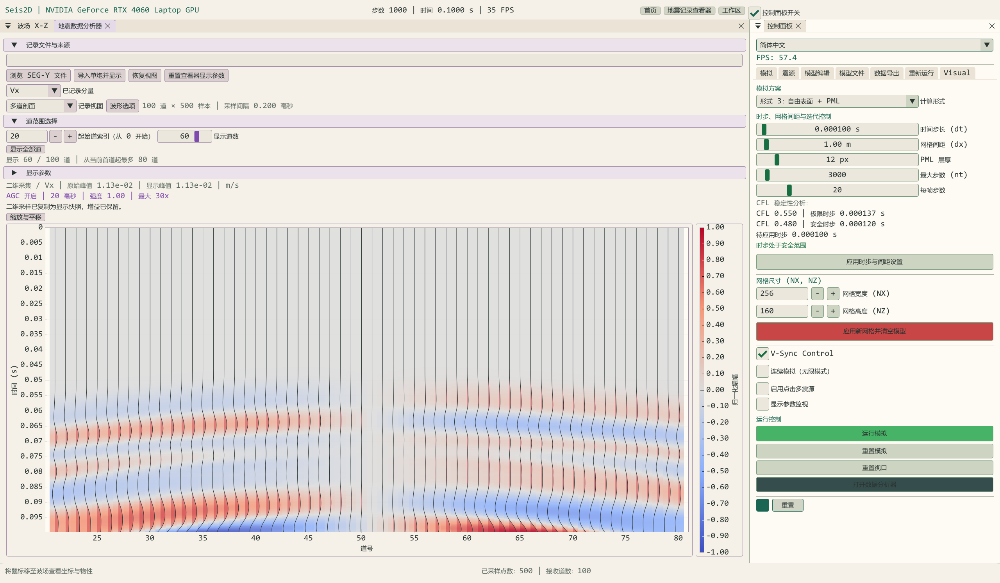

# SeisWave Lab：笛卡尔网格二维与三维弹性波模拟的理论、实现与工作流程

修订日期：2026 年 10 月 18 日。软件版本：v2.0.0；三维模块：Seis3D。

**摘要**　SeisWave Lab 将各向同性弹性波有限差分正演、GPU 并行计算、空间波场观察与地震记录分析整合为一个交互式工作台。当前项目采用笛卡尔规则网格，保留二维 X–Z 平面模拟，并提供独立的三维速度—应力求解、薄层存储 CPML、平面自由表面、正交切片、辅助体绘制、三分量采集及 SEG-Y / VTK 数据交换。本文按照背景、理论、实现、界面流程和复现附录组织，区分数学模型、代码实现、显示处理及已有验证范围。配图全部来自当前程序实际运行，保存完整客户区原图。

**关键词**　弹性波；笛卡尔网格；交错网格有限差分；CUDA；CPML；地震采集；科学可视化

<!-- more -->

## 1 背景与系统边界

### 1.1 面向的问题

地震正演从介质物性、震源和边界条件出发，计算质点速度与应力的传播过程。交互式软件使模型、波场、接收记录和输出数据可以在同一会话中相互核对，适用于水平地表下的层状介质实验、传播现象教学、观测系统布设及算法原型研究。

本项目的计算坐标就是物理笛卡尔坐标，三轴等间距，Z 向下为正深度。水平双层与三层模型是主要入门算例；倾斜界面、断层、异常体和速度梯度仍可在规则网格上按物性分布表示。材料界面的几何变化不改变网格，也不构成曲面自由表面的实现。

曲面地表和贴体曲网格工作在独立的 **Seis3D_Curvilinear** 项目中维护。本项目没有该项目的曲网格度量、同位网格时间组合或 CPU/OpenMP 求解后端；本项目的三维正演由 CUDA 执行。


图 1　完整程序主页。三维入口的 10×10 接收点是界面示意，不是默认采集排列；主页动画不是数值解。

### 1.2 功能与限制

| 方面 | 当前实现 |
| --- | --- |
| 物理模型 | 各向同性线弹性介质，三维 3 速度与 6 应力分量；二维独立工作区 |
| 三维离散 | 八阶内部交错网格空间差分、二阶时间交错推进；平面自由表面二阶闭合 |
| 边界 | 自由顶面加五面 CPML、六面 CPML、六面无损滑移反射壁 |
| 建模 | 九种合成预设，S3DM 物性模型导入与导出 |
| 可视化 | 三正交切片、空间体绘制、物性色标、波场色带、固定或自动幅值参考 |
| 数据 | 单炮／矩形多炮观测系统，最多 500 个空间接收点，Vx/Vy/Vz 三分量 |
| 记录查看 | Live、正式采集、外部单炮 SEG-Y，选行、选道、AGC、色带和双轴导航 |
| 数据交换 | 三分量 SEG-Y、几何 CSV、物性 VTI、当前标量波场 VTI |
| 界面 | ImGui Docking、十套主题、中英文、分组折叠、字号与快捷键 |

当前不包含黏弹性 Q 衰减、各向异性、动态破裂、任意曲面地表、偏移成像或多 GPU 域分解。材料验证允许部分零 Vs 输入，但不能据此认定固液界面处理已经完成物理验证。

### 1.3 如何理解截图和验证

波前光滑、程序运行完成、后端调用成功和导出文件存在分别说明不同事项。它们不能替代到时、振幅、频散、收敛阶、人工边界反射及长时间能量变化的定量研究。界面 FPS 同时受计算批次、渲染和窗口调度影响，不能直接作为 CUDA 求解吞吐率或加速比。

本次重新采集 33 张三维、8 张二维完整截图，原生分辨率均为 **2560×1494**。图片不裁切、不拉伸、不重着色。主页、初始模型和边界设置图是操作说明；动态波场及地震记录来自真实 CUDA 计算。完整图集见 [Seis3D 截图集](user/Seis3D_Screenshot_Gallery.md)，逐图 SHA-256 与条件随图片保存。

## 2 物理与数值原理

### 2.1 三维速度—应力方程

设质点速度为 $\mathbf v=(v_x,v_y,v_z)^T$，对称应力为 $\boldsymbol\sigma$。应力张量与状态分量为

$$
\boldsymbol\sigma=
\begin{pmatrix}
\sigma_{xx}&\sigma_{xy}&\sigma_{xz}\\
\sigma_{xy}&\sigma_{yy}&\sigma_{yz}\\
\sigma_{xz}&\sigma_{yz}&\sigma_{zz}
\end{pmatrix},\qquad
U=(v_x,v_y,v_z,\sigma_{xx},\sigma_{yy},\sigma_{zz},\sigma_{xy},\sigma_{yz},\sigma_{xz})^T.
\tag{1}
$$

在小应变、静止各向同性线弹性假设下，控制方程为

$$
\rho\frac{\partial v_i}{\partial t}
=\frac{\partial\sigma_{ij}}{\partial x_j}+f_i,
\qquad
\frac{\partial\sigma_{ij}}{\partial t}
=\lambda\delta_{ij}\frac{\partial v_k}{\partial x_k}
+\mu\left(\frac{\partial v_i}{\partial x_j}+\frac{\partial v_j}{\partial x_i}\right)+Q_{ij}.
\tag{2}
$$

重复指标在 X/Y/Z 上求和。$\rho$ 是密度，$\lambda,\mu$ 是 Lamé 参数，$\mathbf f$ 为体力密度，$Q_{ij}$ 为应力率源项。速度单位 m/s，应力 Pa，密度 kg/m³，长度 m，时间 s。

例如 X 速度、X 法向应力和 XY 剪应力满足

$$
\begin{aligned}
\rho\,\partial_t v_x&=\partial_x\sigma_{xx}+\partial_y\sigma_{xy}+\partial_z\sigma_{xz}+f_x,\\
\partial_t\sigma_{xx}&=(\lambda+2\mu)\partial_xv_x+\lambda\partial_yv_y+\lambda\partial_zv_z+Q_{xx},\\
\partial_t\sigma_{xy}&=\mu(\partial_yv_x+\partial_xv_y)+Q_{xy}.
\end{aligned}
\tag{3}
$$

其余分量可按循环指标展开。输入 $V_p,V_s,\rho$ 与弹性参数的关系为

$$
\mu=\rho V_s^2,\qquad
\lambda=\rho(V_p^2-2V_s^2),\qquad
K=\lambda+\frac23\mu=\rho\left(V_p^2-\frac43V_s^2\right).
\tag{4}
$$

固体的正弹性能要求 $\rho>0,\mu>0,K>0$，不要求 $\lambda$ 单独为正。代码还检查有限值、速度与密度的实现范围。显示压力按压缩为正定义为

$$
p=-\frac{\sigma_{xx}+\sigma_{yy}+\sigma_{zz}}3.
\tag{5}
$$

### 2.2 笛卡尔交错网格

设等间距 $h=\Delta x=\Delta y=\Delta z$，参考格点为 $(ih,jh,kh)$。法向应力与材料参考点位于整数格点；速度位于相应轴的半格点，剪应力位于两轴半格点。

| 物理量 | 相对参考格点的空间偏移 |
| --- | --- |
| $\sigma_{xx},\sigma_{yy},\sigma_{zz}$ | $(0,0,0)$ |
| $v_x,v_y,v_z$ | 分别为 $(1/2,0,0),(0,1/2,0),(0,0,1/2)$ |
| $\sigma_{xy},\sigma_{yz},\sigma_{xz}$ | 分别为 $(1/2,1/2,0),(0,1/2,1/2),(1/2,0,1/2)$ |

沿 X 的八阶交错一阶导数可写成

$$
(D_x^+u)_i=\frac1h\sum_{m=1}^{4}c_m(u_{i+m}-u_{i-m+1}),
\qquad
(D_x^-u)_i=\frac1h\sum_{m=1}^{4}c_m(u_{i+m-1}-u_{i-m}).
\tag{6}
$$

其中

$$
(c_1,c_2,c_3,c_4)=
\left(\frac{1225}{1024},-\frac{245}{3072},\frac{49}{5120},-\frac5{7168}\right).
\tag{7}
$$

Y/Z 方向使用相同权重和各自内存步幅。一次方向导数使用八个采样点，三轴共为 24 点十字邻域；这不是将 24 个点用于单一方向的导数。速度点使用相邻材料的面平均密度，剪切点采用相应剪切模量的调和平均。材料突变、震源与边界处的整体误差不能直接用光滑内点的八阶截断误差代替。

### 2.3 二阶交错时间推进

应力位于整数时间层，速度位于半时间层。忽略源项的紧凑记号为

$$
\begin{aligned}
\mathbf v^{n+1/2}&=\mathbf v^{n-1/2}+\Delta t\,\rho^{-1}\operatorname{div}_h\boldsymbol\sigma^n,\\
\boldsymbol\sigma^{n+1}&=\boldsymbol\sigma^n+\Delta t\,\mathcal C:\operatorname{symgrad}_h\mathbf v^{n+1/2}.
\end{aligned}
\tag{8}
$$

$\mathcal C$ 是各向同性刚度张量。每个时间步按速度更新、源／边界操作、应力更新及对应源／边界操作执行；CPML 导数记忆与该导数所属的更新同步。

界面在完成第 N 步时显示 $N\Delta t$，此时速度时间为 $(N-1/2)\Delta t$，应力时间为 $N\Delta t$。比较速度记录、压力快照与理论曲线时应保留这一半步差异。

### 2.4 稳定性与空间分辨率

当前三维代码采用保守的交错差分 CFL 约束

$$
\Delta t_{\rm safe}\le
\frac{C_{\rm CFL}h}{\sqrt3 V_{p,\max}S},\qquad
S=\sum_{m=1}^{4}|c_m|,\qquad 0<C_{\rm CFL}\le0.9.
\tag{9}
$$

初始化或导入后扫描最大 Vp，默认安全系数为 0.85。程序将安全上限向下取到整数微秒，自动模式使用该值；手动模式要求整数微秒且不大于安全上限。默认双层模型 $h=10$ m、最大 Vp=4200 m/s 时，量化后的自动时步为 **0.908 ms**，因此 0.5 ms 可用，1 ms 不满足当前约束。

稳定步长不保证短波长能够解析。若关注最高有效频率 $f_{\max}$，固体中可检查最短横波的每波长格点数

$$
\lambda_{s,\min}=\frac{V_{s,\min}}{f_{\max}},\qquad
N_\lambda=\frac{V_{s,\min}}{h f_{\max}},\qquad
N_t=\frac1{f_{\max}\Delta t}.
\tag{10}
$$

$f_{\max}$ 应结合子波有效频带选择，不能直接把主频视为全部频谱的截止。应通过网格加密与波形误差判断所需 $N_\lambda$；减小时间步无法修复空间欠采样。


图 2　截图算例手动使用 0.5 ms，界面同时显示待应用值与实际时步。

### 2.5 Ricker 子波与源机制

三维源采用延迟 Ricker 子波

$$
w(t)=\left[1-2\pi^2f_0^2(t-t_0)^2\right]
\exp[-\pi^2f_0^2(t-t_0)^2],\qquad t_0=\frac{1.2}{f_0}.
\tag{11}
$$

源投影到邻近 3×3×3 格点，离散高斯权重归一化使权重和为 1。爆炸源向三个法向应力施加等幅应力率；体力源沿给定方向作用于速度更新，幅值量纲分别为 Pa/s 与 N/m³。网格加密时的物理矩率／总力归一化仍需单独设计，不能仅固定 UI 幅值就推断绝对振幅可跨网格比较。

主频同时影响 Ricker 波形与 CPML 的频移系数。编辑主频后通过“应用主频并重置波场”、重发或新采集提交；普通继续运行保持当前生效主频。主频不直接进入式（9）的速度上限，但决定可解析频带、采样间隔和记录时长需求。


图 3　本算例使用 20 Hz 爆炸源，位于 [100,100,50] 格点，标称位置为 [1000,1000,500] m。

### 2.6 CPML 与三种边界

非分裂 CPML 将每个方向导数 $d=\partial_\alpha u$ 替换为

$$
\widetilde d^{\,n}=\frac{d^n}{\kappa_\alpha}+\psi_\alpha^n,\qquad
\psi_\alpha^n=b_\alpha\psi_\alpha^{n-1}+a_\alpha d^n,
\tag{12}
$$

$$
b_\alpha=\exp[-(\sigma_\alpha/\kappa_\alpha+\alpha_\alpha)\Delta t],\qquad
a_\alpha=\frac{\sigma_\alpha(b_\alpha-1)}
{\kappa_\alpha(\sigma_\alpha+\kappa_\alpha\alpha_\alpha)}.
\tag{13}
$$

这里的 $\sigma_\alpha$ 是吸收轮廓参数，与应力分量不同；普通区域取 $a=0,b=1,\kappa=1$。代码采用三次轮廓、$\kappa_{\max}=3$、最大频移 $\pi f_0$ 和设计反射参数 $10^{-6}$。**设计参数不是实测残余反射率。** 中心和半格点分别建立系数，每方向的六个记忆槽只存储在对应 CPML 薄层，角点同时接受相关方向的处理。方法背景见 [SEISMIC_CPML 与 Komatitsch–Martin（2007）](https://specfem.org/komatitsch.free.fr/README_seismic_cpml.html)。

自由顶面位于物理 $z=0$，要求

$$
\boldsymbol\sigma\mathbf n=0
\quad\Longrightarrow\quad
\sigma_{zz}=\sigma_{xz}=\sigma_{yz}=0.
\tag{14}
$$

代码按交错位置镜像应力，表面速度闭合满足

$$
\begin{aligned}
\partial_zv_x&=-\partial_xv_z,\\
\partial_zv_y&=-\partial_yv_z,\\
\partial_zv_z&=-\frac{\lambda}{\lambda+2\mu}(\partial_xv_x+\partial_yv_y).
\end{aligned}
\tag{15}
$$

该平面闭合为二阶，不能将整个有边界模型称为全局八阶。顶部自由表面开启时不配置顶部 Z 向 CPML。

| 模式 | 物理设置 | 是否重建 |
| --- | --- | --- |
| 自由顶面 + CPML | 顶面零牵引，侧面与底面吸收 | 更改后重建 |
| 六面 CPML | 六面有限厚度吸收，顶面也为吸收层 | 更改后重建 |
| 六面反射 | 无损滑移壁，法向速度零、切向牵引零，禁用 CPML | 更改后重建 |
| 边界层显示开关 | 仅显示／隐藏计算边界区域，不改变上述条件 | 即时生效 |


图 4–6　三种模式的初始化与控制位置。截图不用于比较反射误差。

### 2.7 二维约化

二维工作区表示沿 Y 不变的 X–Z 平面问题，主要分量为 $v_x,v_z,\sigma_{xx},\sigma_{zz},\sigma_{xz}$。无体力时的连续方程为

$$
\begin{aligned}
\rho\partial_t v_x&=\partial_x\sigma_{xx}+\partial_z\sigma_{xz},\\
\rho\partial_t v_z&=\partial_x\sigma_{xz}+\partial_z\sigma_{zz},\\
\partial_t\sigma_{xx}&=(\lambda+2\mu)\partial_xv_x+\lambda\partial_zv_z,\\
\partial_t\sigma_{zz}&=\lambda\partial_xv_x+(\lambda+2\mu)\partial_zv_z,\\
\partial_t\sigma_{xz}&=\mu(\partial_zv_x+\partial_xv_z).
\end{aligned}
\tag{16}
$$

二维有独立数值配置、模型与生命周期，不能直接套用三维的 CPML 实现、参数或采样起点。旧 UI 的 `Velocity Y` 在二维表示垂向 Vz。二维线源与三维点源的几何扩散不同，不应直接比较绝对幅值。旧二维源还有数值注入比例，UI 幅值不是经过标定的地震矩或 SI 总力。

## 3 软件实现与数据约定

### 3.1 技术栈和职责

| 技术 | 作用 |
| --- | --- |
| C++20 / CUDA C++17 | 会话管理、UI、文件交换与数值核函数 |
| CUDA 12.8 | 格点差分、CPML、材料生成、接收采样和显示抽取 |
| OpenGL 4.3 | 切片、空间体绘制与离屏目标 |
| Dear ImGui Docking / ImPlot | 可停靠面板、双语交互、地震记录与图例 |
| GLFW / GLEW / GLM | 窗口、OpenGL 接口和数学支撑 |
| CMake / MSVC | 编译依赖与外层 out 输出布局 |

Seis3D 类型、算法和资源封闭在 `namespace Seis3D`；`SimulationContext3D` 保存实际物理参数，`GPUSimData3D` 管理设备内存，`GLHandles3D` 管理图形资源，`Seis3D_State` 管理会话与显示状态。二维与三维切换时先释放原模式 GPU/图形资源。主题和主窗口属于应用层。

```text
建模／导入 → 参数与物性检查 → 最大 Vp / CFL / 显存预算
                                 ↓
                     CUDA 速度—应力与边界更新
                         ↙                  ↘
             切片／显示体抽取             接收点三分量采样
                     ↓                          ↓
                OpenGL 视图               Live / 正式道集
                     ↓                          ↓
             当前原分辨率 VTI             SEG-Y + 几何 CSV
```

### 3.2 CUDA 与资源预算

九个物理场分别存储，X 索引连续。各格点执行相近的邻域操作，由 GPU 线程并行处理；同一计算流保持速度、应力、边界和采样的依赖顺序。显示使用 CUDA/OpenGL 互操作缓冲，避免每帧把完整三维场回传 CPU 再上传图形设备。没有在本文给出统一测量的 CPU/GPU 加速比。

三维物理节点总数满足 $N_xN_yN_z\le36\,000\,000$，各轴至少 16，单边不再固定为 512。CPML 和 ghost 不计入物理节点数，但计入显存；同时还需满足 4 GiB 单会话预算、实际空闲显存与 GL 纹理尺寸约束。

| 物理网格 | 节点数 | 自由顶面、12 格 CPML 的代码预算 |
| --- | --- | --- |
| 300×50×300 | 450 万 | 约 0.554 GiB |
| 500×20×500 | 500 万 | 约 0.873 GiB |
| 200³ | 800 万 | 约 0.771 GiB |
| 300³ | 2700 万 | 约 1.987 GiB |
| 300×300×400 | 3600 万 | 约 2.516 GiB |

表中为实现的预算估算，非显卡进程占用实测。CUDA 模块、驱动和其他进程会额外占用显存。

### 3.3 计算、显示与导出分辨率

三正交切片由物理格点抽取。辅助体绘制使用每轴最多 256 点的重采样显示体，输出随视口变化，最长边最多 1536 像素；射线采样按路径长度自适应。增大采样质量可以改善显示，无法恢复显示体已经省略的薄层或高频细节。

VTI 快照直接下载原物理网格的数据，不使用显示体，也不应用增益、色带或透明度。速度分量以相邻半格点的算术平均重构到参考整数格点；速度模从这三个重构分量计算，压力由整数格点法向应力计算。这是空间同位重构，没有进行时间同位插值。

当前快照的 `SimulationTimeSeconds` 写入工具栏名义时间 $N\Delta t$；N≥1 时速度／速度模实际属于 $(N-1/2)\Delta t$，压力属于 $N\Delta t$。外部时间对照应按分量减去对应半步，初始全零状态单独视为初始场。这个元数据约定不应被误读成所有场都在同一物理时间层。

### 3.4 正式采集的时间定义

设求解时步为 $\Delta t$、每 s 个求解步记录一次、每炮 M 点。三维速度样本的时间为

$$
t_k=(s-\tfrac12)\Delta t+k\,s\Delta t,\qquad k=0,1,\ldots,M-1,
\quad\Delta t_r=s\Delta t.
\tag{17}
$$

因此名义记录窗口为 $M\Delta t_r$，首末样点跨度为 $(M-1)\Delta t_r$。本次 $\Delta t=0.5$ ms、s=2、M=1000，采样间隔为 1 ms，实际样本从 **0.75 ms 到 999.75 ms**。显示时不把首点强行改成 0 s；CSV 保存准确起点，SEG-Y 也包含采样与时间信息。

Live 监视按计算批次采样，每道保留最近 1000 点；它的时间窗随每批步数变化。需要从激发开始、固定间隔的完整单炮数据，应使用“激发并采集”，不能把 Live 当作正式道集。

每炮保存 Vx/Vy/Vz 三个分量；500 道是空间接收点上限，每个分量文件各包含最多 500 道。正式记录最多 32767 点，SEG-Y 采样间隔最多 32767 μs，主机三分量缓存受 512 MiB 预算约束。采集开始时冻结模型、震源与几何，后续草稿不会回写旧道集。

### 3.5 AGC 的显示处理

设一条原始记录为 $u_k$，峰值 $P=\max_k|u_k|$。对 $P>0$，令 $\widehat u_k=u_k/P$，全局 RMS 为 R，中心时窗内 RMS 为 $r_k$。实现中的补偿为

$$
R=\sqrt{\frac1M\sum_k\widehat u_k^2},\qquad
r_k=\sqrt{\frac1{|W_k|}\sum_{j\in W_k}\widehat u_j^2},
\tag{18}
$$

$$
B_k=\min\left(B_{\max},\left[\max\left(1,\frac R{\max(r_k,\epsilon)}\right)\right]^q\right),
\quad
g_k=\operatorname{clamp}\left(\frac{r_k-\epsilon}{\epsilon},0,1\right),
\quad
u_k^{\rm display}=u_k[1+g_k(B_k-1)].
\tag{19}
$$

q 为强度（0–1），$B_{\max}$ 为最大增益，$\epsilon$ 是相对原始峰值的噪声门限。门限为 0 时令 $g_k=1$，分母保留极小正数；零记录保持为零。RMS 窗口按实际时间戳选样，本实现只提升弱段，不把强段压低到统一 RMS。

默认参考设置为 120 ms 窗口、强度 1、最大 50×、噪声门限 0.01%。先在完整记录上补偿，再进行最多 2048 点的显示极值抽稀。AGC、逐道归一化、波形增益与密度色阶是不同的显示处理；**它们都不修改 SEG-Y 导出的原始样本**。开启 AGC 的图不能用于定量比较原始道间振幅。

### 3.6 数据交换

| 数据 | 格式 | 内容和用途 |
| --- | --- | --- |
| 内部物性模型 | `.s3dm` | 本项目自定义；网格及 Vp/Vs/密度；可重新导入 |
| 通用物性模型 | `.vti` | VTK XML ImageData，原网格 Vp/Vs/Density；当前只导出 |
| 当前波场 | `.vti` | Vz/Vx/Vy/速度模/压力中的一个标量体，含时刻和单位；不是续算检查点 |
| 三维单炮 | `_vx.sgy`、`_vy.sgy`、`_vz.sgy` | 固定长度三分量道集，IEEE Float32、大端写出 |
| 几何 | `_geometry.csv` | 源检位置、CMP 标号、首样点、间隔与实际样点数 |
| 二维单炮包 | SEG-Y + 描述及可选模型 | 独立二维约定，包含文件摘要与真实采样信息 |

规则等距模型采用 VTI，而非用于显式曲面点坐标的 VTS；格式背景见 [VTK XML 官方规范](https://docs.vtk.org/en/latest/vtk_file_formats/vtkxml_file_format.html)。本项目 VTI 为 PointData、小端 Float32、raw appended 二进制、UInt64 块头，X 最快，原点 [0,0,0]，坐标 Z 正向向下。波场快照保存实际已初始化会话，不读取未应用的模型草稿。

S3DM 不是行业通用标准；模型文件不包含震源、接收系统、时间推进状态或完整动态场。详细格式及独立读取代码见 [S3DM 说明](user/S3DM_Model_Format.md) 和 [VTI 说明](user/VTK_Model_Export.md)。

## 4 界面与完整操作流程

### 4.1 主页与布局

在主页选择二维或 Seis3D。本文采用 **Paper Sand** 界面主题，三维视觉预设为 **Paper scientific**，模型色带为 **Scientific White**，波场为 **Coolwarm**。界面主题只改变控件，视觉预设改变配色；它们均不重置已经调好的波场增益、幅值参考与透明度。需要恢复显示默认值时单独点击“统一重置显示参数”。

三维通过 ImGui Docking 提供四视图、体视图优先、紧凑页签和接收记录优先四种布局。拖动窗口标签可重新停靠；Workspace 菜单可找回关闭窗口。默认字号约 21 px，工作区支持倍率调整，分组提供展开／折叠控件。


图 7　t=0.240 s、第 480 步的 Vz 波场。水平深度切片取 Z=70 格，避开源的对称平面；Live 曲线按每批 8 步记录了 60 个预览点。

### 4.2 步骤一：建模与边界

1. 进入 Simulation，展开网格与模型组，设置 200×200×200、间距 10 m。
2. 选择 Two layers；上层 Vp/Vs/ρ=3000/1700/2200，下层为 4200/2400/2500，单位分别为 m/s、m/s、kg/m³。
3. 保留界面深度比例 0.5、顶部自由表面和 12 格 CPML。
4. 设置 Manual time step=0.5 ms，确认不大于当前 CFL 上限。
5. 点击初始化／重建，核对底部提示、材料分层与当前生效参数。


合成模型共有均匀、双层、球形异常、三层、倾斜界面、低速夹层、断层、梯度和盐丘九种。预设改变待应用物性及几何参数，重建后才进入实际计算；保存需要的旧结果后再重建。


### 4.3 步骤二：震源与显示

设置 20 Hz Ricker、爆炸源及 [100,100,50] 格点，使用 Vz/Coolwarm，显示增益 1.8，关闭历史峰值保持。点击 Run 后观察传播；Pause 停止连续推进，Step 用于单步。

切片滚轮以鼠标位置为中心缩放（100%–3200%），中键平移，左键拾取联动三平面。各平面 Reset view 独立复位，顶部 Reset views 或 R 恢复三剖面与相机。单分量可能因节点对称性接近零，可切到速度模并移动切片，不能只凭某一幅空白剖面判断求解失败。

同一状态的色带比较如下。六张图使用相同模型、分量、时刻与显示增益，只改变波场调色板。


图 8–13　同为第 480 步；顺序色带适合幅值类观察，蓝红发散色带更便于区分正负极性。所有原图均包含完整控制面板。


图 14–16　速度模、体绘制参数和边界可见范围。模型较大时可调体增益、透明度、阈值、尺寸补偿和更新频率；颜色变淡首先核对幅值参考及体显示设置，不应更改物理源强来补偿画面。

### 4.4 步骤三：接收排列与正式采集

软件普通默认接收排列为 100×5、共 500 道，默认单炮 1×1、每道 1000 点。本次截图显式使用 **50×3=150 道**，便于完整展示多排选行；二者不是版本差异。


1. Acquisition 中设置每排 50 道、Y 向 3 排，检查位置全部位于物理模型内。
2. 设置每炮 1000 点、stride=2，确认采样间隔 1 ms。
3. 单炮保持源排列 1×1，选择输出目录和文件名前缀。
4. 点击 Fire + capture。程序重置动态场，应用待提交主频并冻结该炮的源检几何。
5. 等待采集完成，切换 Captured 数据源。提前停止只保留已经有效采集的样本。


### 4.5 步骤四：记录分析


图 20–24　全部道、选行、AGC、密度图和单道三分量。显示最大道数随所选数据总道数更新；选 X row 固定 Y，或 Y row 固定 X。展示一排不删除其他接收样本。

在记录图内滚轮缩放双轴，在时间轴或道轴上滚轮仅缩放该轴，左键拖动平移。手动导航解除自动适配，Reset View 重新适配数据。显示样式包括 Wiggle、Variable area、Density、Density + wiggle、Signed lobes 和组合；色带与波场共用同类颜色定义，但各自保留独立显示参数。


建议先观察未处理数据，再选择一排开启 AGC。若静默段被明显放大，可提高噪声门限或降低最大增益；做幅值分析时关闭 AGC 与逐道归一化。

### 4.6 步骤五：导出、重新导入与外部处理


采集完成后导出 `_vx.sgy`、`_vy.sgy`、`_vz.sgy` 和几何 CSV。导入已有单炮文件使用独立 Imported 数据源，不覆盖当前模拟或正式道集。外部文件的分量、坐标与时间定义需结合其头信息核对。


Model I/O 为 S3DM 与 VTI 分别保存路径；当前波场快照还有独立文件名。先选择目录与新文件名，再显式点击导出。模型和快照不覆盖已有同名文件；快照应在希望保存的时刻暂停后导出。VTI 可由 ParaView/VTK 打开，使用原网格与物理值，不包含显示增益。

### 4.7 二维操作对照

二维控制面板默认在右侧，波场和记录可按建模、并排分析和记录优先布局停靠。二维的模型导入、接收配置和正式采样具有自身约定，详见 [二维指南](user/Seis2D_User_Guide.md)。本次二维为 256×160、100 道×500 点，与三维是独立算例。





以上八图为二维完整流程。AGC 和色标只影响预览；二维输出的真实采样信息与文件摘要在单炮包中保存。

### 4.8 快捷键与帮助


| 快捷键 | 三维操作 |
| --- | --- |
| Space / N | 运行暂停／单步 |
| Q / Shift+Q | 下一／上一波场色带 |
| W / Shift+W | 下一／上一分量 |
| E / Shift+E | 下一／上一模型色带 |
| C / R | 重置动态场／恢复全部视图 |
| G / B / V | 网格／边界可见性／辅助体视图 |
| F1 / Tab | 快捷键帮助／返回首页 |

编辑文字、活动控件和弹窗会抑制工作区快捷键；采集中不能用 C 清空场。切换分量保持增益与同单位参考，压力使用独立 Pa 参考。重建模型清零动态场，但保留显示设置；切换视觉预设也不执行统一重置。

## 5 复现附录与维护

### 5.1 默认参数与截图条件

| 项目 | 当前普通默认值 | 本次三维截图 |
| --- | --- | --- |
| 物理网格 | 300×50×300 | 200×200×200 |
| 间距 | 10 m | 10 m |
| 模型 | 水平双层 | 同左；断层图为单独初始化 |
| 上／下层 Vp | 3000 / 4200 m/s | 同左 |
| 上／下层 Vs | 1700 / 2400 m/s | 同左 |
| 上／下层密度 | 2200 / 2500 kg/m³ | 同左 |
| 主频 | 20 Hz | 20 Hz |
| 求解步长 | 自动 CFL，双层约 0.908 ms | 手动 0.5 ms |
| 接收点 | 100×5=500 | 50×3=150 |
| 炮数 | 1×1 | 1×1 |
| 正式样点数／stride | 1000 / 2 | 1000 / 2 |
| 每帧步数 | 2 | 波场阶段 8；采集结束恢复 2 |
| 波场／预设／色带 | Vz / Paper scientific / Coolwarm | 同左；色带图只切调色板 |
| 显示增益／历史峰值 | 1.8 / 关闭 | 同左 |
| 主题 | 读取用户偏好 | Paper Sand，独立演示会话 |

本次设备为 NVIDIA GeForce RTX 4060 Laptop GPU、计算能力 8.9、约 8 GiB 显存。六种色带图均为第 480 步，工具栏时间 0.240 s，Vz 对应半步时刻 0.23975 s。正式记录 150×1000×3 个 Float32 样本，含三分量但不将其计成 450 个空间接收点。

### 5.2 目录组织与构建

外层工作区为 `SeisWaveLab_Cartesian_Workspace`，Git 根目录为其内层 `SeisWaveLab_Cartesian`。CMake 项目为 `SeisWaveLab_Cartesian`，主程序目标为 `SeisWaveLab`。源码、原始资源、文档、发表截图与工具均在仓库中；编译和生成结果进入其父目录的 `out`。

```text
外层工作区/
├─ CMakeLists.txt、AGENTS.md          外层构建入口和约定
├─ SeisWaveLab_Cartesian/          Git 仓库
│  ├─ Main_cpp、Main_header           应用与共享界面
│  ├─ src/Seis2D、src/Seis3D          独立工作区与 I/O
│  ├─ cuda、CUDA_Kernels、shaders     计算与显示代码
│  ├─ include、resources、resource_CUDA_V1
│  ├─ docs/PROJECT_MANUAL.md          本文维护源
│  ├─ docs/user、build、development   分类说明
│  ├─ docs/assets                    当前图与历史图
│  └─ docs/tools                     截图发布和文档打包
└─ out/
   ├─ build、bin、lib                 编译缓存与程序
   ├─ screenshots                    本次原始截图与独立模拟数据
   ├─ documentation                  可离线阅读的 Markdown 图文包
   ├─ blog                           Hexo 文章与资源、ZIP
   └─ docs-work、archive              排版／渲染中间件与历史输出
```

外层 VS Release 配置为 RelWithDebInfo，程序为 `out/bin/RelWithDebInfo/SeisWaveLab_Cartesian.exe`。独立打开内层仓库时使用单独的 `out/build/standalone/<配置>` 缓存，不能与外层入口共用缓存。构建步骤见 [BUILDING](build/BUILDING.md)，文件分类见 [仓库组织](development/REPOSITORY_LAYOUT.md)。

### 5.3 重新截图与生成 Hexo

在外层工作区运行：

```powershell
& ./out/bin/RelWithDebInfo/SeisWaveLab_Cartesian.exe --capture-seis3d-workflow
& ./out/bin/RelWithDebInfo/SeisWaveLab_Cartesian.exe --capture-seis2d-workflow
```

随后从内层 Git 仓库运行：

```powershell
python -B docs/tools/prepare_paper_screenshots.py
python -B docs/tools/prepare_seis2d_screenshots.py
python -B docs/tools/package_documentation.py
```

先检查真实图像与元数据，再发布图片。打包读取本维护源并生成博客 front matter，转换图片与本地文档链接；不通过全局替换 LaTeX 反斜线修改公式。输出包含 `hexo/source/_posts/CUDA_Seis3D.md` 及同名 `CUDA_Seis3D/` 资源目录，配套文档也在资源目录内。开启站点文章资源文件夹，将资源目录加入 `skip_render`，使附件保持下载文件而非额外文章，按 [Hexo 公式设置](build/HEXO_MATH.md) 合并配置。打包不自动部署网站。

### 5.4 当前证据与后续实验

本轮完成当前程序重新构建检查、二维／三维完整流程采集及文档资源检查。结果和清单见 [本轮文档更新记录](reviews/DOCUMENTATION_REFRESH_2026_10_18.md)。既有求解／边界回归属于其记载的历史条件，不将本轮截图写成新增精度证明。

后续定量研究建议记录实际源码提交号，建立均匀介质 P/S 到时、网格与时间收敛、平面自由表面反射与 Rayleigh 波、CPML 入射角与厚度扫描、材料界面反射透射、长时能量以及 CUDA cells/s 与显存基准。原始记录使用统一源归一化，比较振幅时关闭显示增益、AGC 与逐道归一化。软件论文准备见 [发表路线](publication/PUBLICATION_ROADMAP.md)。

### 5.5 进一步阅读

- [三维逐项用户指南](user/Seis3D_User_Guide.md)：更详细的操作说明与问题处理。
- [二维用户指南](user/Seis2D_User_Guide.md)：二维模型、采样和数据包约定。
- [三维实现说明](development/SEIS3D_IMPLEMENTATION.md)：函数职责、显存、边界与文件头。
- [S3DM 格式](user/S3DM_Model_Format.md) 与 [VTI 导出](user/VTK_Model_Export.md)：数据布局和独立读取。
- [SEISMIC_CPML 官方资料](https://specfem.org/komatitsch.free.fr/README_seismic_cpml.html)：卷积吸收边界方法与原文链接。
- [VTK XML 格式规范](https://docs.vtk.org/en/latest/vtk_file_formats/vtkxml_file_format.html)：ImageData 与二进制数据结构。

理论式（6）—（15）对应当前笛卡尔三维实现；二维和独立曲网格项目的离散、边界与采样约定应分别阅读。项目许可与第三方来源由仓库的 LICENSE 和 THIRD_PARTY_NOTICES 说明。
