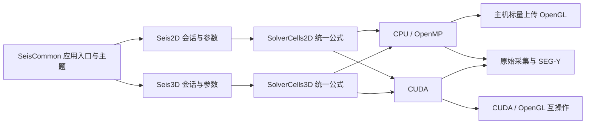

# Cartesian 项目代码架构

说明整理日期：2026-10-24。主程序唯一输出名称为 `SeisWaveLab_Cartesian.exe`，CMake 构建目标保留 `SeisWaveLab`。本轮补充分层、代码入口和数据生命周期，不改动算法或重新测量性能。

## 目录与职责

```text
SeisWaveLab_Cartesian/
  src/
    Seis2D/       二维会话、参数草稿、采集、记录分析与 CPU 求解
      cuda/       二维 CUDA 调度与设备内核
    Seis3D/       三维会话、模型、CPML、采集、剖面/体显示与 CPU 求解
      cuda/       三维 CUDA 调度与设备内核
    SeisCommon/   应用入口、主页、主题、翻译、资源定位、SEG-Y 与帮助
  include/
    Seis2D/       二维对外接口与外置吸收域工具
    Seis3D/       三维数据结构与对外接口
    SeisCommon/   共享 UI、记录显示、调色板、文件与运行资源接口
  resources/      软件图标与 Windows 版本资源
  shaders/        三维着色器
  resource_CUDA_V1/  二维着色器、字体和运行资源
  tests/          数值、记录、后端及工作区回归
  docs/           用户指南、架构、理论、资源及维护工具
```

旧 `Main_cpp`、`Main_header`、`CUDA_Kernels` 与顶层 `cuda` 已迁入上述分类。完整逐文件映射见 [迁移清单](SOURCE_MIGRATION_2026-10-19.json)。第三方库及资源保留原位置和许可。

## 分层与代码定位

| 层次 | 职责与边界 | 主要代码 |
| --- | --- | --- |
| 应用与共享服务 | 主页路由、语言/主题、资源定位；两个工作区共用服务代码 | `SeisCommon/SeisWaveLab.cpp`、`AppTheme.cpp`、`AppLanguage.cpp`、`ResourcePaths.cpp` |
| 工作区交互 | 参数控件、停靠、快捷键、剖面/记录交互；由 UI 线程执行 | `Seis2D/Workspace2D.inc`、`Seis3D/Workspace3D.cpp`、两个维度的记录查看组件 |
| 模拟会话 | 物性、源检几何、当前参数与草稿、启动/暂停/重建/采集状态 | `Seis2D/Simulation2D.cpp`、`Seis3D/Simulation3D.cpp` 及各自采集组件 |
| 数值与后端 | 各维度的共享单元公式、OpenMP 调度与 CUDA 内核；管理各自内存归属 | `SolverCells2D.h`、`SolverCells3D.h`、`CpuSolver2D.cpp`、`CpuSolver3D.cpp`、各自 `cuda/` |
| 显示与数据交换 | OpenGL 图形资源、CPU 上传/CUDA 互操作、VTI 物性与 SEG-Y 记录 | `Seis3D/Renderer3D.cpp`、`Seis2D/Canvas2D.inc`、`SeisCommon/VtiModelIO.cpp`、各自模型/记录 I/O |

表中路径均相对 `src`。共享数值公式按维度分别维护；共享组件不会把二维、三维的计算缓冲或采集状态合并成同一个会话。二维 `.inc` 是私有实现片段，由 `Simulation2D.cpp` 包含一次，不是单独的编译目标。

## 计算与显示链路



二维 `SolverCells2D.h` 与三维 `SolverCells3D.h` 各自维护一份有限差分公式，供主机和设备编译。二维三种方案（全域分裂 PML、内部 FDM/边界 PML、自由表面）及三维 CPML、平面自由表面、反射边界均支持 CPU/OpenMP。时间推进保留应力/速度阶段间的同步；重合震源在 CPU 上按顺序累加。物理域之外的吸收边界约定不变。

`GPUSimData` / `GPUSimData3D` 保留既有 API 命名，其 CPU 标志明确该会话的指针归属；统一内存助手按归属分配、复制和释放。CPU 指针不会传入 CUDA 内核。CPU 显示通过主机标量缓冲上传 OpenGL，CUDA 使用互操作。后台计算仍需要 OpenGL 4.3 显示环境。

自动选择优先 CUDA；无设备、驱动异常、初始化失败或 CUDA/OpenGL 互操作不可用时回退 CPU。CPU 线程数可配置，切换核心通过重新初始化生效。程序允许没有可用 CUDA 设备时进入主页与工作区。当前工程仍需 CUDA Toolkit 编译（并非无 Toolkit 源码配置）；发布目录随程序部署 CUDA Runtime DLL，运行 CPU 不要求 CUDA 显卡或 Toolkit。

## 参数、采集与分析

二维参数面板与控制面板默认同组页签停靠在左侧。面板并列列出当前值和待应用值，差异着色；更新按钮应用尺寸、时间、间距、PML、震源频率及计算核心，撤销按钮恢复草稿。尺寸变化重建物性模型；时间/核心变化清空波场并保留物性；采集中禁止重建。三维当前参数面板也显示当前/草稿对照并保留重建按钮。

二维和三维以 VTI ImageData 为主要物性模型，`ModelIO` 公共库保存原点、间距与 Vp/Vs/Density；实现位于 SeisCommon/VtiModelIO.cpp。二维保留 SEG-Y 物性组用于外部交换。ModelIo2D.inc / ModelIo3D.cpp 对接各自会话与 CPU/CUDA 材料上传；当前波场 VTI 快照独立。S3DM 接口已移除。

三维界面的导入路径使用 `ModelImportTask3D`：`beginModelImport3D` 冻结路径和参数并启动后台校验/读取；主线程 `pollModelImport3D` 非阻塞轮询，校验后释放旧缓冲，再启动后台 CPU/CUDA 分配和上传。任务不访问 ImGui 或 OpenGL；主线程最后安装图形资源并调用共享 `completeSession3D`，互操作失败时异步回退 CPU。进度与取消使用原子状态，读取按块通知进度。析构先取消并等待任务，再销毁计算/图形资源。详见[异步导入验证](../reviews/VTI_ASYNC_IMPORT_2026_10_19.md)。

`include/SeisCommon/NativeFileDialog.h` 共用 Windows Unicode 文件选择器。目录与文件名分别传入，缺失目录回退到有效父目录，取消不更新路径，并显式恢复工作目录。二维 VTI、二维数据包名称和三维模型/快照/记录目标使用同一实现。`SeisNativeFileDialogRegression` 验证路径准备；加 `--native-dialogs` 实际运行自动打开/取消的系统对话框检查。

二维分析器使用与三维记录面板一致的顶部数据来源、分量/全部道或单道选择、首道与显示道数、显示参数、增益/AGC、恢复视图布局。两者共用 `TraceProcessing.h`、`RecordVisuals.h` 等处理与配色模块。分析器持有冻结的主机样本，不持有计算场指针；显示增益及 AGC 不改原始记录和导出。

## 数据与状态生命周期

| 数据 | 所有者与更新方式 | 需要区分的操作 |
| --- | --- | --- |
| 待应用参数 | 各工作区编辑状态；控件先修改草稿 | 编辑控件不自动替换生效网格或物性 |
| 生效模型与动态场 | 各模拟会话及其 CPU/CUDA 后端 | 重建按参数重新分配；清场重置动态量，具体保留范围由操作定义 |
| 正式接收记录 | 采集缓冲与完成后的冻结记录 | 捕获原始样本及实际几何/时间；显示增益不写回样本 |
| 显示副本与相机 | 记录查看器和波场显示组件 | AGC、选道、缩放、色带及增益用于预览 |
| 异步导入材料 | `ModelImportTask3D` 的私有缓冲与计算准备资源 | 校验阶段取消保留旧模型；初始化后旧计算资源已释放，图形安装由主线程完成 |
| 文件与生成结果 | VTI/SEG-Y/几何输出或文档工具 | 模型文件不是完整续算检查点；运行生成数据放在外层 `out` |

典型调用顺序为：**编辑模型/参数 → 显式应用 → 校验与分配 → 配置源检 → 推进与采样 → 冻结/查看 → 导出**。CPU/CUDA 切换属于会话重建，不能把显示模式切换与计算核心切换混为同一操作。两工作区切换及程序退出时，先结束任务，再按计算/图形资源的所有权释放；主程序不通过全局设备重置回收某个工作区。

## 性能指标与回归

二维时间步面板显示已同步的求解墙钟耗时、步/秒、百万网格点/秒，排除显示与文件导出。二维对比在独立会话中推进同一当前模型，预热 4 步，计时 20 步，报告 CPU/CUDA 耗时比和 Vz 相对 L2 误差，不改正在查看的原始记录。

三维报告每批耗时（包括采样与同步，排除显示和文件导出）；标准对比采用 32³ 物理网格、CPML 8、相同物性方案/间距/时间步/震源，预热 4 步计时 20 步。它是标准算例对比，不表示当前大模型的实测加速比。CPU 线程数、网格与输出频率都会影响性能；比值大于 1 表示 CUDA 较快。

新增 `Backend3DRegression` 检查串行/OpenMP 一致性、CPU/CUDA 波场和接收器、显示提取、模型平面读写、清场和释放。二维 `SolverRegression` 增加 CPU 串行/OpenMP、三种边界、CUDA 对照、零增益、回放和接收器生命周期。`SEISWAVE_FORCE_CPU=1` 可强制实际应用进入 CPU 回退路径进行验证。

构建约定见 [BUILDING](../build/BUILDING.md)。所有缓存、程序与运行输出位于外层 `out`，源码树不创建构建目录。

## 分组折叠状态

二维 `ParameterGroups2D.inc`、三维 `sectionHeader3D` 使用面板级命令修订号广播“全部展开/折叠”，每组记录最后消费的修订号。未显示页签在下次访问时补消费命令，因此全部折叠覆盖面板全部类别；平常允许单独展开，避免每帧强制覆盖。参数查看和更新也独立分组；折叠不改变模拟状态。

本轮验证范围及结果见 [后端验证](BACKEND_VALIDATION.md)。发布目录同步 CUDA Runtime 与 MSVC/OpenMP 可再分发运行库。

## 外置性能测试入口

`benchmarks/ComputeBenchmark.cpp` 通过可选 CMake 目标 `SeisComputeBenchmark` 复用生产求解器，CPU 固定 32 线程，对照 CUDA 每步与每8步同步。该工具独立于 GUI 与正确性 ctest，输出外层 out，再由 RenderReport.py 生成正式报告；不改变原模拟程序的默认设置。详见 [性能实测报告](../performance/CPU_CUDA_REPORT.md)。
