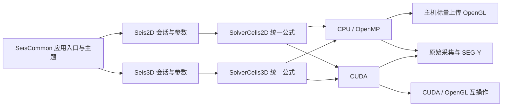

# Cartesian 项目代码架构

更新日期：2026-10-19。主程序唯一输出名称为 `SeisWaveLab_Cartesian.exe`，CMake 构建目标保留 `SeisWaveLab`。

## 目录与职责

```text
SeisWaveLab_Cartesian/
  src/
    Seis2D/       二维会话、参数草稿、采集、记录分析与 CPU 求解
      cuda/       二维 CUDA 调度与设备内核
    Seis3D/       三维会话、模型、CPML、采集、剖面/体显示与 CPU 求解
      cuda/       三维 CUDA 调度与设备内核
    SeisCommon/   应用入口、主页、主题、翻译、资源定位、SEG-Y 与帮助
  include/
    Seis2D/       二维对外接口与外置吸收域工具
    Seis3D/       三维数据结构与对外接口
    SeisCommon/   共享 UI、记录显示、调色板、文件与运行资源接口
  resources/      软件图标与 Windows 版本资源
  shaders/        三维着色器
  resource_CUDA_V1/  二维着色器、字体和运行资源
  tests/          数值、记录、后端及工作区回归
  docs/           用户指南、架构、理论、资源及维护工具
```

旧 `Main_cpp`、`Main_header`、`CUDA_Kernels` 与顶层 `cuda` 已迁入上述分类。完整逐文件映射见 [迁移清单](SOURCE_MIGRATION_2026-10-19.json)。第三方库及资源保留原位置和许可。

## 计算与显示链路



二维 `SolverCells2D.h` 与三维 `SolverCells3D.h` 各自维护一份有限差分公式，供主机和设备编译。二维三种方案（全域分裂 PML、内部 FDM/边界 PML、自由表面）及三维 CPML、平面自由表面、反射边界均支持 CPU/OpenMP。时间推进保留应力/速度阶段间的同步；重合震源在 CPU 上按顺序累加。物理域之外的吸收边界约定不变。

`GPUSimData` / `GPUSimData3D` 保留既有 API 命名，其 CPU 标志明确该会话的指针归属；统一内存助手按归属分配、复制和释放。CPU 指针不会传入 CUDA 内核。CPU 显示通过主机标量缓冲上传 OpenGL，CUDA 使用互操作。后台计算仍需要 OpenGL 4.3 显示环境。

自动选择优先 CUDA；无设备、驱动异常、初始化失败或 CUDA/OpenGL 互操作不可用时回退 CPU。CPU 线程数可配置，切换核心通过重新初始化生效。程序允许没有可用 CUDA 设备时进入主页与工作区。当前工程仍需 CUDA Toolkit 编译（并非无 Toolkit 源码配置）；发布目录随程序部署 CUDA Runtime DLL，运行 CPU 不要求 CUDA 显卡或 Toolkit。

## 参数、采集与分析

二维参数面板与控制面板默认同组页签停靠在左侧。面板并列列出当前值和待应用值，差异着色；更新按钮应用尺寸、时间、间距、PML、震源频率及计算核心，撤销按钮恢复草稿。尺寸变化重建物性模型；时间/核心变化清空波场并保留物性；采集中禁止重建。三维当前参数面板也显示当前/草稿对照并保留重建按钮。

二维外部物性导入仅保留 `.sgy` / `.segy` 的 Vp、Vs、密度三文件组，选择器及手输路径均限制扩展名。波场电影加载属于独立回放入口；三维 S3DM/VTI 原有数据交换接口保留。

二维分析器使用与三维记录面板一致的顶部数据来源、分量/全部道或单道选择、首道与显示道数、显示参数、增益/AGC、恢复视图布局。两者共用 `TraceProcessing.h`、`RecordVisuals.h` 等处理与配色模块。分析器持有冻结的主机样本，不持有计算场指针；显示增益及 AGC 不改原始记录和导出。

## 性能指标与回归

二维时间步面板显示已同步的求解墙钟耗时、步/秒、百万网格点/秒，排除显示与文件导出。二维对比在独立会话中推进同一当前模型，预热 4 步，计时 20 步，报告 CPU/CUDA 耗时比和 Vz 相对 L2 误差，不改正在查看的原始记录。

三维报告每批耗时（包括采样与同步，排除显示和文件导出）；标准对比采用 32³ 物理网格、CPML 8、相同物性方案/间距/时间步/震源，预热 4 步计时 20 步。它是标准算例对比，不表示当前大模型的实测加速比。CPU 线程数、网格与输出频率都会影响性能；比值大于 1 表示 CUDA 较快。

新增 `Backend3DRegression` 检查串行/OpenMP 一致性、CPU/CUDA 波场和接收器、显示提取、模型平面读写、清场和释放。二维 `SolverRegression` 增加 CPU 串行/OpenMP、三种边界、CUDA 对照、零增益、回放和接收器生命周期。`SEISWAVE_FORCE_CPU=1` 可强制实际应用进入 CPU 回退路径进行验证。

构建约定见 [BUILDING](../build/BUILDING.md)。所有缓存、程序与运行输出位于外层 `out`，源码树不创建构建目录。

## 分组折叠状态

二维 `ParameterGroups2D.inc`、三维 `sectionHeader3D` 使用面板级命令修订号广播“全部展开/折叠”，每组记录最后消费的修订号。未显示页签在下次访问时补消费命令，因此全部折叠覆盖面板全部类别；平常允许单独展开，避免每帧强制覆盖。参数查看和更新也独立分组；折叠不改变模拟状态。

本轮验证范围及结果见 [后端验证](BACKEND_VALIDATION.md)。发布目录同步 CUDA Runtime 与 MSVC/OpenMP 可再分发运行库。

## 外置性能测试入口

`benchmarks/ComputeBenchmark.cpp` 通过可选 CMake 目标 `SeisComputeBenchmark` 复用生产求解器，CPU 固定 32 线程，对照 CUDA 每步与每8步同步。该工具独立于 GUI 与正确性 ctest，输出外层 out，再由 RenderReport.py 生成正式报告；不改变原模拟程序的默认设置。详见 [性能实测报告](../performance/CPU_CUDA_REPORT.md)。
