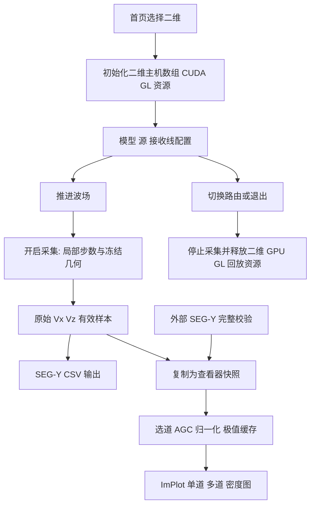

# 二维代码整理、记录查看器升级与优化建议

日期：2026-10-14。软件：SeisWave Lab v2.0.0。本文记录本轮实际实现、回归结果及仍待完成的事项；用户操作见 [二维图文指南](../user/Seis2D_User_Guide.md)。

## 1. 主要问题与处理

| 原有问题 | 影响 | 本轮处理 |
| --- | --- | --- |
| 约 4700 行的 `Seis_Sim.h` 同时定义状态、求解准备、模型、采集、UI、分析和资源清理 | 头文件暴露大量可变状态，路由直接依赖细节，改动难定位 | 缩为不足 30 行的接口，实现在单一二维翻译单元中持有，按职责分类 |
| 路由和关闭程序分别释放同一组二维资源 | 容易遗漏或顺序不一致 | 统一 `releaseSimulation2D`，独立卸载可选设备监测 |
| 查看器与旧 PlotContext / AnalysisState 混杂 | 设置、数据来源和计算状态难以区分 | 新建 CPU `ViewerState2D`，删除旧查看器专用状态 |
| 弱记录主要依靠简单缩放，二维/三维 AGC 实现可能漂移 | UI 行为不一致，维护重复 | 无状态 `Seismic::applyAgc` 共用，双方仍保留独立记录和设置 |
| 打开查看器或更换数据可能丢掉显示调整 | 用户反复调节增益 | 导入和快照替换只提交数据及适配请求；显式按钮重置显示 |
| 分配时长被当作有效采集长度 | 提前停止产生无效零尾段 | `capturedSamples` 跟踪实际取得样本，查看/SEG-Y/CSV 统一裁切 |
| 中途采集按模拟绝对步数写新缓存 | 前段空洞、进度不正确 | `captureStartStep` 建立局部采集时间轴，第一条样本写索引 0 |
| 导出读取正在编辑的下一炮几何 | 样本与炮检坐标不匹配 | 保存源、间距及接收位置快照，重新触发不覆盖已有记录的几何 |
| 采集中改 dt、排列或模型 | 可能破坏采样时间轴和 buffer 一致性 | 控件冻结、画布注入/编辑暂停；重置结束采集；底层继续检查 dt/stride |
| SEG-Y 字段强制缩成 16 位 | 样点数/间隔溢出且可能显示成功 | 写入前检查范围、矩形数组和有限值，检测文件打开与结束写入失败 |
| 大道集每帧全量重处理 | UI 不必要消耗 CPU | 以数据 revision、选道、分量、AGC、归一化为键缓存；gain/色图不重算 |
| 过大 SEG-Y 延迟换算成 int 索引 | 时间桶选择可能整数溢出 | 在 double 中先夹紧到样本范围，再转换为 int |
| 非有限 AGC 参数 | 预览可能出现 NaN | 开启 AGC 时显式验证参数，失败保留原样本 |
| 标记使用全局前景绘图 | 接收点/源标记盖住工具窗口 | 在波场窗口图层绘制并裁切，工具窗口正确遮挡 |
| 浅色主题仍用暗色文字/霓虹刻度、固定底栏排版 | 可读性下降、文字交叠 | 本地主题作用域、功能色、低对比网格、响应式状态栏，移除页尾控件固定覆盖位置 |
| 2D 面板每帧扫描材料求 Vp 最大值 | 大网格增加无效主线程工作 | 用材料变更时刷新的物性范围缓存显示 CFL；应用参数仍复核实际材料 |
| NVML 解析/初始化失败时只检查 loaded | 库句柄可能无法释放 | 区分句柄和设备加载状态，未完全初始化也释放库 |

本轮没有重写二维差分内核，也没有把三维上下文或 GPU 状态迁入二维。已有物理修正的历史条件见 [数值审查](../reviews/NUMERICAL_STABILITY_REVIEW.md)。

## 2. 文件组织

```text
Main_header/
├─ Seis_Sim.h                 二维公共门面与生命周期入口
├─ SeismicViewer2D.h          CPU 记录、查看器设置和有界预览缓存
└─ TraceProcessing.h          二维/三维共用的无状态 AGC 与极值预览
src/Seis2D/
├─ Simulation2D.cpp           唯一二维实现翻译单元；公开 API 的适配
├─ State2D.inc                私有状态、采集缓存、可选 NVML 监测
├─ Material2D.inc             物性统计、模型纹理、GPU 材料上传
├─ Canvas2D.inc               物理尺标、画笔、震源标记和提示框
├─ Numerics2D.inc             Ricker、CFL、PML 阻尼、初始物理数组
├─ ModelPresets2D.inc          合成模型与场景应用
├─ ModelIo2D.inc              旧模型文本/SEG-Y 导入、重采样与导出
├─ Acquisition2D.inc          接收上传、单炮启动、2C SEG-Y/CSV 输出
├─ Workflow2D.inc             输入、推进、采样、多炮状态机、CUDA/GL 显示
├─ Workspace2D.inc            控制面板、状态栏和工作区逐帧组织
├─ RecordData2D.cpp           SEG-Y 安全读取、事务替换、缓存准备
└─ RecordViewer2D.cpp         文件选择、单/多道 ImPlot 与显示选项
tests/
└─ Seis2DRecordRegression.cpp CPU 读取/增益/状态/导出回归
docs/
├─ user/Seis2D_User_Guide.md
├─ assets/seis2d/             八张实际 CUDA/OpenGL 截图
└─ tools/prepare_seis2d_screenshots.py
```

`.inc` 是私有实现片段，只由 `Simulation2D.cpp` 按依赖顺序包含一次，不能再从公共头或其他 `.cpp` 包含，也不作为独立编译源。这样先解除大型头文件的外部耦合，保留原求解路径，便于对照回归。

这不是所有子系统都已独立编译或对象化。`namespace Seis2D::Legacy2D` 中仍有持久状态，下一阶段可逐步迁入 Session 实例，再用私有头与独立 `.cpp` 替换部分 `.inc`。新数据读取和查看器已经是独立 `.cpp`，无需继续扩充大型 UI 头文件。

CMake 将新文件列入二维源分组；VS 能直接按功能定位。`ImGui_docking`、`ImPlot`、`GLFW` 等第三方代码保留原目录，不在本轮批量重命名。

## 3. API、命名与状态边界

公开 `Seis2D` API 包括：渲染、冷释放、监测关闭、字段重置请求、视口重置请求、主题强调色更新、打开采集快照，以及专用截图与采集时间轴检查入口。

本轮将主要私有全局状态改为驼峰并带 2D 后缀，例如 `simulationContext2D`、`gpuData2D`、`acquisition2D`、`parameters2D`、`gridWidth2D`、`sourceFrequency2D`、`recordViewer2D`。新状态类型为 `ViewerState2D`、`RecordData2D`、`ViewerCache2D`；原采集/源序列状态有显式 2D 类型名。

已有公共 CUDA 结构字段和函数未机械全量改名；例如 `src_idx`、`record_vx` 仍按求解器接口保留。GLSL uniform 字符串也保持实际绑定名。后续改这些接口应单独完成调用点和数值对照，避免一次全库替换引入符号或布局问题。

公开 API、新处理函数和拆分后的主要流程函数均保留用途注释，说明初始化/释放、输入验证、状态改变和显示副本边界。后续新增函数应遵循相同规则，不只写“处理数据”式空泛注释。

## 4. 生命周期与数据流



### 4.1 GPU 冷切换

应用路由不再直接访问二维私有求解状态。离开二维时调用 `releaseSimulation2D`，停止当前采集/多炮，清理回放缓存，释放求解缓冲、取消 CUDA/GL 图像注册、删除纹理与 RGBA 暂存，再将初始化标志复位。退出程序采用同一入口，并在 GL 上下文销毁前调用。

三维继续使用自己的 `Seis3D_State` 和资源释放流程，不与二维共用模拟单例。CPU 查看器快照可保留，因此冷切换是 GPU 生命周期隔离，并不意味着所有 CPU 历史样本立即清空。

### 4.2 采集局部时间轴

新缓存记录开始时保存 `captureStartStep`。采样使用：

```text
recordingStep = currentStep - captureStartStep
sampleIndex   = recordingStep / samplingStride
```

仅在 `recordingStep % samplingStride == 0` 写样本；有效计数在真实 GPU 采样完成后更新。`TRIGGER & ACQUIRE` 将源和场重启，采集起点为新炮；`START CAPTURE` 可从已有场继续，记录的 t=0 是采集局部起点。

目前没有把中途采集的绝对起始模拟时刻写入 SEG-Y 延迟头；定量炮集建议使用重新激发的采集方式。这是明确的数据语义限制，不能把新局部时间轴误当完整源时刻。

### 4.3 不可变原始记录与显示状态

`RecordData2D` 持有样本、各道起始时间、采样间隔、名称和单位。处理器在选中道的 double 副本上工作，正式写出不读取处理缓存。新文件完整解析后才提交；失败不更换旧记录。

数据 revision、选集、分量、AGC 或归一化变化会重建缓存。修改线宽增益、色图和密度范围只影响绘制，不重新扫描整段数据。显式显示重置保留数据及文件路径。

## 5. 性能与内存约束

| 层级 | 限制或行为 |
| --- | --- |
| 二维正式采集 | 200 道 UI 上限；双分量原始 buffer 合计 512 MiB 上限 |
| 外部 SEG-Y | 最多 8192 道、32767 样点/道、原始 float 总量 512 MiB |
| 预览选集 | 当前数据可用道数，单道模式只处理选中一条；取消固定 128 道限制 |
| wiggle 绘图 | 每道最多 2048 点，保留桶内正负极值与首尾 |
| 密度图 | 最多可见道数×1024 个 double；由处理后极值预览按时间分桶，空桶在有效范围内插值 |
| 处理顺序 | 完整选中道先 AGC，再极值抽稀，原始样本保留 |
| 逐帧 CPU | 缓存命中不重做 AGC；二维常规 CFL 标签读取缓存统计 |

512 MiB 是原始数据预算，**不是整个进程峰值内存上限**。导入事务可能暂时同时保留旧/新记录，AGC 工作数组、快照和曲线缓存也会增加内存。二维采集快照会复制两分量；超大数据还需分块/流式方案。

滑窗 RMS 通常线性推进左右端点；在强脉冲离窗造成浮点消减误差时重新累加窗口能量，避免安静段的 RMS 被舍入残留支配。预览抽稀同样线性扫描选中道。这里没有宣称在所有输入上严格固定耗时，实际吞吐应通过数据规模与硬件测量。

## 6. 已执行检查

环境：Windows / MSVC x64 / NVIDIA GeForce RTX 4060 Laptop GPU（约 8 GiB），外层 CMake 构建。当前主机 C++ 使用 C++20，CUDA 编译标准为 C++17。

| 检查 | 本轮结果 | 覆盖范围 |
| --- | --- | --- |
| RelWithDebInfo 主程序构建 | 通过 | 新二维模块、共享处理、主题与现有三维连接 |
| Debug 主程序构建 | 通过 | 同一源码与调试配置 |
| `Seis2DRecordRegression` | 通过 | 五种样本格式、中文路径、延迟时间标量、失败回滚、显示参数保持、AGC 弱到达与原始数据隔离、缓存命中、单/多道选择、SEG-Y 输出单位和范围拒绝 |
| 极端时间/AGC 输入 | 通过 | ±1000000 s 首时、1 μs 间隔的密度图索引；NaN AGC 参数拒绝且不改原样本 |
| `SeisSimSolverRegression` | 通过 | 模板矩、CFL/边界约束、解析梯度、自由面奇对称与开关、多源叠加、接收生命周期、重复释放、有限推进、PML 大域参考 |
| `Seis3DWorkspaceRegression` | 通过 | 共享 AGC 接入后，原三维状态保持、主题、记录导入/采集、布局、切片、体显示与冷释放等回归 |
| `--capture-seis2d-paper` | 通过 | 真实 CUDA 波场、双分量采集、raw/AGC/单道/Vx 实际界面输出；中途采集从局部样点 0 开始，已打开的 500 样点快照保持 |
| 图片人工检查 | 完成 | 文字对比、标记遮挡、时间/道号、正负配色、单道峰值和状态栏布局 |

二维 PML 算例晚到时间窗的误差范数，相对无阻尼反射对照分别为 Type 1 `0.0433824`、Type 2 `0.0433818`。这与既有基线一致，说明本轮组织整理没有在该算例上改变已检查结果；它们不是通用反射系数，也不能证明所有模型和入射角都满足相同误差。

编译仍可能出现已有的 `APIENTRY` 宏重复定义及 CUDA 标准库数值字面量提示。本轮未把这些提示当作功能失败，也未声称构建完全零警告。

自动回归不覆盖每个文件选择对话框手势、所有旧模型导入路径、长期多炮运行、驱动失效或所有 OOM 情况。当前仍需持续补充物理基准和长期交互检查。

## 7. 复现构建、测试与截图

在已初始化 MSVC x64 环境的终端，从外层项目目录执行；不要在源码内创建 out：

```powershell
cmake -S . -B out/build/x64-Release -G Ninja -DCMAKE_BUILD_TYPE=RelWithDebInfo -DSEISSIM_BUILD_SOLVER_TESTS=ON -DSEIS3D_BUILD_WORKSPACE_CHECKS=ON
cmake --build out/build/x64-Release --target SeisWaveLab Seis2DRecordRegression SeisSimSolverRegression Seis3DWorkspaceRegression --parallel 2
.\out\bin\RelWithDebInfo\Seis2DRecordRegression.exe
.\out\bin\RelWithDebInfo\SeisSimSolverRegression.exe
.\out\bin\RelWithDebInfo\Seis3DWorkspaceRegression.exe
.\out\bin\RelWithDebInfo\SeisWaveLab.exe --capture-seis2d-paper
python SeisWaveLab_Cartesian/docs/tools/prepare_seis2d_screenshots.py
```

CPU 记录回归的生成文件保存在外层程序目录的 `checks/seis2d-record-<编号>`，不会写入源码。截图入口不保存用户主题或布局偏好。更多路径约定见 [BUILDING](../build/BUILDING.md)。

## 8. 下一阶段优化优先级

| 优先级 | 建议 | 验收方向 |
| --- | --- | --- |
| 高 | 将旧二维状态逐步迁入 `SimulationSession2D`，引入明确 Running / Capturing / Editing / Replaying 状态转换 | 配置、记录和资源生命周期可独立实例化；重建失败可回滚 |
| 高 | 统一二维模型/记录 I/O 的校验、Unicode 路径和错误传播 | 旧模型读取也有分配上限和事务提交；无错误成功提示 |
| 已实现基础 | 二维导出采用文件夹/文件名选择、会话命名、防覆盖与双分量目录提交 | 见第 9 节；同步 I/O 与异常断电恢复仍可优化 |
| 高 | 扩充 Rayleigh 波、自由面 P/S 反射透射、流固界面与斜/掠入射 PML 定量基准 | 给出网格收敛、频率和边界反射条件，不只验证有限值 |
| 高 | 明确二维 Z、高程、SEG-Y Y 字段和绝对采集首时映射 | 外部处理软件不误解几何与走时；需要时写延迟/标量头 |
| 已实现基础 | 二维拆分 Wavefield / Controls / Records 独立 DockSpace 与预设 | 三种布局、局部坐标映射、稳定双语窗口 ID；见第 9 节 |
| 中 | 接收点异步批量采样、pinned 环形 buffer 与 GPU 事件测时 | 用实际剖析证据证明减少同步，不将 FPS 当求解吞吐 |
| 中 | 记录处理后台任务、导入取消、分块读取/预览 | 大文件主界面保持响应，并有总进程内存预算 |
| 中 | 波场显示使用更高精度的浮点互操作纹理与显式幅值标尺 | 避免现有 RGBA8 量化影响弱波可视化；不改变原始记录 |
| 中 | 小网格自适应预设、接收点重复检测、源/接收深度物理区域提示 | 用户不会把空气层/PML 采样误当有效地表记录 |
| 中 | 分块波场回放与磁盘预算 | 长时或三维回放不依靠无限内存增长 |
| 低 | 逐步减少遗留兼容页面、统一小控件字号与图例导出 | 保持旧数据可读，UI 改动可以独立回归 |

建议继续在当前仓库按小步骤迭代，先固定回归基线和数据语义，再改计算性能。三维模块维持隔离；适合共用的是纯函数、文件格式基础工具和 UI 控件，而不是物理上下文、可变缓存或 GPU 句柄。

## 9. 后续迭代：独立停靠视口与研究数据归档

本节记录同日继续迭代的变化；此前已执行检查表是前一阶段基线，新验证结果另列于本节。

### 9.1 Docking 与坐标

新增 `DockWorkspace2D.inc`，使用独立窗口类和三个稳定 ID。原波场渲染至二维私有 FBO，再作为 ImGui 图像提交；FBO 按视口像素缩放，最长单轴限制 4096。渲染作用域恢复原读/写 FBO、视口和混合/裁切开关。输出 alpha 为 1，防止帧间透明混合残影。

图像起点和实际尺寸共同决定鼠标、画笔、源/接收标记、物理刻度及裁切。采集中禁用物理编辑，但保留缩放/平移与物性拾取。记录面板较小时将参数收进弹出控件，避免曲线区域被挤掉。建模、波场+记录、记录分析布局只改变停靠状态，不改变增益或物理参数。

验证曾发现画笔与遗留模型函数的 Z 原点约定不同。新增 `setGridMaterial2D` 使用向下网格 Z，画笔直接调用；旧 `setMaterialAt` 继续为合成模型转换原有向上 Y 约定。真实画笔检查同时验证目标格点被改、镜像格点未变，避免只测试鼠标读数。

### 9.2 采集与安全导出

新增 `ShotExport2D.h/.cpp` 和 `ExportPanel2D.inc`。输出采用 native Unicode 文件系统路径，既支持目录选择又支持数据包名称/位置选择。每炮先写新建的私有 `.part-...` 目录，全部关闭、计算 SHA-256、写完清单后再重命名发布；已有目标直接拒绝。异常只清理本次确实创建的暂存目录。

这是单个数据包目录的提交，不是跨文件系统的持久化事务；突然断电可能留下 `.part` 目录。清理失败时不会尝试删除无关目录。文件 I/O 仍同步运行，后台任务/取消和异常断电恢复未实现。

归档保存实际双分量样本、炮检坐标、实际 dt 与 SEG-Y 微秒值、模型、完整源子波及源参数。源频率/延迟使用已生成子波对应的值，不读取未应用的界面草稿。Type 3 自由面源落点使用实际向下夹紧后的深度。

源码核查确认类型 0/1/4 是体力速度注入，类型 2/3 是应力注入；修正界面文案，并将遗留 1e7 源尺度统一为 `kSourceInjectionScale2D`，归档包含该值。该常量提取没有改变原计算值，但不能代替物理源强度校准。

`initBuffer` 先完成候选模型、几何及双分量内存准备，再提交新缓存，失败保留旧主机记录。总步数结束停止运行，保留/导出有效部分；自动多炮根据时长向上取整步数并限制 50000 步，移除无效的周期导出控件。数据包格式、预算和复现边界见 [指南第 9 节](../user/Seis2D_User_Guide.md)。

### 9.3 构建与发布准备

原内部仓库 CMake 依赖外层未版本化脚本。本轮将三个构建辅助文件和现有 MIT 许可证副本纳入仓库，内部入口从自己的 `cmake/` 加载，所有产物仍在外层 out。GLM/GLEW/GLFW 路径可配置；CUDA 使用 CMake 导入目标，调用方指定的架构列表不再被 native 覆盖。最低 CMake 为 3.26，匹配实际使用的资源同步命令；本机验证工具为 3.31.6-msvc6。

新增英文 README、贡献说明、第三方授权待办与 [论文准备路线](../publication/PUBLICATION_ROADMAP.md)。外部 SDK 仍需安装，不代表已实现跨平台打包或完成字体授权审核。

### 9.4 本阶段验证范围

本阶段实际验证结果：

| 检查 | 结果 |
| --- | --- |
| 外层 RelWithDebInfo 与 Debug 主程序构建 | 通过 |
| 内部仓库独立配置/完整主程序与 CPU 记录检查构建 | 通过；显式 CUDA 架构 89 保留，输出仍在外层 out |
| 四项 CTest：2D 记录、2D 数值、3D 工作区、3D 边界 | 全部通过，无跳过；一次完整运行约 35.5 s，时间仅为本机执行记录 |
| 隐藏真实应用八图与交互/采集检查 | 通过；100 道×500 样点，保留用户主题与布局偏好 |
| 独立 Python 包验证 | 实际 CUDA 包与中文路径 CPU 包均通过，包含六个文件哈希、格式和模型/子波长度 |
| 损坏负例 | 副本中修改一个字节，被 SHA-256 校验拒绝；原包未修改 |
| 文档与图片 | 九份入口/说明文档本地链接通过，八张原始 PNG 均为 1600×1000 |

独立校验曾发现模型魔数描述使用了 JSON 不支持的 `\0` 转义，已统一通过 JSON 字符串编码器输出，并加入 C++ 防回归检查；随后重新生成真实包与 CPU 包，使用标准 Python JSON 解析和 SHA-256 验证通过。此前验证用的临时包留在外层 checks 供排查，不应将其作为论文数据。

三维边界回归曾因 UI 默认网格变为 128×96×96 而失去其“96³ 中心源”对称性前提。本轮在测试中显式固定 96³、中心 X/Y 与爆炸源，不调整生产内核，也不放宽原吸收判据。

现有回归不能证明所有模型均正确，也不覆盖驱动丢失、完整 GPU 初始化失败回滚、长期多炮及每个文件对话框手势。旧二维模型 I/O 的事务化、`SimulationSession2D` 实例化和完整物理基准仍为优先任务。

## 10. 两侧记录查看器与右侧二维参数布局

二维显示道数上限改为数据总道数，新增自动跟随全部道模式。完整处理数组改为逐道临时持有，避免取消 128 道限制后按全部道分配完整 double 数组。`TraceProcessing.h` 的纯函数为两侧查看器生成密度图，处理与原始数据继续分离。

`WavePalettes.h` 提供与三维 GPU 配色一致的十四套五段色带，`RecordVisuals.h` 提供共同的样式、极性颜色、色标和导航 UI；二维和三维设置与缓存仍独立。六种预设只改变呈现开关，不重置增益、AGC 或原始数据。颜色透明度通过带 alpha 的 ImPlot 色带实现，不修改第三方热力图代码。

三维增加密度图与色标，静态记录按数据/选道/分量/AGC/归一化缓存，实时和采集中逐帧更新。移除单道时间轴的强制 AutoFit 标志；鼠标缩放/平移先关闭每帧自动适配，两轴随后交给 ImPlot 原生输入处理，Reset View 请求一次复位。

二维 DockSpace 升为 v2，首次迁移旧布局时采用右侧控制面板，三种布局均以右侧参数为默认。迁移不改物理参数，随后保存的新停靠布局继续保留。旧版截图仍展示迁移前的左侧面板，指南已明确标注。本阶段只进行构建和源码核对，未新增或执行交互/数值测试。
