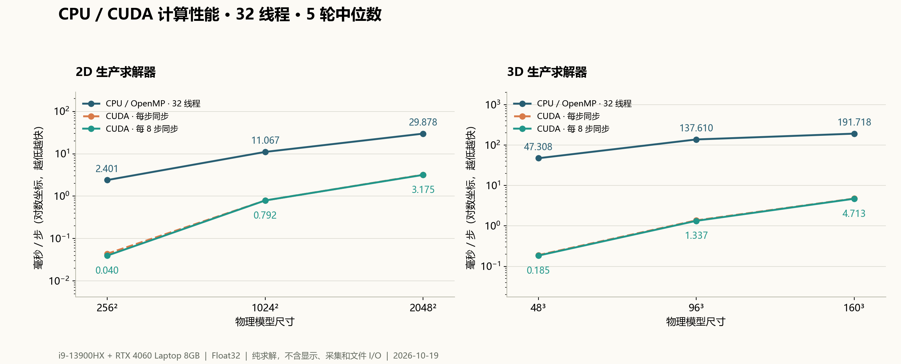
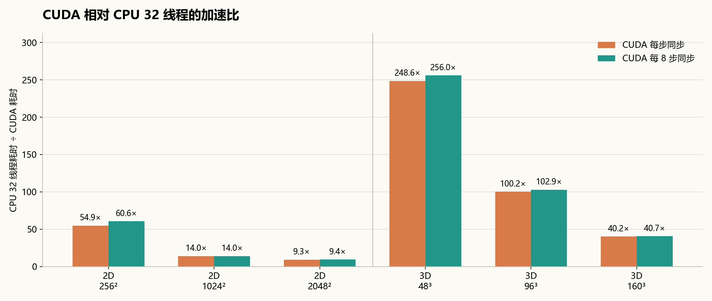

# 二维 / 三维 CPU 与 CUDA 性能测试报告

测试日期：2026-10-19（Asia/Shanghai）。本机生产求解器实测；CPU 固定 **32 工作线程**。

六档模型均完成 5 轮，全部 CPU/CUDA Vz 波场对照通过。以 CUDA 每 8 步同步计算，二维加速 **9.41–60.61 倍**，三维加速 **40.68–256.00 倍**。这些倍数比较的是本项目当前 CPU 实现，不表示 CPU 与 GPU 硬件理论峰值差。

## 1. 测试环境

- CPU：13th Gen Intel(R) Core(TM) i9-13900HX，24 物理核 / 32 逻辑处理器；请求与实际 OpenMP 工作线程均为 32。
- CPU 亲和性掩码：`0xFFFFFFFF`，覆盖全部 32 个逻辑处理器；关闭 OpenMP 动态缩减，测试进程 Above Normal 优先级。
- GPU：NVIDIA GeForce RTX 4060 Laptop GPU，8.00 GiB，Compute Capability 8.9；驱动 591.74，CUDA Runtime 12.8。
- 内存：15.81 GiB；接电运行。
- 系统当前仅列出“平衡”电源方案；保持原方案，没有更改 BIOS、超频、GPU 功率上限或系统电源策略。因此这是当前机器环境下的 32 线程结果，不能宣称已测得硬件绝对峰值。
- GPU 预热期间采样到 P0；整轮最高温度 74°C、SM 频率 2640 MHz、功耗 117.90 W。遥测约每 2 秒一次，不能代表瞬时峰值或每次计时段的精确状态。
- 构建：外层 `out/build/x64-Release`，`RelWithDebInfo`，MSVC 19.44、C++20、`/O2`。二维 CUDA 沿用程序的 `--use_fast_math`，三维 CUDA 沿用其独立编译选项；CPU/CUDA 均为 Float32。

## 2. 模型与计时协议

| 项目 | 二维 | 三维 |
|---|---|---|
| 小 / 中 / 稍大模型 | 256² / 1024² / 2048² | 48³ / 96³ / 160³ |
| 求解方案 | Type 3：自由表面 + 外置分裂 PML | 平面自由表面 + CPML |
| 吸收层宽度 | 16 格 | 12 格 |
| 每轮预热 / 计时 | 20 / 100 步 | 20 / 40 步 |
| 每模式重复 | 5 轮，报告中位数与四分位范围 | 5 轮，报告中位数与四分位范围 |

每轮包含预热后的总物理时长为二维 60 ms、三维 30 ms；正式计时窗口分别为 10–60 ms 与 10–30 ms，并非完整长时地震记录。

采用双层弹性介质，上层 Vp/Vs/ρ 为 3000 m/s、1700 m/s、2200 kg/m³，下层为 4200 m/s、2400 m/s、2500 kg/m³；界面位于半深度。两维度均使用 dx=10 m、dt=0.5 ms、Ricker 30 Hz、垂向集中力源，震源位于水平中心与四分之一深度。各 CPU/CUDA 配对使用完全相同的模型、震源和步数。源实现及其幅值约定分别沿用各维度生产接口，不能将二维和三维视为同等每节点工作量。

时间来自 `steady_clock` 墙钟，包括应力、速度、震源、吸收边界及 CPML 更新，以及主机提交和必要的 CUDA 完成同步。计时排除初始化、分配、清场、显示、接收器采样、文件导出及误差验证下载。CUDA 测两种模式：每步完成同步、每 8 步完成同步；不足 8 步的尾批也等待完成。CPU 与 CUDA 顺序运行，避免两个求解器同时争用资源。

GPU 每轮先等待 600 ms，使上一阶段 CPU 线程退出活跃等待，然后用生产求解器预运行至少 300 ms，清场后再执行与 CPU 一致的 20 步预热；预运行与等待不进入统计。CPU 每轮从同样的零场开始。

## 3. 核心结果

单位：ms/步，越低越快。“加速比”=32 线程 CPU 中位耗时÷CUDA 中位耗时。

| 维度 / 档位 | 物理尺寸 | CPU 32线程 | CUDA 每步同步 | CUDA 每8步同步 | 每步加速比 | 批量加速比 |
|---|---:|---:|---:|---:|---:|---:|
| 2D 小 | 256 × 256 | 2.401 | 0.044 | 0.040 | 54.85× | 60.61× |
| 2D 中 | 1024 × 1024 | 11.067 | 0.791 | 0.792 | 13.99× | 13.98× |
| 2D 稍大 | 2048 × 2048 | 29.878 | 3.212 | 3.175 | 9.30× | 9.41× |
| 3D 小 | 48 × 48 × 48 | 47.308 | 0.190 | 0.185 | 248.55× | 256.00× |
| 3D 中 | 96 × 96 × 96 | 137.610 | 1.373 | 1.337 | 100.21× | 102.92× |
| 3D 稍大 | 160 × 160 × 160 | 191.718 | 4.764 | 4.713 | 40.24× | 40.68× |





## 4. 吞吐量、域尺寸和数值一致性

吞吐量用**物理节点数×推进步数/秒**归一化，包含计算吸收层所消耗的时间；它不是浮点运算次数。分配域含吸收层与守卫节点，最外层守卫并不都执行同等内点更新。

| 维度 / 尺寸 | 物理节点 | 分配域节点 | CPU 32线程（百万物理节点·步/s） | CUDA批8步（百万物理节点·步/s） | Vz相对L2误差 |
|---|---:|---:|---:|---:|---:|
| 2D 256 | 65,536 | 82,944 | 27.29 | 1654.24 | 6.517e-07 |
| 2D 1024 | 1,048,576 | 1,115,136 | 94.74 | 1324.58 | 6.517e-07 |
| 2D 2048 | 4,194,304 | 4,326,400 | 140.38 | 1320.97 | 6.517e-07 |
| 3D 48 | 110,592 | 435,200 | 2.34 | 598.46 | 6.314e-08 |
| 3D 96 | 884,736 | 1,900,544 | 6.43 | 661.71 | 6.304e-08 |
| 3D 160 | 4,096,000 | 6,635,520 | 21.36 | 869.15 | 6.304e-08 |

误差采用全部物理节点的 Vz，`||Vz_CPU−Vz_CUDA||₂ / ||Vz_CPU||₂`，最大为 **6.517e-07**，全部低于预设 `2e-4`。两种 CUDA 同步方式的波场也一致（检查阈值 `1e-6`）。未使用随机值、假波形或估计耗时。

## 5. 重复性：P25–P75

以下为 5 轮每步耗时的四分位范围；小模型计时短，动态频率和调度抖动更容易改变比值。

| 维度 / 尺寸 | CPU 32线程 ms | CUDA逐步同步 ms | CUDA批8步 ms |
|---|---:|---:|---:|
| 2D 256 | 2.387–2.420 | 0.042–0.045 | 0.039–0.043 |
| 2D 1024 | 10.929–11.231 | 0.788–0.792 | 0.786–0.792 |
| 2D 2048 | 29.259–32.196 | 3.203–3.263 | 3.175–3.179 |
| 3D 48 | 47.275–47.439 | 0.190–0.196 | 0.180–0.190 |
| 3D 96 | 136.704–137.827 | 1.371–1.527 | 1.332–1.391 |
| 3D 160 | 190.763–192.095 | 4.740–4.823 | 4.703–4.774 |

## 6. 对当前软件的含义

- 六档模型均适合优先使用 CUDA；本次 CUDA 都快于固定 32 线程 CPU。CPU 保留作为无可用 CUDA 时的计算回退。
- 32 线程不保证每个小模型都比少线程更快。本轮按要求固定 32 线程，没有测线程数扫描，因此不能据此断言 32 是各档模型的最优线程数。
- 当前二维界面逐步同步，对应主表“CUDA 每步同步”；当前三维界面按最多 8 步一批推进，纯求解行为更接近批量列，但其计时还可能含接收器处理。批8步不是每帧固定8步的界面FPS。
- 小模型的 CPU/GPU 加速比更大，不能线性外推到任意大模型。吸收层相对开销、固定并行调度成本、缓存/访存等都可能参与；本轮没有硬件计数器剖析，不将其写成已证实的单一瓶颈。
- 批8步只在二维小模型出现约一成改善，中大模型改善很小或落在波动范围内。因此仅减少同步次数不足以解释或解决全部性能差异。
- 结果不包括实时体绘制、纹理提取、采集写盘和窗口刷新；完整工作区运行通常比这里报告的求解步率低。

## 7. 可复现产物与运行方式

- 本次正式数据共 **90** 个计时区块（6尺寸 × 3模式 × 5轮）；二维每模式每尺寸计时500步，三维计时200步。
- [六档汇总 CSV](data/comparison.csv)
- [二维逐轮数据](data/2d-trials.csv) · [三维逐轮数据](data/3d-trials.csv)
- [二维硬件/协议](data/2d-hardware.json) · [三维硬件/协议](data/3d-hardware.json)
- [二维GPU遥测](data/2d-gpu-telemetry.csv) · [三维GPU遥测](data/3d-gpu-telemetry.csv)
- [源文件与程序指纹](data/provenance.json)
- 基准入口：`benchmarks/ComputeBenchmark.cpp`，直接链接生产二维/三维计算代码；绘图入口：`benchmarks/RenderReport.py`。

```powershell
cmake -S . -B out/build/x64-Release -DSEISWAVE_BUILD_BENCHMARKS=ON
cmake --build out/build/x64-Release --target SeisComputeBenchmark -j 4
& ./out/bin/RelWithDebInfo/SeisComputeBenchmark.exe --output out/benchmarks/retest/2d --threads 32 --repeats 5 --warmup 20 --steps 100 --dimension 2 --ftz 0
& ./out/bin/RelWithDebInfo/SeisComputeBenchmark.exe --output out/benchmarks/retest/3d --threads 32 --repeats 5 --warmup 20 --steps 40 --dimension 3 --ftz 0
```

上述命令在外层工作区、已加载 VS x64 编译环境时执行；所有产物放外层 `out`。`--ftz 0` 为本报告采用的默认浮点环境对照模式；`--ftz 1` 仅供单独的次正规数处理实验，不属于主表。原模拟程序的计算设置和默认线程数没有因本次测试而改变。
