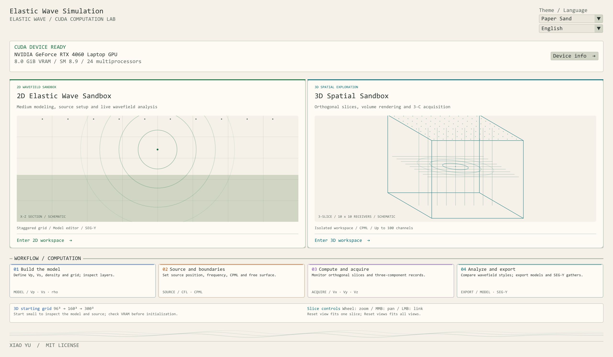
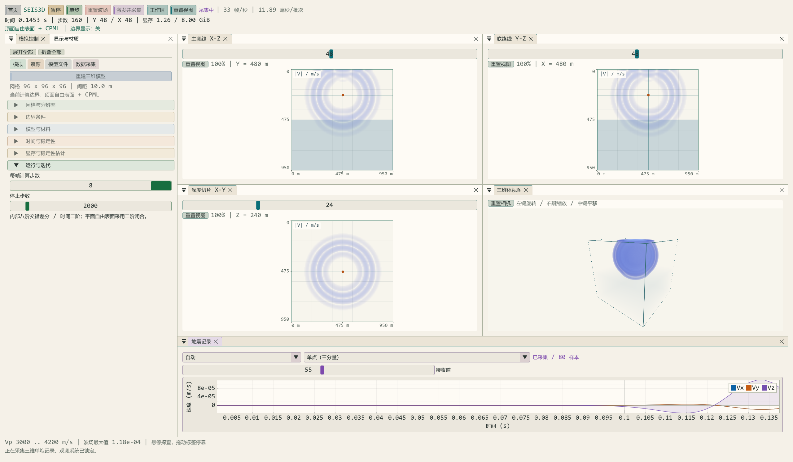
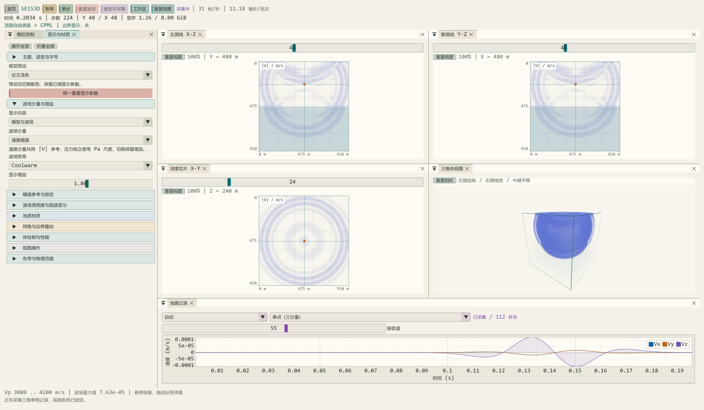

# 双语界面与紧凑参数面板检查

日期：2026-10-13。范围：应用文字、三维操作分组、停靠与显示参数保持。

## 界面调整

三维模拟、震源、显示和采集的详细参数采用默认关闭的折叠组。运行与迭代、波场分量与增益默认展开；初始化/重建、采集、停止、进度和已有道集导出保留常用入口。模拟/显示面板提供展开全部与折叠全部，作用于当前可见控制标签或面板。嵌套材料/几何分组响应同一动作。显存超预算或参数非法的提示在明细收起时继续显示。

显示面板按外观、波场增益、幅值参考、弱波映射、材料、网格/边界、体绘制、导航和图例分组。峰值诊断分行展示，减少窄栏中数字被换行截开的情况。

## 双语实现

`Main_header/AppLanguage.h` 与 `Main_cpp/AppLanguage.cpp` 管理应用语言偏好；`Main_cpp/AppTranslations.inc` 为集中词条，`AppWidgets.h` 将界面调用接入翻译。首页、三维工作区、二维主要控件和设备信息接入同一语言状态。未知文本保留原文；标准色带名、文件字段和技术符号保持原标识，部分历史说明及底层诊断暂未翻译。

语言即时切换，正常启动读取程序目录中的 `ui_language.ini`。语言不存放在物理模型或三维状态中。中文沿用现有微软雅黑合并字体，无需切换时重建字体。

可翻译控件在两种语言中采用同一源标签 ID 后缀；隐藏 ID、已有 `###` 后缀及未翻译的内部宿主名保持稳定。原先没有稳定后缀的历史窗口首次使用时迁移已有位置/尺寸/停靠设置。三维 DockSpace 宿主 ID 不变，避免语言切换重建停靠树。下拉框翻译逐条进行，保留选项顺序和参数索引；printf 词条检查格式参数一致性。

## 已完成验证

Debug 与 RelWithDebInfo 主程序和 `Seis3DWorkspaceRegression` 构建通过，两种配置的回归均通过：

- 英文、中文往返切换，三维窗口对象与 DockId 不变，显示参数、采集数据和模拟步数相同。
- 控件 ID、带隐藏后缀的控件 ID、DockSpace 宿主 ID 保持稳定；旧窗口位置与尺寸迁移检查通过。
- 翻译词条无重复英文键，printf 参数一致；多项下拉框顺序与译文正确。
- 实际绘制模拟参数面板，全部收起约 267 px，全部展开约 1643 px；此值来自测试模型、21 px 字号和 470 px 面板宽度，并非所有布局的固定高度。
- 语言切换后已收起组仍保持关闭；折叠动作未改变显示参数或采集样本。
- 原有共同幅值参考、SEG-Y 导入导出、100 道采集、波形选排、缩放、四种停靠布局与资源冷释放检查继续通过。

RelWithDebInfo 真实主程序分别执行英文和中文截图入口，均通过 96³ 模型、切片显示、实际 ImGui 图像提交和 100 道采集检查。截图已查看，英文首页长标题已缩短。

以上截图均来自真实程序窗口。此次检查未完整遍历历史二维页面的所有交互，也未重新执行物理精度或长期稳定性验证。
