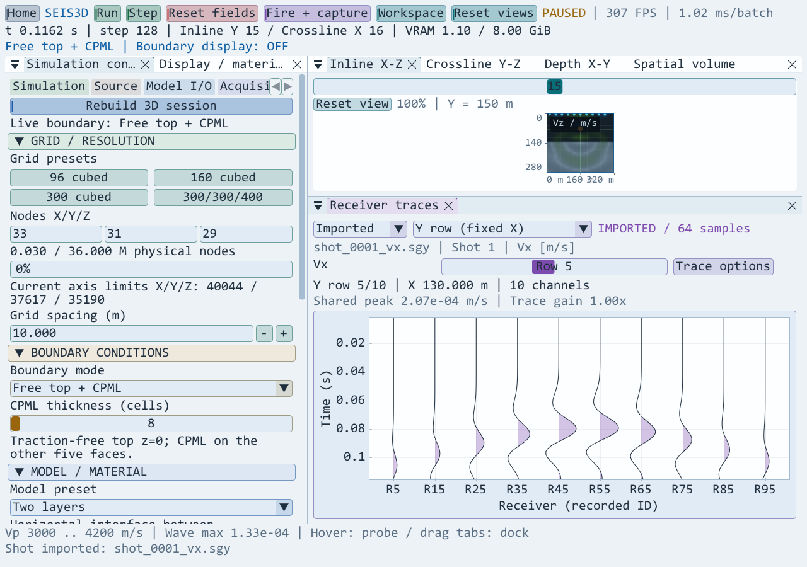

# 波场分量尺度与单炮 SEG-Y 导入检查

日期：2026-10-13。范围：显示参考生命周期、CPU 单炮导入与真实 GPU/OpenGL/ImPlot 集成。

## 修复原因与行为

原逻辑在切换分量时清空历史峰值，并用新分量的最大值重新归一化，因此增益数字即使没变，显示强度仍会跳变。现在 Vx、Vy、Vz、速度幅值统一采用速度幅值参考；压力采用独立 Pa 参考。往返切换保留各单位的历史峰值与手动尺度，重建/重新发射清除旧波场统计并保留用户显示设置。不同分量的实际振幅和极性差异仍如实显示。

单炮文件导入为独立 CPU 数据源，先完整校验再替换已导入记录。导入成功或失败均不覆盖采集快照、不改变步数/运行状态/波场增益。单文件只提供其中实际存储的分量。

## 已执行检查

Debug 与 RelWithDebInfo 主程序和 `Seis3DWorkspaceRegression` 编译通过；两个配置的回归程序均通过：

- 在实际 32³ GPU 场中设置 Vx=3、Vy=4，共同速度参考为 5；分量最大值分别为 3 与 4。波场衰减后切换仍保持历史尺度，Vx 往返切换像素一致。
- 速度/压力的手动尺度分别为 5 和 200，来回切换均恢复对应值；新会话清空两类历史峰值并保留手动值。
- IBM float32、IEEE float32、int32、int16、int8 五种输入格式正确解码正负样本；验证坐标比例、原道号、Pa 单位、逐道时间比例以及固定数量扩展文本头。
- 未初始化 GPU 的状态可读取文件。不存在的文件、多炮、截断文件和 4097 道输入均拒绝，先前的有效导入数据和运行状态保留。
- 实际模拟采集 100 道 × 64 样本，用生产导出函数写入 Vx SEG-Y 后重新导入；逐样本值完全一致，坐标和时间起点匹配导出编码。
- Imported 单道、全部道、X 排、Y 排在真实 ImPlot 中绘制，无 OpenGL 错误；保留原采集数据与模拟步数。
- 原有显示参数保持、幅值锁定、接收选行、100 道采集、四套停靠布局和冷释放检查继续通过。
- RelWithDebInfo 主程序的 `--capture-seis3d-paper` 通过真实 96³ 模型、不透明切片、100 道采集及完整窗口显示检查，生成的显示面板和导入截图已查看。

时间比例运算采用 1e-12 秒容差；自身 SEG-Y 导出的起点量化另以 1e-7 秒容差检查。不能以二进制浮点与十进制常量的严格相等判断时间比例正确性。

截图由回归程序的真实窗口像素读回，Arctic Lab 主题；仅从 PPM 无损转换为 PNG，未重新绘制曲线。

## 格式范围与限制

依据 [SEG-Y rev1 官方标准](https://seg.org/wp-content/uploads/2025/11/seg_y_rev1.pdf) 实现大端 rev0/rev1、格式码 1/2/3/5/8。支持固定长度单炮单分量文件、坐标与时间比例；英尺长度换算为米，角度坐标保持标注，不做投影转换。上限 4096 道、32767 样本/道及 256 MiB CPU 样本缓冲。

尚未验证第三方实测文件库和 Windows 文件选择器的自动交互。不支持 rev2、小端、变长道、混合分量或多炮文件；导入在 UI 线程执行。此次未修改弹性波求解方程，也未新增物理精度认证结论。
