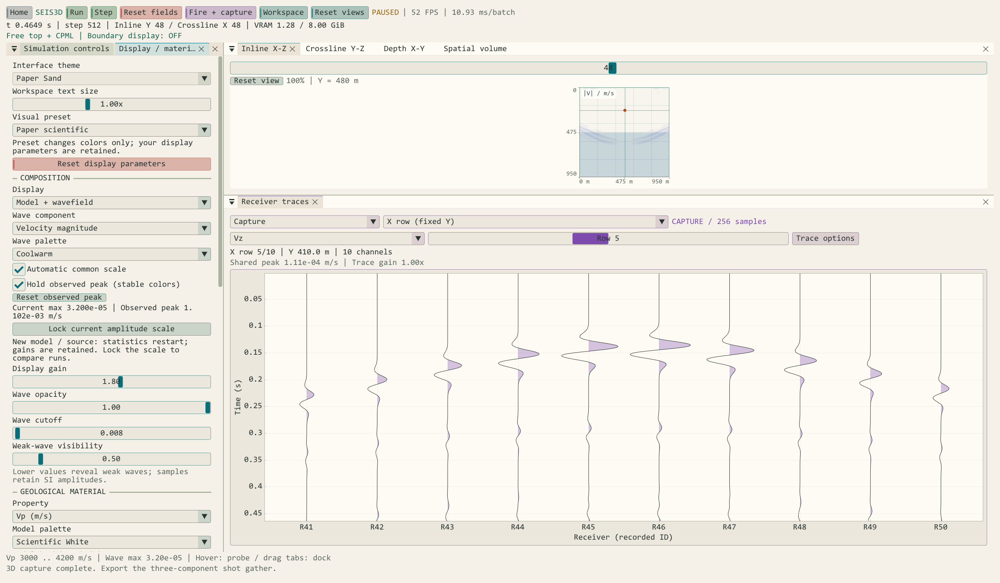

# Seis3D 显示状态与接收选行检查

日期：2026-10-13。设备：RTX 4060 Laptop GPU（8 GiB）；CUDA 12.8、OpenGL 4.3。构建与检查产物均位于外层 `out`。

## 1. 显示参数与波场统计

审查确认：模型初始化、重建及震源重发原本保留显示增益，但自动归一化参考来自波场统计。新物理会话需要清零旧峰值，因此同一增益在自动模式中可能产生不同观感。

当前行为：

| 操作 | 显示参数 | 波场统计 |
| --- | --- | --- |
| Visual preset | 只切换两类色带，其余保持 | 保持 |
| 初始化、重建、模型导入 | 保持增益、尺度、透明度、阈值等 | 清零旧会话最大值和峰值 |
| 重发震源、开始采集 | 保持 | 清零并重新统计 |
| 修改正在编辑的物理参数 | 显示参数保持 | 重建前不替换当前模型 |
| 自动转手动 / Lock current amplitude scale | 复制当前分量的有效幅值参考，增益保持 | 保持 |
| Reset display parameters | 显式恢复当前预设的显示默认值 | 不清除物理场或采集记录 |

修正了重发震源后旧 `viewMaximum3D` 仍可能短暂保留的问题，并标记分量统计待更新。无有效统计时，自动转手动保持已有手动值，避免把空波场参考写入手动尺度。有效尺度下限与实际着色器统一为 1e-12。

## 2. 接收排列与预览

Acquisition 增加 20×5、5×20、适配网格的 X/Y 直线排列。道集视图提供单接收点三分量、全部道、固定 Y 的 X 排和固定 X 的 Y 排；Row 从 1 开始编号。选行依据实际坐标分组并沿测线排序，保留原始道号。

Captured 使用冻结的接收坐标，后来编辑或部署的排列不影响已有记录；Live 使用当前部署坐标及环形时间。Trace gain、共同/逐道归一化和正振幅填充只影响预览。默认共同峰值来自当前所选道；逐道归一化不能用于道间振幅比较。

单道和多道预览每道最多 2048 点，长记录保留区间极值、起止点及完整峰值统计。此预览不能替代完整信号分析，导出仍使用原始全样本。Receiver focus 为新增独立停靠预设，不自动覆盖已有用户布局。

图为 96³ 双层模型的正式 100 道 × 256 样本采集，选择第 5 排的 Vz（R41–R50），采用 Paper Sand 界面。截图未重绘或修改波形。

## 3. 验证条件与结果

`Seis3DWorkspaceRegression` 在 Debug 与 RelWithDebInfo 均通过：

- 用一组自定义显示设置，在 33×31×29 初始化、35×33×31 重建、Vp/频率修改、模型文件导出再导入、双层预设及三种边界重建后逐项比较设置。
- 注入相同幅值的已知场，读回真实切片像素：暂停时修改增益改变像素，恢复增益恢复原像素；相同物理幅值和手动尺度在重建/导入/边界改变后得到相同像素。
- 自动转手动后参考值和像素一致；空波场转手动不覆盖原值。Visual preset 往返不改变显示参数或峰值。
- 修改震源幅值并启动真实 100 道采集，显示参数保持；显式显示重置不改变记录样本或步数。
- 实际部署 20×5、5×20 及适配小网格的 X/Y 直线，GPU 道数、行数与坐标选择一致；旧正式记录保持冻结。
- 检查空排列、行号越界、乱序坐标、不同方向选行、待部署参数与冻结记录隔离。
- 用 3000 样本的合成窄脉冲检查极值预览，正负峰均保留且点数不超过 2048；512 帧实时环形回卷后按时间顺序显示。
- 真实采集记录的全部道、X/Y 排、共同/逐道归一化、正振幅填充和实时选行绘制无 OpenGL 错误；四种停靠布局均通过。

发布主程序 `--capture-seis3d-paper` 完成 96³ 模型、100 道采集及新增选行截图，已检查实际图像。原始输出保存在外层 `out/checks/ui-detail/display-receivers-release.log`、`display-receivers-debug.log` 与 `app-display-receivers-release.log`。

本轮未修改差分求解器。以上检查验证显示状态、渲染和数据选择，不构成传播精度、长期稳定性、SEG-Y 第三方兼容性或大型网格性能认证。
