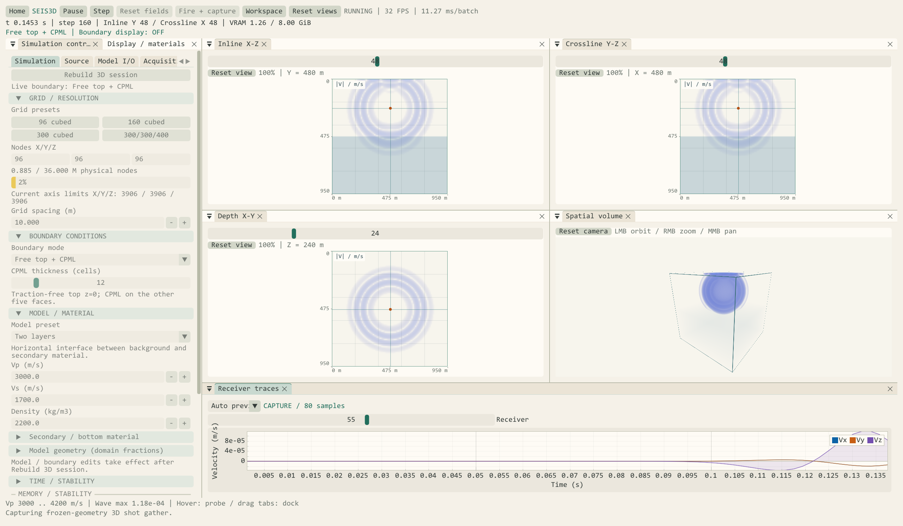
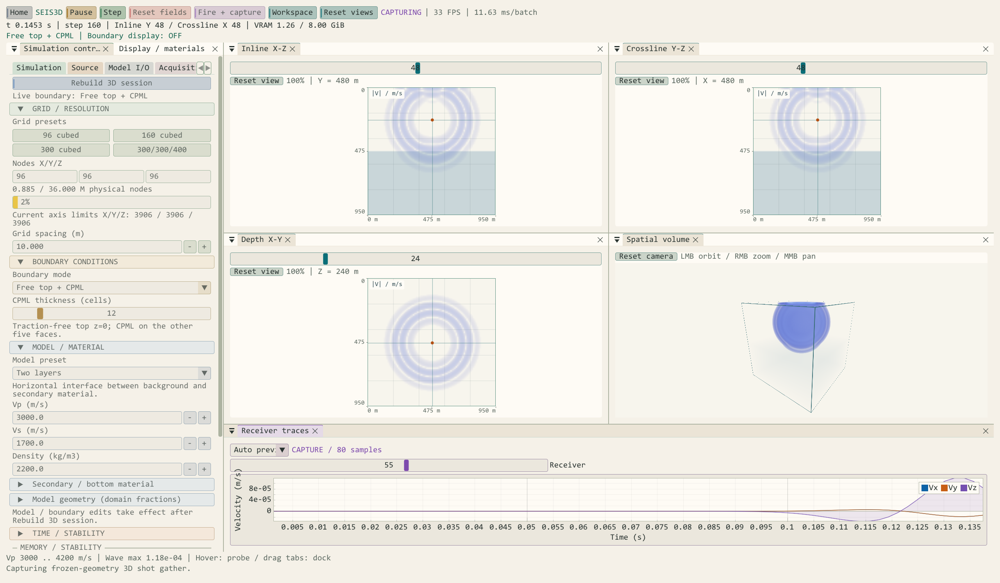

# Seis3D 体绘制、网格总量与六面吸收检查

检查日期：2026-10-12 至 2026-10-13。设备：NVIDIA GeForce RTX 4060 Laptop GPU，约 8 GiB 显存；CUDA 12.8、OpenGL 4.3。

## 1. 体视图清晰度

| 项目 | 原设置 | 当前设置 |
| --- | --- | --- |
| 辅助显示体 | 每轴最多 128 点 | 每轴最多 256 点 |
| 大体积抽取 | 整数截断取点 | 按体素中心三线性重采样 |
| 输出图像 | 固定 640 × 640 | 随视口和显示缩放调整，最长边 1536 像素 |
| 投影 | 固定正方形 | 按输出宽高比投影 |
| 射线采样 | 固定 192 点 | 按体素路径调整为 192–1024 点 |
| 波前分离 | 共用弱波显示参数 | 增加独立 Wavefront sharpness |

三正交剖面保留完整格点。体视图属于可视化采样；提高像素数不能提高 FDTD 的物理分辨率。显示预算包含 CUDA staging、RG32F 纹理、切片及最大 RGBA8 输出目标。

实际程序的 Paper Sand / Paper scientific 截图（96³ 双层模型、自由顶面、100 道采集）：



## 2. 物理节点总量

每轴至少 16 点，`Nx × Ny × Nz ≤ 36,000,000`。去除 512 固定单边限制，新增 300 × 300 × 400 预设。UI 显示总量、占比与其余两轴固定时的轴上限；超过总量时拒绝初始化和导入，不自动改动用户模型。

总量检查使用先除后乘的方式，拒绝极大整数字段而不发生乘积溢出。4 GiB 沙盒预算、实际空闲显存余量、CUDA 启动网格上限和 OpenGL 纹理上限仍需同时满足。

验证范围：

- 600 × 200 × 200、300 × 300 × 400：通过尺寸验证，未分配这两个大体积模型。
- 400 × 400 × 300、三个 INT_MAX、负尺寸：正确拒绝。
- 600 × 24 × 20：实际完成 CUDA/GL 初始化、8 步推进、256 点显示体抽取；已知线性场的重采样值通过检查。

## 3. “顶面没有吸收干净”的对照

截图同时显示 CPML 外部区域和物理区。此前的波幅自动统计只包含物理区，却给 CPML 使用相同色阶；当物理区波场已衰减而波仍在较厚的 CPML 中传播时，外部尾波可能被严重放大并饱和。逐帧自动归一化也会把晚期浮点残留映射成强颜色。

本次调用生产 CUDA 求解器进行对照：物理网格 96³、10 m 间距、CFL=0.85、20 Hz Ricker 爆炸源、幅值 1e8 Pa/s，震源 X/Y=(48,48)，六面 CPML。均匀介质 Vp/Vs/ρ=3000/1700/2200；双层下层=4200/2400/2500，界面相对深度 0.5。每 200 步记录一次，推进至 1600 步。

| 对照 | CPML 格数 | 震源 Z | 结束时刻 | 末次物理区 Σ\|v\|² / 已采样峰值 |
| --- | --- | --- | --- | --- |
| 均匀介质、中心源 | 12 | 48 | 2.0336 s | 3.76 × 10⁻¹⁵ |
| 均匀介质、浅源 | 40 | 24 | 2.0336 s | 2.70 × 10⁻¹⁵ |
| 双层介质、浅源 | 40 | 24 | 1.4528 s | 4.85 × 10⁻¹² |
| 均匀介质、全反射参考 | 无 | 48 | 2.0336 s | 0.877 |

这里的量为**格点中心速度平方和**，不是完整弹性能量，也不是边界反射系数。均匀中心源在第 200、400 步的同向侧面/顶底面最大速度满足 0.1% 轴向一致性检查；不同正负面因震源位于偶数网格的整数节点和交错离散，允许轻微差异。双层介质与浅震源本来就不具有六面等价的传播条件。

双层浅源第 800 步：物理区最大速度约 7.47e-10 m/s，吸收区最大速度约 2.40e-6 m/s。旧版色阶会把吸收区振幅放大到物理区尺度的三千多倍并饱和；第 1600 步顶面残留已降至约 4.78e-11 m/s。该对照未复现顶面独立漏吸收或数值发散。

修正方式：

1. 显示 CPML 时，将可见吸收区纳入共同波幅统计。
2. 默认开启已观测峰值保持，波场衰减时仍保留可比较的色阶。
3. 提供逐帧自动尺度、手动尺度、当前最大值、历史峰值及峰值重置，方便检查弱波。
4. 重发震源、重建模型和切换分量时清除历史峰值。

本轮依据对照修正显示映射，保留真实 CPML 样本。有限厚度 CPML 仍有离散反射；本次结果不覆盖所有模型、掠入射、力源、自由表面、高频欠采样或长期稳定性。CPML 方法背景参考 [Komatitsch & Martin, 2007](https://specfem.org/komatitsch.free.fr/published_papers/geophysics_CPML_2007_elastic_typos_fixed.pdf)。

## 4. 可复现检查

从外层项目在 VS 开发者终端配置，产物继续写入外层 out：

```powershell
cmake -S . -B out/build/x64-Release -DSEIS3D_BUILD_BOUNDARY_CHECKS=ON -DSEIS3D_BUILD_WORKSPACE_CHECKS=ON
cmake --build out/build/x64-Release --target Seis3DBoundaryRegression Seis3DWorkspaceRegression --parallel 2
.\out\bin\RelWithDebInfo\Seis3DBoundaryRegression.exe
.\out\bin\RelWithDebInfo\Seis3DWorkspaceRegression.exe
```

边界诊断输出 CSV 行与 SUMMARY，检查非有限值、轴向一致性和吸收/反射的晚期差异。图形检查使用不可见窗口，验证真实着色器、CUDA/GL 数据传递、矩形体视口、峰值保持、CPML 色阶、长轴重采样、停靠、切片缩放及 100 道采集。两个选项默认关闭，不影响日常主程序构建。

本轮原始对照记录位于外层 `out/build/x64-Release/boundary-before.csv` 和 `boundary-after.csv`。大型模型实时帧率、误差收敛率和定量边界反射系数尚未测量。

完成状态：Debug 与 RelWithDebInfo 主程序均编译成功，两种配置的 CUDA/GL 工作区检查及真实程序 Paper 截图/100 道采集检查通过；发布配置的四组边界诊断通过。发布版生成于外层 `out/bin/RelWithDebInfo`，新版实际截图已纳入本页。

## 5. 2026-10-13：功能颜色与大模型波前透明度

界面统一计算绿、模型蓝、震源橙、采集紫、显示青、边界/警告琥珀、重置/错误红，并保留文字识别。按钮带细色标，参数分组、停靠标签和滑块使用对应颜色；浅色主题采用深强调色。新增 Arctic Lab、Warm Ivory，主题总数为十；控件描边、选中态与圆角统一，Paper Sand 文字对比度略提高。



### 大模型颜色偏淡的原因与修正

原体绘制按归一化盒子距离积分透明度。固定为六个格点厚度的波前放入更大的网格时，在盒子中的路径缩短，即使振幅和透明度参数相同，颜色也更接近背景。新增默认开启的 **Size-consistent wave opacity**，按可见最长轴相对于 96 点的比例补偿波场光学密度，材料背景保持原密度。

另外增加体视图独立 **Volume gain**（默认 1.8）与 Balanced / Vivid wavefronts / Soft cloud 配方。它们不改变物理波场、剖面增益、接收样本或导出数据。图例分别显示剖面范围和体视图增益/幅值范围；保留已观测峰值保持，避免以自动放大晚期残留的方式增强显示。暂停时切换补偿或增益会重绘。

### 实测渲染对照

同一 RTX 4060 Laptop 上，使用生产 CUDA 分配、显示抽取和 GLSL 体绘制；分别建立 96³ 与 300³ 均匀模型，写入相同六层厚度、Vz=0.05 的合成平面信号。固定手动尺度 1、共享/体增益 1、波场模式、透明度 0.2 和相机；读回体视图中心像素。指标为该像素与关闭波场时背景的三个 8 位 RGB 分量绝对差之和。

| 网格 | 关闭尺寸补偿 | 开启尺寸补偿 |
| --- | ---: | ---: |
| 96³ | 54 | 54 |
| 300³ | 18 | 52 |

该结果验证尺寸相关的透明度下降及补偿效果，不代表真实地震波传播振幅、分辨率或 FPS。体绘制仍有采样、颜色饱和和沿射线叠加，不能直接读取定量振幅。

Debug 与 RelWithDebInfo 的 `Seis3DWorkspaceRegression` 均通过：上述大小模型对照、暂停时体增益更新且剖面像素不变、十主题/八功能颜色的作用域恢复及作用域内主题切换、已有切片交互、100 道采集和资源冷释放。发布主程序 `--capture-seis3d-paper` 通过真实 96³ 波场与 100 道采集检查，生成并检查新版截图。两种主程序均编译链接成功。求解器本轮未改动，前文边界诊断未重复执行。
