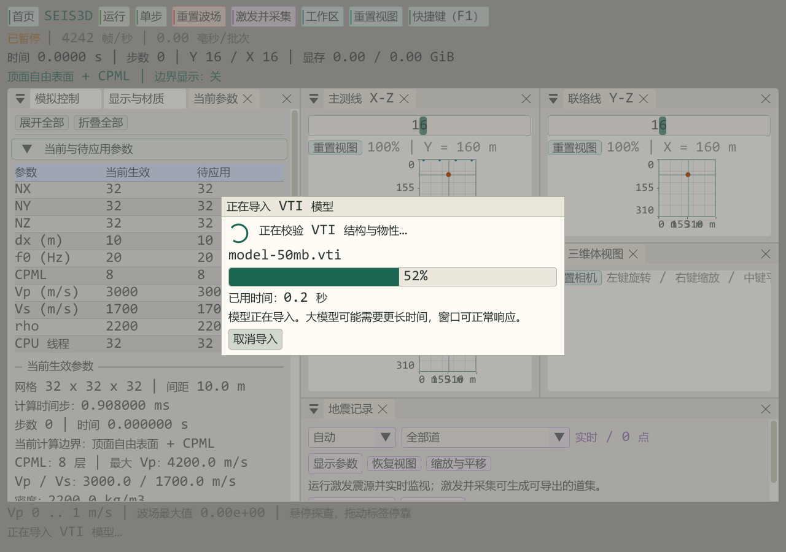

# 三维 VTI 异步导入与进度反馈

更新日期：2026-10-19。导入按钮现启动后台任务，窗口显示旋转动画、阶段、百分比和已用时间。二进制材料采用分块读取；避免原有逐浮点值查询文件位置，界面入口避免同步路径的重复扫描。旧的同步初始化 API 保留供程序初始化与既有回归使用。

## 本机验证

文件 **50,382,183 字节**，164×160×160，间距 7.5 m，Vp/Vs/密度随 XYZ 变化。使用生产后台任务、CPU/CUDA 上传以及真实 ImGui/OpenGL 渲染路径，测试窗口为 1280×900。CPU 使用 32 线程，GPU 为 RTX 4060 Laptop。

| 核心 | 导入总时间 | 导入期间最大绘制帧耗时 |
| --- | --- | --- |
| CPU/OpenMP | 0.671 s | 129.70 ms |
| CUDA | 0.358 s | 9.97 ms |

测试为隐藏的真实窗口、未开启垂直同步，渲染帧数不代表普通显示 FPS；耗时受磁盘缓存、驱动、模型编码和硬件影响，只代表本机本算例。动态画面未加入人为等待时间。

该图片是本次工作区回归原生 1280×900 完整帧，独立于此前 45 张文档流程图；只转换 PPM 为 PNG，不裁切或合成。

## 覆盖范围

- CPU 与 CUDA 均核对首、中、末 Z 平面的全部物性，尺寸/间距与 XYZ 顺序保持一致。
- 确认多个连续绘制帧呈现模态进度，进度不回退，重复点击任务被拒绝。
- 读取取消和文件校验失败保持旧计算缓冲；冻结记录及显示增益保留。
- 关闭正在校验的会话时先取消、等待任务，避免线程访问已销毁状态。
- 公共 VTI 回归验证分块读取的大小端、Float32/64、UInt32/64 块头、ASCII、异常输入与进度回调取消。

导入完成后恢复控制。GPU 初始化阶段不提供取消；该阶段旧模型已释放。OpenGL 安装在主线程，仍有短暂的资源准备帧。初始化失败显示错误后可重试，不承诺恢复已释放的旧 GPU 会话。

复现：从外层工作区构建全部回归目标，运行 `ctest --test-dir out/build/x64-Release -C RelWithDebInfo -R 'VtiModelRegression|Seis3DWorkspaceRegression' --output-on-failure`。实际材料与帧耗时摘要在外层 `out/bin/RelWithDebInfo/checks/async-vti/validation.txt`；[本轮 JSON](VTI_ASYNC_IMPORT_2026_10_19.json)保存程序和图片摘要。
