# SeisWave Lab：二维弹性波模拟与地震记录查看器

更新日期：2026-10-19。适用于当前 v2.0.0 工作区，三维操作另见 [Seis3D 使用指南](Seis3D_User_Guide.md)。本文包含实际 CUDA 计算截图、模型至采集的操作步骤，以及显示参数和数据格式的边界。本轮重新采集 11 张 2560×1494 完整窗口图，新增外置吸收边界及分组展开/折叠；理论与二维约化见[完整说明](../PROJECT_MANUAL.md)，各维度的实际采样与边界约定仍独立。

## 2026-10-19：CPU/CUDA、参数与记录面板

主程序入口为外层 `out/bin/RelWithDebInfo/SeisWaveLab_Cartesian.exe`。

1. **模型导入**：二维 Model I/O 仅保留 SEG-Y 物性组；选择 Vp、Vs、密度三个 `.sgy` / `.segy` 文件，设置原始空间间距、方向和密度单位转换，再加载。TXT/CSV 模型导入入口已移除。
2. **当前参数**：左侧控制面板旁的“当前参数”页签并列显示当前生效值和待应用值，差异着色。点击“更新参数”应用；“撤销待应用参数”恢复草稿。修改网格尺寸会重建模型；修改时间、核心会重置波场，采集中禁用这些操作。
3. **计算核心**：在“计算核心”选择自动、CPU/OpenMP 或 CUDA，并设置 CPU 并行线程，点击“应用计算核心”。自动优先 CUDA；无可用 CUDA 时回退 CPU。核心切换会清场，先完成需要保留的采集与导出。
4. **性能**：“时间步计算耗时”查看求解耗时；“CPU / CUDA 效率对比”在独立波场比较当前二维模型，输出毫秒/步、耗时比与相对 L2 误差。CUDA 不可用时仍可运行 CPU 模拟，但无法实测双核心对比。
5. **数据分析**：顶部选择来源、分量、全部道/单道；默认全部道。首道从 1 开始，输入首道与道数可以局部查看。显示样式与 AGC/增益选项收进按钮面板，恢复视图按钮重新适配曲线。导入与显示处理保持原始样本不变。
6. **颜色增益**：二维默认 100，可调范围 0–1000，0 仅隐藏波场着色。

代码布局及后端细节见 [代码架构](../development/CODE_ARCHITECTURE.md)。当前控制面板和参数组默认在左侧，本轮 11 张流程截图均来自当前程序。

## 1. 本轮改进

- 二维实现从大型 `Seis_Sim.h` 中迁出，按状态、模型、数值准备、采集、工作流程、画布和控制面板分类。外部通过 `Seis2D` 接口进入和释放工作区。
- 地震记录查看器采用与三维相近的控制方式：单道/多道、分量选择、波形增益、滑动 RMS AGC、逐道归一化、配色、缩放和平移。
- 记录查看与原始采样分离。调节增益、AGC、色阶不改写原始记录；切换分量或导入新文件保留已调好的显示参数。
- 修复提前停止采集后将未填充缓存导出的零尾段；冻结采集时的炮检几何，导出不再读取下一炮的编辑位置。
- 从运行中途开始采集时，独立的采集时间轴从样点 0 写入，不再按整个模拟的绝对步数留下无效零前段。
- 浅色主题下控制面板、网格和刻度更清楚；接收点与震源标记绘制在工具窗口下方，不再盖住记录查看器。
- 二维现已采用独立 DockSpace：波场离屏渲染为可停靠视口，提供建模、波场与记录对照、记录分析三种布局。采集期间仍可缩放/平移波场。
- 单炮导出升级为 Unicode 路径数据包，包含几何、真实采样间隔、可选模型/源子波和 SHA-256 清单；已有目录不覆盖。

## 2. 启动与界面位置

发布程序为外层 `out/bin/RelWithDebInfo/SeisWaveLab_Cartesian.exe`；Debug 为 `out/bin/Debug/SeisWaveLab_Cartesian.exe`。保留程序旁的 `resource_CUDA_V1` 和 `resource_Seis3D`，不要只拷贝 EXE。

在首页选择二维沙盒。首页可切换语言及主题；二维控制面板也有语言选择。Paper Sand、Scientific Light、Arctic Lab、Warm Ivory 适合报告截图。界面主题改变控件外观，模型背景和波场颜色仍由 Visual 页独立控制。

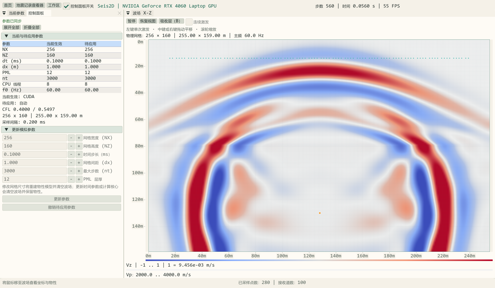

图 1：实际 256×160 CUDA 模型，显示 Vz，t=0.056 s。源坐标为网格 [128,130]，上方青色点为接收排列。白色模型背景与淡灰网格仅用于显示，波场来自真实计算。完整窗口原图为 2560×1494，左侧当前参数列出当前生效值与待应用值；未裁切或外部放大。

| 区域 | 内容 | 操作建议 |
| --- | --- | --- |
| 顶部状态栏 | GPU、步数、模拟时间、FPS、首页、地震记录查看器、面板开关 | FPS 是界面帧率，不是求解器吞吐率 |
| Simulation / 模拟 | 方案、dt、间距、PML、总步数、每帧步数、网格尺寸、运行与重置 | 先确定物理离散，再开始采集 |
| Source / 震源 | 网格位置、幅度、类型、角度、Ricker 参数 | 参数需应用；新炮与继续运行含义不同 |
| Model Edit / 模型编辑 | 均匀介质、场景预设、画笔 | 先保存需要的模型，再清空或覆盖 |
| Model I/O / 模型文件 | SEG-Y 物性模型组导入与导出 | 这是物性模型入口，区别于单炮记录导入 |
| Data Export / 数据导出 | 接收线、采样率、时长、单炮/连续场采集、多炮 | Run 本身不会产生正式采集缓存 |
| Replay / 重新运行或回放 | 波场帧录制、保存、读取、播放 | 波场电影不是地震道集 |
| Visual / 显示 | 分量、波场风格、模型背景、增益、网格 | 显示增强不改变物理求解 |
| 底部状态栏 | 鼠标格点、米坐标、Vp/Vs/密度；空闲时显示已采样点数 | 用于核对物性与接收点位置 |

二维波场、控制面板和记录窗口可拖动停靠或浮动，二维与三维使用独立停靠类。顶部 **Workspace / 工作区** 提供三种布局；应用布局不重建模型、不修改增益或采集数据，切换语言保留窗口身份。

| 布局 | 位置与用途 |
| --- | --- |
| Modeling layout / 建模布局 | 左侧控制/参数页签，右侧波场；记录默认收起 |
| Wavefield + records layout / 波场与记录对照布局 | 左侧控制/参数，右上波场，右下记录 |
| Record focus layout / 记录分析布局 | 左侧控制/参数，右侧波场和记录采用页签组合；选记录页可放大分析 |

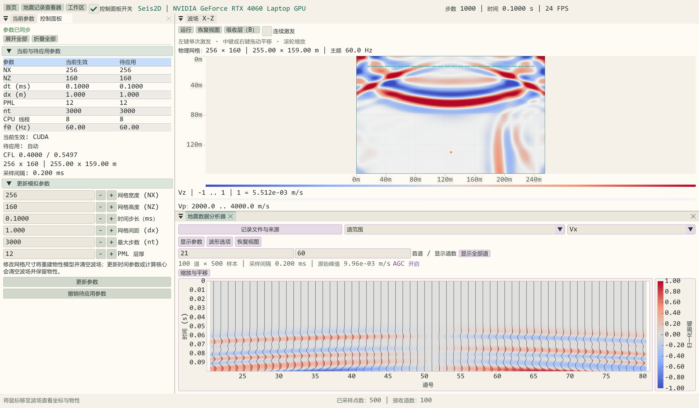

窗口高度较小时，记录文件、选道和显示参数自动收进按钮弹出控件，保留曲线空间。**Show controls / Show records** 可找回关闭的窗口，重新应用布局可恢复位置。波场视口有独立 Run/Pause、Reset View；滚轮和中键拖动按当前图像区域计算。

## 3. 建立物理模型

### 3.1 网格与物性

二维使用 X–Z 剖面，X 水平、Z 向下。部分历史 UI 使用 `Depth (Y)` 或 `Velocity Y`，在二维这里指垂向 Z / Vz，并非三维的水平 Y / Vy。

1. 在 Simulation 设 NX、NZ，点击 **APPLY NEW GRID SIZE & CLEAR MODEL**。该操作重建并清空模型，需在加载预设或外部物性之前完成。
2. 设置等间距 `dx`；当前二维求解采用 X、Z 相同间距。
3. 在 Model Edit 选择场景并点击 **APPLY SCENARIO & REALLOCATE**，或设置 Vp、Vs、密度后应用均匀介质。
4. 在波场上检查界面位置，底栏确认物性。重置视口仅恢复画面，不恢复模型。
5. 最后核对源位置和接收位置。预设可能移动震源；改变网格后原接收排列可能不再有效。

当前场景包括均匀介质、地壳与地核示意、双缝、双层介质、直/弯波导、声子晶体、随机散射、正弦界面、线性速度梯度、Penrose 房间和地形材料示意。部分预设包含固定格点尺度，适用于教学观察；小网格下需重新核对源和结构位置。地形材料示意不等价于任意起伏地形的牵引自由边界。

基本物性关系为：

$$\mu=\rho V_s^2,\qquad \lambda=\rho(V_p^2-2V_s^2),\qquad \lambda+2\mu=\rho V_p^2.$$

正密度、有限数值和合理弹性模量是基础要求。提高速度、减小网格间距或增加震源频率后，必须重新核对稳定性与空间分辨率。仅满足 CFL 并不能保证高频波形的精度。

### 3.2 时间步与边界

二维内部采用八阶交错空间差分，四个权重为 `1225/1024, -245/3072, 49/5120, -5/7168`。当前均匀等间距上限按权重和估计：

$$C_{\mathrm{limit}}=\frac{1}{\sqrt2\sum_j |c_j|}\approx0.550,\qquad \Delta t_{\mathrm{safe}}=0.480\frac{h}{V_{p,\max}}.$$

界面显示极限时步、安全时步和待应用时步。建议将 dt 保持在安全值以内；应用时超出上限会自动收紧。模型预设或物性调整可能重新计算安全时步，因此应在模型确定后再核对并应用所需 dt。每帧步数只决定一帧推进多少步，不改变单步 dt。

| 方案 | 含义 | 使用边界 |
| --- | --- | --- |
| Type 1: Whole-domain PML | 全域分裂场 PML 更新 | 二维现有 PML，不应称为三维 CPML |
| Type 2: Interior FDM + Boundary PML | 内部总场与外部 PML 结合 | 适合对比内部和边界更新 |
| Type 3: Free Surface + PML | 平面自由表面及其余外置吸收区域 | 用户物理坐标自由面为 Z=0；扩展存储含模板 ghost 行 |
| PML 宽度为 0 | 去掉吸收阻尼的人工反射对照 | 并非各面物理牵引自由；Type 3 开自由面时不能设为 0 |

自由面附近闭合不能直接沿用内部八阶精度结论。斜入射、Rayleigh 波、流固界面等定量验证仍需继续补充。已有数值检查和适用边界见 [数值稳定性审查](../reviews/NUMERICAL_STABILITY_REVIEW.md)。

## 4. 设置震源与波场显示

在 Source 中配置位置、幅度、类型和 Ricker 主频。建议：

1. 将源布置在有效物理区域，远离吸收层；自由面算例应明确源深度相对哪个参考面。
2. 应用源配置，再运行或激发新炮。类型 0/1/4 实际向 Vz、Vx 或倾斜方向速度更新注入体力；2/3 分别注入各向同性正应力和剪应力。本轮已修正旧 `Vertical Force (Tzz)` 等容易混淆的标签，类型编号和计算方法未改。
3. Ricker 中心延迟通常取 `1/f0`。增大 f0 会缩短波长，需更细网格。
4. 在 Visual 选择 Vx 或垂向速度查看带正负极性的波场；速度模长非负，在发散色图中可能主要显示一侧颜色，这是正常现象。
5. 选择 `1_Coolwarm` 与 `Scientific White` 可获得本文的浅色搭配。可降低 Grid Opacity，使网格不遮盖弱波前。

二维提供速度模长、水平/垂向速度、正应力、剪应力、散度和旋度等显示。应力与导数分量包含历史显示平衡系数，不宜仅凭相同 Color Gain 比较不同物理量的绝对振幅。记录查看器的 Vx/Vz 则使用实际采集的速度样本。

**Color Gain 是波场画布的增益，Trace gain 是地震记录的增益，两者相互独立。** 改波场配色不应通过调源幅度代替；源幅度改变会实际改变计算和采集结果。

## 5. 布设接收线与正式采集

### 5.1 接收几何

在 Data Export 中设置 Channels、X 起止位置和深度，点击 **DEPLOY LINEAR ARRAY**。二维当前允许 1–200 道；三维的 500 道上限属于独立 Seis3D 模块，不与二维共用。

接收点按物理模型整数格点排列。道数多于可用格点时可能出现重复位置；若需要等间距解释，应核对实际离散坐标。自由表面算例建议将接收点放在 Z=0 以下若干格点。图示采用物理 Z=14、外置 PML 厚度 12；导入、震源和接收位置不手动追加 PML 偏移。

部署会准备新的采集缓存。已打开的查看器快照保持不变，但后续正式缓存会被新采集替换；需要保留上一炮时应先导出。

### 5.2 请求采样率与真实采样间隔

采样必须落在数值时间步上，系统通过整数 stride 对齐：

$$\Delta t_{\mathrm{record}}=\mathrm{stride}\cdot\Delta t_{\mathrm{solver}}.$$

请求 Hz 不一定精确等于实际 Hz。查看器显示真实 dt，SEG-Y 也写入实际采样间隔。例如求解 dt=0.1 ms、stride=2，则记录 dt=0.2 ms，即 5000 Hz。显示时不应再次按请求 Hz 人工修正时间轴。

### 5.3 三种操作的区别

| 操作 | 波场是否重启 | 是否产生正式采集记录 | 时间含义 |
| --- | --- | --- | --- |
| RUN SIMULATION | 继续当前场 | 未开启采集时不生成正式记录 | 顶栏为模拟步数×dt |
| START CAPTURE | 继续当前场 | 开始写入新缓存 | 查看器从采集局部 t=0 开始，不代表整炮起爆时刻 |
| TRIGGER & ACQUIRE | 重建零初始场并激发配置源 | 从新炮开始采集 | 适合需要完整走时解释和导出的单炮 |

采集期间物理参数、模型/震源编辑、采样设置和接收部署被冻结，画布点击注入/涂改也暂停，显示控件仍可调整。暂停模拟不清除已录数据；恢复运行可继续。重置波场会结束当前采集，保留已取得的样本，需主动开始下一次采集。

若非无限模式，`nt×dt` 应覆盖记录长度。到达 nt 会停止运行，若单炮仍在采集则保存已取得的部分记录；需要新时间步时应重新激发或调整运行长度。自动多炮每炮限制 1–50000 个求解步，避免误填极长时长造成巨大源数组分配。

**STOP & SAVE NOW** 导出已取得的部分记录。正常采集达到设定时长时会保存；正式导出和查看器快照只包含 `capturedSamples`，不包含分配后尚未录入的零尾段。

自动多炮功能会依次移动源、采集并输出。建议先用一炮验证路径、接收位置、采样间隔和波形，再扩大炮数；不要把波场帧回放与多炮地震记录混用。

## 6. 打开地震记录查看器

顶部 **Record viewer / 地震记录查看器**，或 Simulation 中 **OPEN DATA ANALYZER**，会将当前已采集的 Vz/Vx 复制为独立快照。

- 查看器不会持续跟随 GPU：需要新记录时，再通过入口刷新快照。
- 关闭窗口不等于删除数据；重新打开后仍可保留显示设置。
- 切换物理模型、网格或三维模式不会让查看器读到已释放的设备指针；查看器持有 CPU 样本副本。
- 外部导入与当前模拟分离。若有新采集，再打开“当前采集”的入口会用新快照替代查看器中的外部文件。
- 当前分量可选 Vz/Vx；外部单文件一般只包含一个存储分量，不会自动根据文件名合并双分量。

### 6.1 外部单炮 SEG-Y 导入

1. 展开 **Record file / source / 记录文件与来源**。
2. 点击 **Browse SEG-Y** 选择 `.sgy` 或 `.segy`，或编辑路径。
3. 点击 **Import shot for display** 才实际读取；浏览文件本身不替换数据。
4. 检查道数、样点数、真实 dt、峰值和单位，再选择显示方式。
5. 文件错误时旧记录与显示参数保留，并显示错误；不要把旧图误认为新文件导入成功。

新查看器使用 Unicode 文件选择和文件读取，可读取中文目录/文件名；可编辑路径栏上限为 1023 个 UTF-8 字节，过长路径会明确拒绝。

支持大端固定道长 SEG-Y rev0/rev1，样本格式包括 IBM float32（1）、int32（2）、int16（3）、IEEE float32（5）、int8（8）。支持已知数量的扩展文本头，并读取各道延迟时间和时间标量。

限制为最多 8192 道、每道 32767 样点，原始 float 样本总量最多 512 MiB。不同道长/采样间隔、未知扩展头数量、截断文件、非法浮点样本和未支持格式会被拒绝。当前不包含 rev2、变道长、自动小端识别、完整卷结构或自动三维测线分类。单位头可识别 m/s；否则显示 `file units`，不擅自推断物理单位。

## 7. 多道、单道和显示参数

### 7.1 多道记录

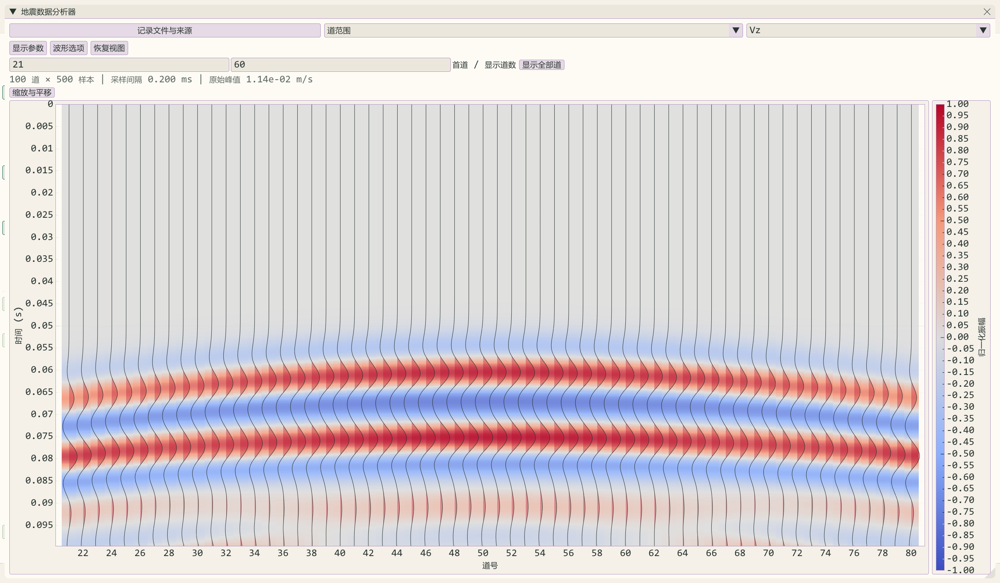

图 2：同一炮 Vz 的第 21–80 道，AGC 关闭，100 道原始记录每道 500 样点，dt=0.2 ms。多道横轴为道号，纵轴为秒且向下增加。

选择 **Receiver section / 多道记录**，设置首道及可见道数。首道输入按 0 开始，图中道号按 1 开始：`First trace=20` 对应显示第 21 道。显示道数上限随当前数据更新，取消固定 128 道限制；手动范围最多显示从首道起剩余的道数。**Show all traces / 显示全部道** 恢复首道并自动跟随总道数。切换分量、样式和色带保留增益与 AGC。

| 控件 | 默认 / 范围 | 作用 |
| --- | --- | --- |
| Trace gain | 1×；0.1–20× | 控制多道 wiggle 横向展开宽度；不会同时改变密度图色阶 |
| Normalize each trace | 关闭 | 关闭时选中道共用峰值参考；开启后每道独立缩放，会丢失道间相对振幅关系 |
| Positive variable area | 开启 | 正振幅变面积填充，仅用于 wiggle |
| Show Wiggle | 开启 | 显示折线/变面积 |
| Show Heatmap | 开启 | 显示振幅密度图 |
| Record style | Density + wiggle | 波形线、变面积、密度图、密度图与波形、正负极性填充、密度图与极性填充；手动组合标为自定义 |
| Wave palette | Coolwarm | 与三维波场共用十四套配色：Seismic Bipolar、Coolwarm、PuOr、Grayscale、Inferno、Plasma、Viridis、Turbo、Magma Glow、Jet Rainbow、Hot、Cold、Terrain Map、CUDA Green |
| Heatmap range | 1；0.01–1 | 归一化色阶半范围，调小增强弱色彩并更早饱和 |
| Density opacity | 0.85；0.05–1 | 调整密度层透明度；不改变原始数据 |
| Auto fit traces | 关闭 | 开启后持续适配；手动滚轮或拖动会自动关闭，保留缩放视图 |

Coolwarm 的负振幅为蓝色，正振幅为红色。密度图采用选中道的幅值参考；当 AGC 或逐道归一化开启时，颜色代表处理后的预览，不代表原始绝对速度。

密度模式在图旁显示归一化振幅色标。图内滚轮缩放两轴，时间轴或道号轴上滚轮只缩放该轴，左键拖动平移；Reset View 恢复范围。**Navigation / 缩放与平移** 可查看操作提示。单道模式采用同一色带和正负填充设置，密度层用于多道剖面。

### 7.2 单道记录

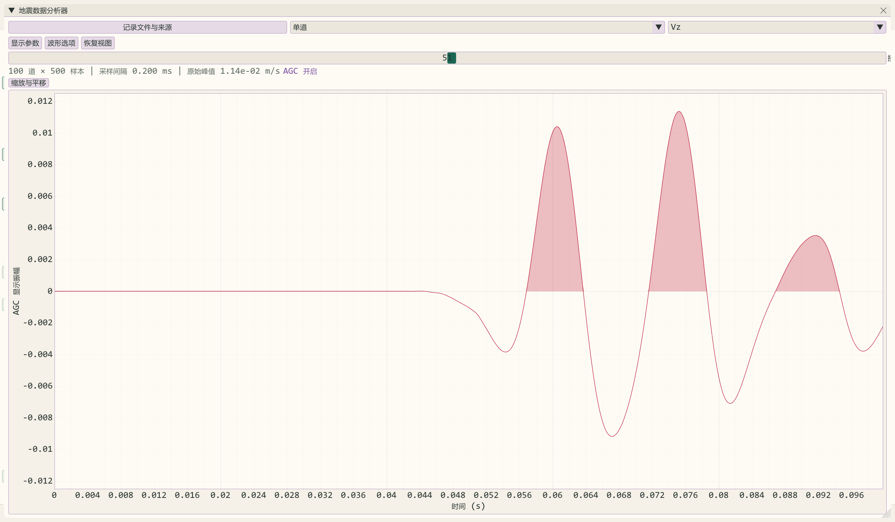

图 3：接收索引 50，即第 51 道的 Vz；AGC 开启，单道显示增益为 1×。横轴为时间，纵轴为预览振幅。图中峰值可用于显示诊断，不可在 AGC 开启时当作原始物理振幅。

切换 **Single trace / 单道** 后，用 Receiver 滑块选道。与多道的横向展开不同，单道 Trace gain 通过收紧/放宽纵轴范围改变视觉强度；高增益可能裁掉强峰。修改单道增益会请求重新适配该图，不覆盖原始数据。

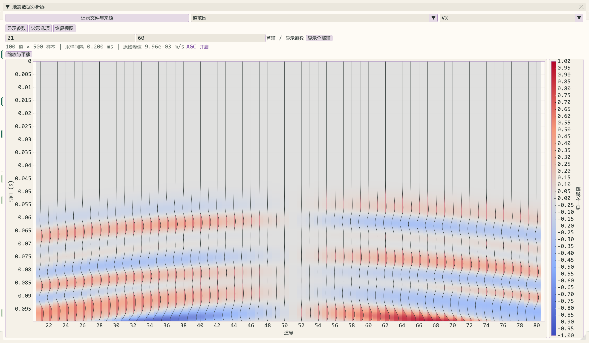

图 4：同一组采集的 Vx 多道预览。Vz/Vx 本身可有不同物理幅值；切换保留增益和 AGC，但当前分量按其选中记录的峰值适配，不能只凭屏幕宽度判断两个分量绝对大小。需要定量比较时关闭 AGC/逐道归一化，检查原始峰值或导出原始样本。

### 7.3 缩放、平移与重置

鼠标在 ImPlot 图内滚轮缩放，按当前 ImPlot 手势拖动平移。保持 Auto fit traces 关闭；**Reset View / 恢复视图** 或 **Fit traces now** 将当前选集恢复到可见范围。

| 操作 | 改变数据 | 改变增益/AGC | 改变坐标范围 |
| --- | --- | --- | --- |
| 切换记录分量、选道或单/多道 | 否 | 保留 | 请求适配新的选集 |
| 成功导入文件/刷新采集快照 | 替换查看器中的数据副本 | 保留 | 请求适配 |
| 文件导入失败 | 保留旧数据 | 保留 | 保留 |
| Reset View / Fit traces now | 否 | 保留 | 恢复当前选集 |
| Reset AGC parameters | 否 | 恢复 AGC 的四个参数，保持开启 | 随处理后的波形重新检查 |
| Reset viewer display | 否 | 恢复 gain=1、关闭 AGC/逐道归一化、恢复默认配色与显示选项 | 请求适配 |
| 波场 RESET SIMULATION | 保留已有查看器快照，终止当前采集 | 保留查看器设置 | 波场重新初始化 |
| 波场 RESET VIEWPORT | 否 | 保留 | 只恢复波场相机，也不删除多点震源 |

## 8. AGC：增强弱到达而保留原始数据

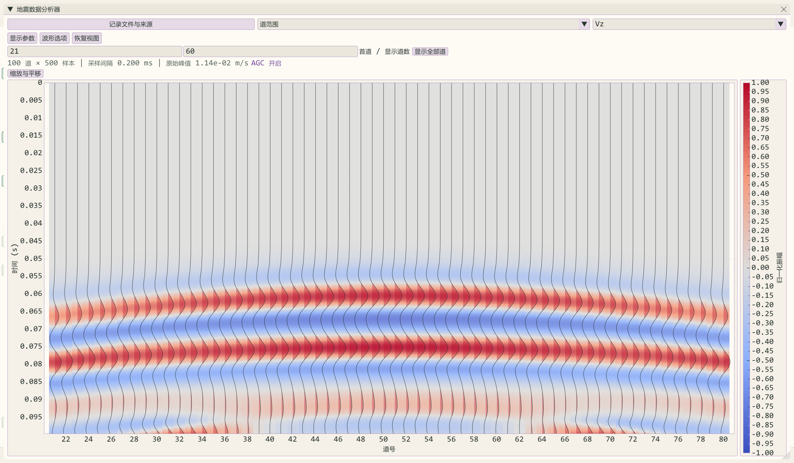

图 5：与图 2 完全相同的原始记录和选道，启用 20 ms 窗、强度 1、最大 30×、噪声门限 0.002%。弱到达更清楚，原始记录不变。

在 **Trace options / 波形选项** 中开启 Automatic gain compensation。二维与三维现共用无状态 CPU 处理函数，分别持有设置和记录。

| 参数 | 默认 | UI 范围 | 调节建议 |
| --- | --- | --- | --- |
| AGC window | 120 ms | 5–2000 ms | 长窗保持包络趋势，短窗更突出局部弱波形但会改变强弱对比 |
| AGC strength | 1 | 0–1 | 从 0.3–0.6 开始观察；0 等效无增强 |
| Maximum AGC boost | 50× | 1–200× | 先试 20–50×，上限大也会放大噪声 |
| Noise floor | 峰值的 0.01% | 0–2% | 限制极静区的放大；弱到达消失时检查门限是否过高 |

处理先计算全道 RMS 参考，再计算居中的滑窗 RMS。设局部 RMS 为 r(t)、全道参考为 R，补偿强度为 p、最大放大量为 M，则基础放大量近似为：

$$g(t)=\operatorname{clamp}\left(\max\left(1,\frac{R}{\max(r(t),r_{\mathrm{floor}})}\right)^p,\,1,\,M\right).$$

实际实现还对低 RMS 窗口作平滑门控：门限以下不额外放大，过渡区逐渐增强。它不会把原始低幅样本直接删除；增益下限为 1，属于弱段补偿，并非完整的去噪或强段压缩处理。

先逐道执行完整时间序列的 AGC，再保留极值生成绘图预览。单道预览最多 2048 点，密度图最多为可见道数×1024；密度图从处理后的预览按真实时间分桶，保留桶内最大绝对振幅的符号，空桶在有效时间区间内插值。显示全部道时只保留一个完整道的临时处理数组，缓存和绘图量仍随道数增长。屏幕预览适合观察，精确走时、相位和频谱分析应使用完整导出数据。

**AGC 改变相对振幅，不能用于直接读取反射系数、能量或 AVO 振幅。** 定量振幅分析应关闭 AGC 和逐道归一化，并使用原始记录。正式 SEG-Y/CSV 导出始终取原始采集样本，不取 AGC 缓存。

## 9. 导出与文件管理

### 9.1 目录和名称

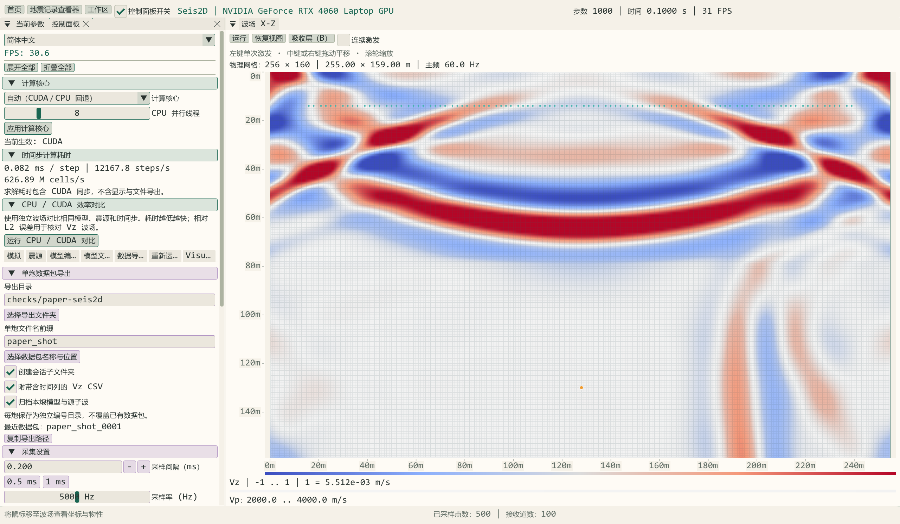

在 Data Export → **Shot package output** 设置：

| 控件 | 操作与含义 |
| --- | --- |
| Export directory / 导出目录 | 编辑或用 Browse export folder 选择，支持中文路径；默认程序旁 `exports2d` |
| Shot file prefix / 单炮文件名前缀 | 只填名称，不含路径分隔符；可以使用中文 |
| Choose package name / location | 通过原生选择框选择父目录和基本名称；最终输出是带编号目录，不是单一文件 |
| Create session subfolder | 默认开启，每次正式启动创建独立会话目录；一组自动多炮共用该会话 |
| Include time-column Vz CSV | 默认附带含时间列、道号表头的原始 Vz CSV |
| Archive frozen model and wavelet | 默认归档本炮开始时的模型与实际源子波 |
| Export current shot package | 停止采集后可再次输出当前原始记录；目标已存在时更换前缀或目录 |

相对目录以 EXE 所在目录为基准，与 VS 启动工作目录无关。采集时锁定输出设置；完成后显示最近数据包，悬停查看完整路径，Copy export path 可复制目录。

### 9.2 数据包内容与提交

```text
exports2d/session-<编号>/survey_0001/
├─ record_vx.sgy             原始 Vx，IEEE float32，大端
├─ record_vz.sgy             原始 Vz，IEEE float32，大端
├─ geometry.csv              道号、源/接收点 X/Z 米坐标
├─ record_vz.csv             可选：time_s 和 trace_1…trace_N
├─ model.s2dm                可选：冻结的 λ、μ、ρ 数组
├─ source_wavelet.f32le      可选：实际源子波样本
└─ manifest.json             版本、GPU、采样/模型/源参数及各文件 SHA-256
```

每炮先写入本次独占的 `.part-<编号>` 临时目录。全部文件关闭、校验值计算和清单写完后，再在同一父目录内重命名为完整目录。Windows 下已有目标不覆盖；失败只清理本次创建的临时目录，旧数据包保持。断电可能留下 `.part-*`，它不代表完整提交结果。

- SEG-Y 道头使用毫米精度、坐标标量 -1000、米单位，保留冻结的炮号及几何。二维继续采用 **SEG-Y Y 字段存垂向 Z** 的兼容约定；不能直接解释为三维水平 Y，几何 CSV 和清单明确标注该约定。
- 速度单位为 m/s。清单保留实际浮点采样间隔，SEG-Y 以整数微秒写入舍入后的值，两者同时记录。
- 启动前检查每道 1–32767 样点、间隔 1–32767 μs；例如 10 Hz 的 100000 μs 会要求调整参数，不截断字段。
- CSV 含 time_s，保持原始 Vz；AGC、Trace gain 和色阶不写入记录。
- 原始双分量缓存预算 512 MiB，冻结模型三数组预算 256 MiB；不是整个进程内存上限。即使不写模型文件，也保留采集时的模型快照至下次采集。
- 新缓存与模型先准备成功再替换旧缓存。导出仍为同步 I/O，大模型归档可能短暂停顿；后台导出属于后续优化。

`.s2dm` 是二维归档格式：20 字节头为 `S2DMOD1\0`、uint32 小端 NX/NZ、float32 小端 h；随后是 λ、μ、ρ 三个完整小端 float32 平面，展平索引 `z*NX+x`。它不是三维 `.s3dm`，旧二维 Model I/O 暂不直接读取。源子波为小端 float32，长度见清单 solver.nt。

### 9.3 校验与复现边界

从仓库运行独立只读校验：

```powershell
python docs/tools/verify_shot_package.py "完整的数据包目录"
```

检查 SHA-256、文件长度、SEG-Y 样本头、模型头和源子波长度。校验值可发现损坏或修改，不能证明数值正确，也不是真实性签名。

清单记录起始步、dt、stride、实际生效的源机制、频率、幅度、角度和模型；未应用的界面频率草稿不改变归档。二维遗留内核使用 **1e7 数值注入尺度**，现已统一为常量并记录在 source.numerical_injection_scale 中；Amplitude 是数值乘子，未经源归一化校准不能解释成 N 或 N·m。

**中途采集没有保存起点动态波场，多点源事件序列也未归档，因此数据包不是可继续求解的检查点。** 零场开始的标准单炮更适合论文归档，仍需配套代码版本、环境、完整算例配置和批量重跑入口。

以上改进针对采集数据包。物性模型采用独立的 SEG-Y 三文件组接口；文本模型导入已移除，格式与路径规则见模型文件页。

## 10. 复现本文示例

本文截图来自实际程序同一次 CUDA 会话，不使用手工生成的波形或后期着色。参数如下：

| 项目 | 值 |
| --- | --- |
| 界面/语言 | Paper Sand / 简体中文 |
| 网格 | NX=256、NZ=160，h=1 m |
| 方案 | Type 3 平面自由表面 + PML，npml=12 |
| 时间 | dt=0.0001 s，nt=3000，每帧 20 步 |
| 双层界面 | Z=80；上层 Vp=4000、Vs=2300 m/s、ρ=2500 kg/m³；下层 Vp=2000、Vs=1100 m/s、ρ=1500 kg/m³ |
| 震源 | [128,130]，类型 0 垂向体力源（Vz），幅度 1，Ricker f0=60 Hz、延迟 1/60 s |
| 接收线 | 100 道，X=16…239，Z=14；截图入口采用四舍五入布点 |
| 采样 | 请求 5000 Hz，stride=2，真实 dt=0.2 ms |
| 记录 | 预留 0.25 s，在第 1000 步暂停，实际冻结 500 样点/道；最后显示样点约 0.0998 s |
| 波场截图 | 第 560 步，t=0.056 s，Vz / Coolwarm / Scientific White，Color Gain=35，网格不透明度 0.08 |
| 多道截图 | 第 21–80 道，Trace gain=1.5×，统一选集峰值，不开启逐道归一化 |
| AGC 对照 | raw 关闭；AGC 图开启 20 ms / 1 / 30× / 0.002% |
| 单道截图 | 接收索引 50（第 51 道），AGC 同上，Trace gain=1× |

手工按这些设置可获得相近传播过程；屏幕 FPS、滚动位置和格点布点取整可能不同。为生成完全一致的参数流程，使用专用截图入口。

从外层项目目录执行：

```powershell
.\out\bin\RelWithDebInfo\SeisWaveLab_Cartesian.exe --capture-seis2d-workflow
python SeisWaveLab_Cartesian/docs/tools/prepare_seis2d_screenshots.py
```

入口创建隐藏的真实 GLFW/OpenGL 窗口，运行 CUDA 求解与 ImGui 渲染，读取最大化窗口的实际帧缓冲，本机生成2560×1494完整PNG；临时应用浅色设置，不保存用户布局或主题偏好。临时使用中文，不保存语言偏好。复制工具保持原始像素，不合成或重绘波场。

11 张原图位于外层 `out/screenshots/application/2d`，文档副本位于 `docs/assets/seis2d`。包含外置边界、分组折叠、停靠对照、记录分析和导出设置；对照布局根据字体及可用高度将记录控件改为弹出菜单，保留绘图空间。导出截图中的多炮编辑值为 3 炮、X=51、步距 60，截图只演示配置，不表示已完成三炮采集。入口在程序旁 `checks/paper-seis2d` 保存一份真实 100 道×500 样点数据包；它不导出完整 0.25 s 炮集。副本附带日期、程序摘要和文件 SHA-256 清单。

## 11. 常见问题

| 现象 | 检查与处理 |
| --- | --- |
| 有波场但记录为空 | 确认接收点已部署，正式采集已开启；Run 不等于 Capture；打开快照前要有有效样点 |
| 顶栏有时间但查看器仍是旧图 | 查看器是冻结副本；通过顶部入口再次打开当前采集，或导入目标文件 |
| 首段全零 | 完整炮的传播走时造成零值可能正常；中途采集不应再因绝对步数产生人工零前段 |
| 晚到信号看不清 | 开 AGC，调窗口/上限/门限；密度图调小 Heatmap range；wiggle 调 Trace gain |
| 调 Trace gain，背景颜色没变 | 两套控件独立；调 Heatmap range 控制密度图 |
| 切到 Vx 波形宽度相近，但峰值不同 | 选集按各分量峰值适配，增益未重置；读取 Raw peak 或导出数据作比较 |
| 高增益单道峰值被裁掉 | 降低增益或恢复视图；高增益本来会收紧纵轴 |
| 滚轮缩放马上复原 | 关闭 Auto fit traces，再滚轮/拖动；选集变化会请求一次适配 |
| 地表道一直近零 | 核对 Type 3 自由面位于 npml 行，接收深度是否误落空气或 ghost 区 |
| 只显示单侧颜色 | 检查是否选了非负速度模长；看带符号波场请选择 Vx/Vz |
| SEG-Y 拒绝导出 | 核对有效样点、真实 dt、整数微秒范围、路径权限；先使用短时长和可写目录 |
| 导入成功但单位未知 | 外部头未标明速度单位，显示 file units；根据数据来源确认，不能直接标 m/s |
| 修改模型/震源控件灰色 | 正在采集；先停止或重置，再编辑下一炮 |
| 编译无法覆盖 EXE | 保存所需数据并关闭对应运行实例后再编译；当前版本见外层输出目录 |

常用二维快捷键：空格运行/暂停，R 恢复波场视口，C 重置波场，**Q/W/E 分别切换波场色带/波场分量/模型色带**，与三维保持一致；Shift+Q/W/E 反向循环，G 显示/隐藏网格，1–5 切换画笔，Tab 返回首页。新版 Q/W 顺序交换，请按新映射使用。按住按键不会重复轮转；编辑控件、输入文本、打开弹窗以及 Ctrl/Alt 等组合键期间不触发。C 不是“保证自动采集新炮”的快捷键，完整新炮请使用 TRIGGER & ACQUIRE。

## 12. 适用范围与进一步阅读

当前系统适合交互建模、教学、算法调试和受控合成算例。GPU 回归通过不能代替工程勘探级物理精度验收；二维平面自由表面、流固界面和 PML 的完整定量验证仍在后续计划中。

- [二维代码整理、检查结果与后续优化](../development/SEIS2D_REFACTOR_AND_VIEWER.md)
- [三维使用指南](Seis3D_User_Guide.md)
- [构建与截图更新](../build/BUILDING.md)
- [二维历史数值稳定性审查](../reviews/NUMERICAL_STABILITY_REVIEW.md)
- [论文准备、验证矩阵与期刊建议](../publication/PUBLICATION_ROADMAP.md)

## 二维外部吸收层与操作（2026-10-19）

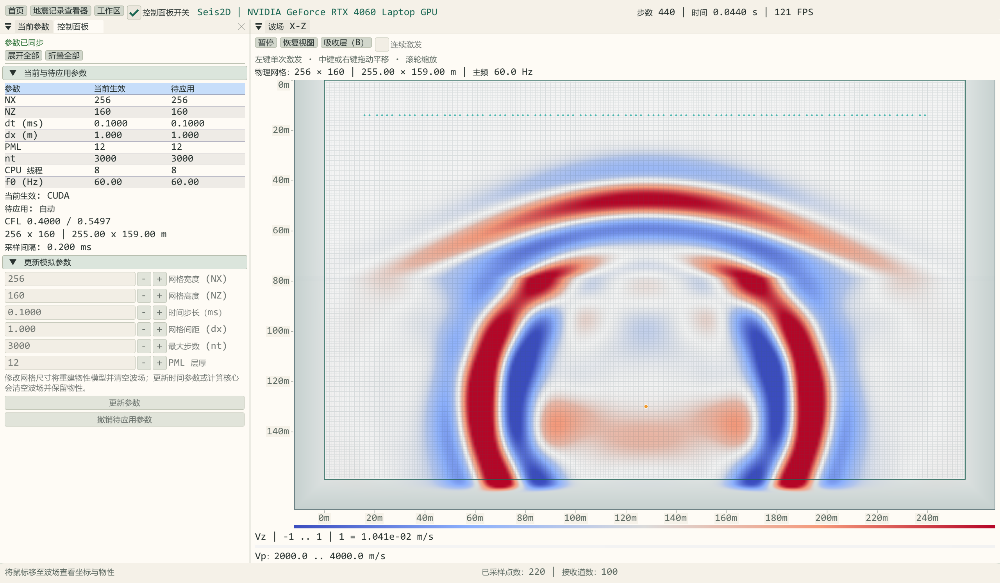

外置吸收层位于用户物理模型之外，按 B 切换其显示。物理模型尺寸和源检坐标保持不变。

模型 NX×NZ 表示完整物理节点网格。GPU 在模型四周另行分配吸收／差分保护层，材料按边缘值外推；吸收层不再占用模型节点。自由表面的顶部只有镜像保护行，不作为顶部吸收层显示。物理坐标从 (0,0) 到 ((NX−1)dx,(NZ−1)dx)，深度向下。

- **B** 或“吸收层（B）”：显示／隐藏真实外部吸收层，默认隐藏；只改变显示，不关闭吸收计算，不重启波场。
- **滚轮**：整体缩放；**按住中键或右键拖动**：平移，拖出画布仍可继续，释放后结束。
- **左键**：激发；勾选“连续激发”后按住左键以 0.1 秒的操作间隔加入新震源，不清空已有波场。模型编辑工具启用时左键用于画笔；拖动平移时抑制左键激发和绘制。
- 正式“单炮激发／采集”使用单一固定震源，退出交互多源模式，冻结本炮几何与采样参数。
- 波场采用曲网格同类的符号色带与振幅透明度叠加；十四套色带与底部色标共用同一颜色定义。模型网格和坐标主次网格分别控制，缩小时自动淡出密集节点线。

SEG-Y 模型导入不把吸收层写入模型尺寸，并保留密度单位转换。模型导出及波场回放仅包含物理网格。单炮 manifest 的 grid.external_pml 指示是否使用外扩吸收域。

波场使用浮点纹理传输，避免 8 位显示编码截断弱波。默认按物理区的当前幅值峰值归一化，色标显示对应参考振幅；可关闭自动归一化使用手动增益。显示缩放、透明度和色带不改变原始采集数据。

### 参数分组与全部展开／折叠

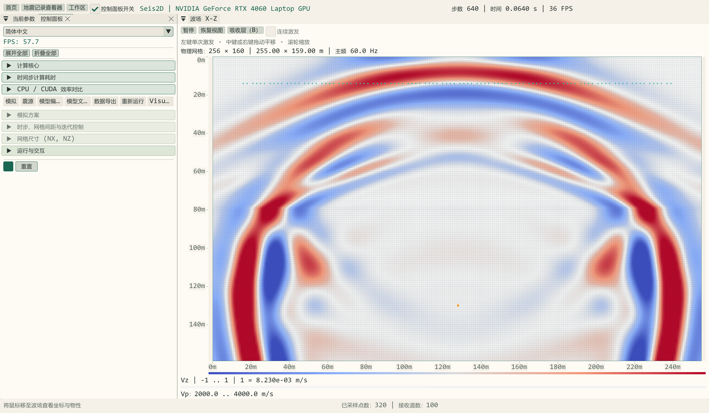

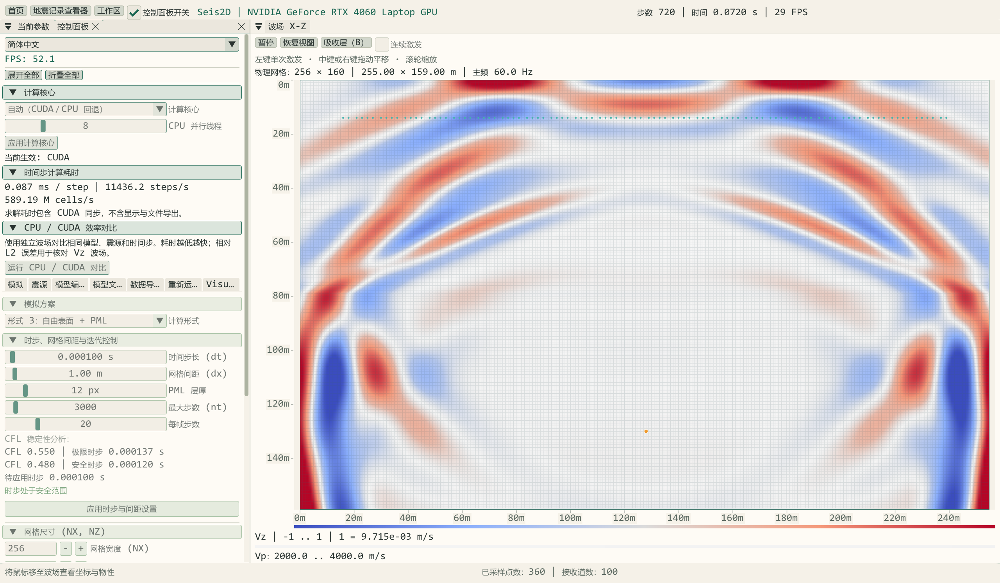

参数按职责折叠分组：计算核心、时间步耗时、CPU/CUDA 对比、模型/网格与边界、震源/子波、物性/预设/画笔、SEG-Y 导入导出、采样/检波器/采集/多炮、回放、波场/物性/网格显示。当前参数页分为当前与待应用参数、采集（二维集中在采集页）和参数更新。

面板顶部“全部展开”“全部折叠”影响该面板所有组，包括暂未打开的页签；切换页签后仍保持该命令。每组也可单独点击标题展开/折叠，语言切换保留状态。折叠不会应用参数、改变波场或清空记录。

当前 CPU/OpenMP 会话中的参数对照与记录分析器（CUDA 设备已屏蔽，来自实际计算）：

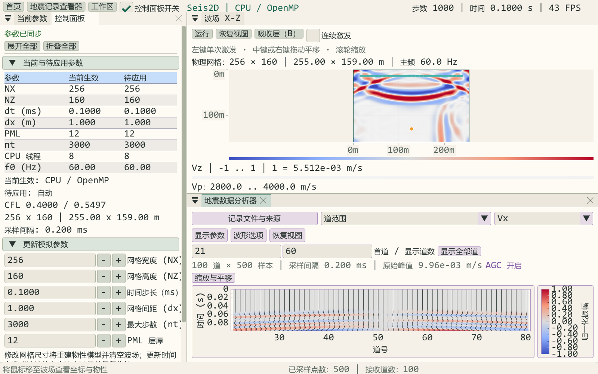

参数按组全部折叠后的界面：

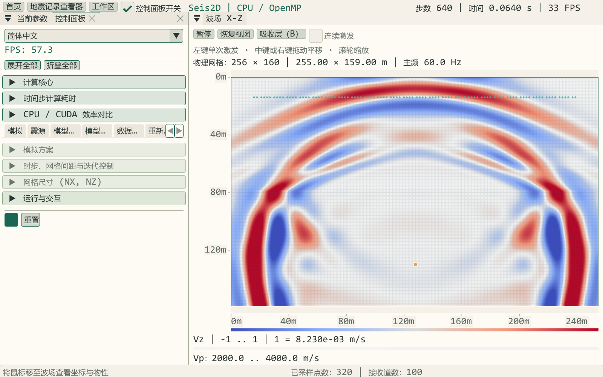
