# SeisWave Lab Seis3D 三维地震波模拟使用说明

适用软件 SeisWave Lab v2.0.0　三维模块 Seis3D　更新日期 2026 年 10 月 19 日

理论、19 组编号公式与可复现流程见[完整说明](../PROJECT_MANUAL.md)。本项目是笛卡尔网格、平面地表模拟；曲面地表由独立曲网格项目维护。本轮全部图片重新采自当前程序，三维图集与摘要记录实际日期和条件。

本文说明如何建立三维弹性介质模型、运行波场、查看正交剖面与体视图，以及采集和导出三分量地震记录。示例统一使用 Paper Sand 界面与 Paper scientific 显示预设，模型采用浅色分层，波场采用蓝红配色。

二维沙盒的新查看器、模型到采集流程和实际截图见 [二维模拟与地震记录指南](Seis2D_User_Guide.md)。二维与三维共用无状态滑窗 RMS AGC 处理函数，计算上下文、原始记录和显示设置仍独立；三维控制、显示与当前参数页签默认同组停靠在左侧。

当前版本提供九种模型预设、三种边界模式、实际 CPML 显示和可调大字号，并增加功能颜色、十套界面主题及大模型体视图透明度补偿。本文图片已全部替换为当前版本的完整窗口 PNG，原始分辨率 2560×1494，不裁切、不拉伸、不生成局部放大图。

本轮截图覆盖模型、时步、震源、接收布设、采集、记录分析和文件导入导出，并展示六种波场色带。英文标签与中文标签对应同一功能；本文保留英文操作名称，便于对照中文实际截图。

当前初始设置为 **Vz + Paper scientific（论文浅色）+ Coolwarm**，材料采用 Scientific White，波场显示增益为 **1.8**，历史峰值保持关闭；默认物理网格 **300×50×300**，每炮 **1000 样点**、采样步数间隔 2；接收排列 **X 向每排 100 道、Y 向 5 排，共 500 道**，接收总上限 **500 道**。默认网格中的排列为 X=1+3i（i=0…99）、Y=2/13/24/35/46、Z=0。初始为单炮激发，多炮布设默认为 **1×1**；接收点数不会增加同时激发的震源数。修改视觉预设保留已调增益；重置显示参数会采用当前预设的默认值，并关闭历史峰值保持。

**本次截图参数：** 200³ 双层模型、10 m 间距、20 Hz、0.5 ms 手动步长、50×3 接收排列。中文界面采用 Paper Sand，波场采用 Paper scientific 配色与 1.8 倍显示增益。六种色带比较使用同一暂停时刻：第480步、0.240 s；深度切片移到 Z=70 格（700 m），避免 Vz 位于震源对称面而接近零。各剖面均为100%适配，文字倍率1.0。记录分析使用软件自身的 Receiver focus 布局，图片未做外部放大。全部33张原图见[完整窗口截图集](Seis3D_Screenshot_Gallery.md)。

模型设置到采集、AGC 对比和 SEG-Y 导出的真实界面录像及中文字幕见[三维实操视频教程](Seis3D_Video_Tutorial.md)。

## 1 首页与模式选择

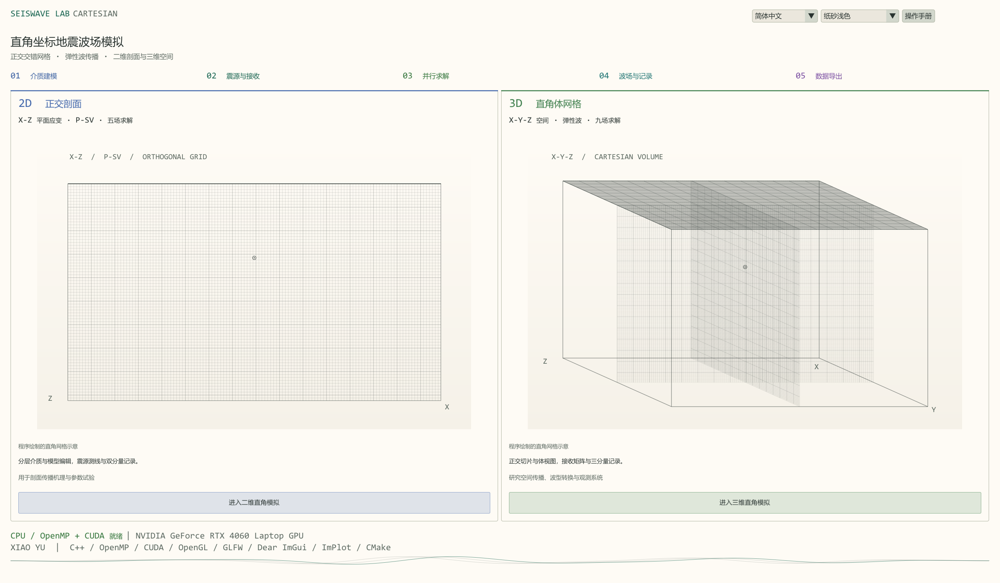

图1　Paper Sand 首页实际截图。右侧卡片进入三维空间探索沙盒。

首页显示当前 CUDA 设备、显存容量和二维与三维两个独立入口。选择 **进入三维工作区** 打开 Seis3D；选择二维卡片则进入原二维模拟流程。

首页右上角入口为 **Operating manual / 操作手册**。手册包含快速开始、模型与边界、震源与采集、波场与地震记录、导入与导出、鼠标操作与排查、二维模拟与记录，以及关于 SeisWave Lab，共八章。支持中英文切换、滚动阅读及直接进入沙盒。“关于”页显示名称、版本号、Seis3D、技术栈与许可证。发布程序位于外层 `out/bin/RelWithDebInfo/SeisWaveLab_Cartesian.exe`。

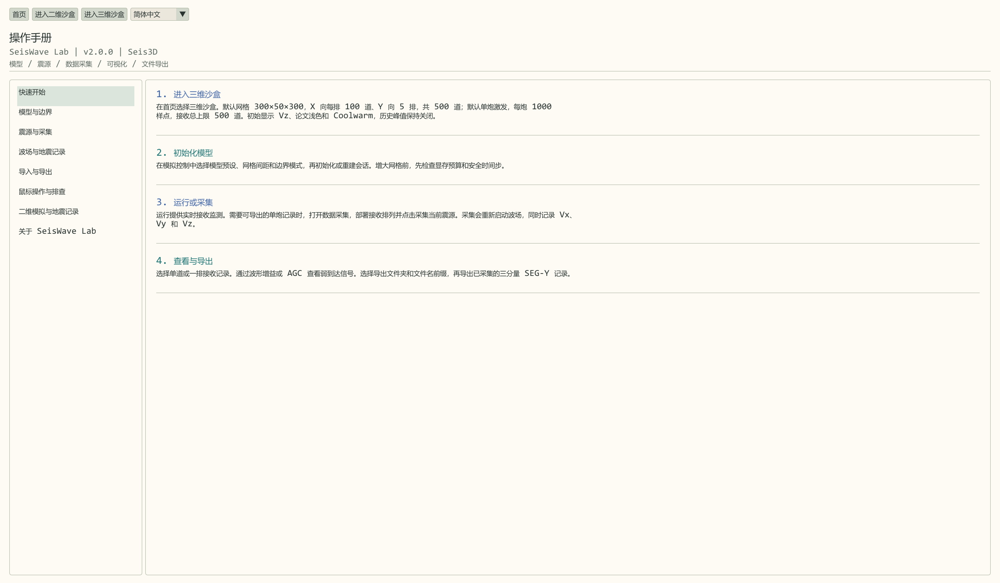

主题菜单位于首页右上角。选择 **Paper Sand** 后，界面采用暖白底色、深灰文字和青绿色控件。进入三维后，**Display / materials → Visual preset** 默认选择 **Paper scientific（论文浅色）**，模型与波场使用配套的浅色画布。界面主题仍按用户自己的选择使用。

界面现有十套主题，新增 **Arctic Lab**（冷白蓝灰）与 **Warm Ivory**（暖白铜色），均适合浅色科研界面。主题只改变界面；模型与波场配色仍在显示设置中独立选择。

本指南依次介绍工作区、快速运行、参数与震源、剖面交互、显示设置、体视图、采集导出、模型与计算边界，以及常见问题。

二维与三维采用独立模拟状态。返回首页切换模式时，程序释放原模式的 GPU 和图形资源；再次进入三维后需要重新初始化波场。

### 中英文切换

首页右上角第二个下拉框可选择 **English / 简体中文**。三维工作区可从 **Workspace → Language（工作区 → 界面语言）** 切换，也可展开 **Display / materials → APPEARANCE / LANGUAGE（显示与材质 → 主题、语言与字号）**。二维控制面板顶部也提供语言选择器。

语言即时生效，偏好保存在程序旁的 `ui_language.ini`，重新启动后读取。切换保留三维停靠位置、分组折叠状态、已调显示增益、模拟进度和采集数据。文件名、物理符号、SI 单位和标准色带名称保持原有标识；部分历史页面说明及底层诊断仍保留原文。

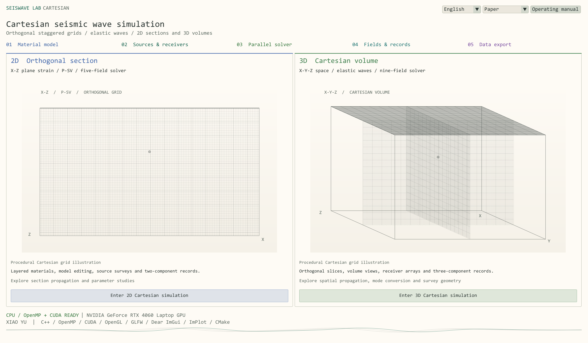

<!-- pagebreak -->

## 2 三维工作区总览

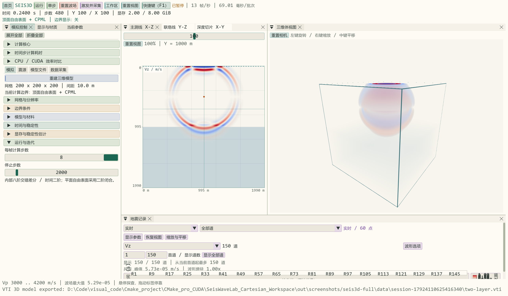

图2　200³ 双层模型，模拟时间0.240 s、第480步，Live监视已有60个计算批次预览点。三剖面均为100%适配，源位于[100,100,50]。

| 区域 | 显示内容 | 常用操作 |
| --- | --- | --- |
| 顶部工具栏 | Run、Step、Reset fields、Fire + capture、Workspace | 运行、单步、重置、采集和布局切换 |
| 左侧参数区 | Simulation、Source、Model I/O、Acquisition | 编辑模型、震源、接收点和导出路径 |
| 左侧显示标签 | Display / materials | 主题、配色、物性与显示强度 |
| 中央四视图 | 三个正交剖面和 Spatial volume | 剖面缩放、位置联动与轨道观察 |
| 底部曲线区 | Receiver traces | 选择接收点与 Live 或 Captured 数据 |

顶部状态栏显示模拟时间、计算步数、Inline Y 与 Crossline X 位置、显存占用和帧率。底部状态栏显示鼠标拾取的格点、物理坐标、Vp、Vs、密度以及最近操作提示。

窗口标签可以拖动、合并和重新停靠。需要恢复本图布局时，选择 **Workspace → Four views**；若某个窗口被关闭，在 Workspace 菜单中重新打开。

默认字号提高到约 24 像素，标尺字号同时增大。**Workspace → Text size** 或显示面板的 **Workspace text size** 可在 0.85–1.25 倍之间调整。重新应用布局预设时，参数列宽依据字号计算；已有停靠布局保持不变。参数按网格、边界、模型、时间稳定性折叠分组，顶部工具栏在窄窗口自动换行。

### 参数分组与折叠

模拟和显示面板顶部提供 **Expand all / Collapse all（展开全部 / 折叠全部）**，作用于当前显示的面板或控制标签。点击分组标题可单独展开；切换语言保留当前折叠状态。折叠只改变界面，不恢复参数默认值。

模拟参数中的网格、边界、材料、稳定性和显存明细默认收起；**RUN / ITERATION（运行与迭代）** 默认展开。初始化/重建按钮、网格摘要、当前边界和参数错误提示持续可见。模型的次级材料与几何参数为内部折叠组。

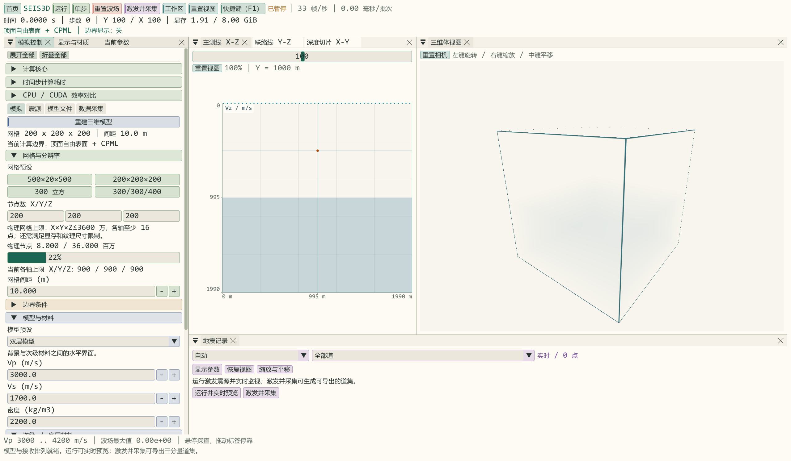

显示面板默认展开 **WAVEFIELD / GAIN（波场分量与增益）**。幅值参考、弱波显示、地质材质、网格边界叠加、体绘制性能、视图操作和色带分别收起，按需展开。**Visual preset（视觉预设）** 与 **Reset display parameters（统一重置显示参数）** 保持独立；切换预设仍只改变配色。

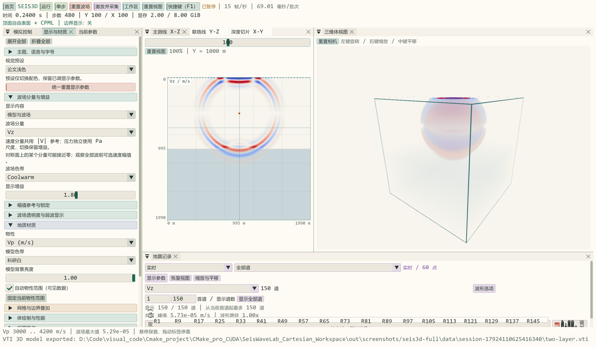

采集页将文件导入、接收排列、世界坐标/CMP、记录采样和多测线放炮分组。采集按钮、采集进度、停止采集及已有记录导出操作保留在分组之外，避免折叠后找不到停止按钮。首次编辑参数时，先展开对应标题，或点击展开全部。

新版通过标签、按钮标记、控件描边和选中状态区分功能；文字标签仍是主要识别方式。浅色主题使用较深的强调色，深色主题使用较亮的强调色。

| 功能 | 强调色 |
| --- | --- |
| 计算、运行与单步 | 绿色 |
| 模型、物性和模型文件 | 蓝色 |
| 震源与时间参数 | 橙色 |
| 采集和接收曲线 | 紫色 |
| 显示、剖面和布局 | 青色 |
| 边界与暂停提示 | 琥珀色 |
| 重置、停止和错误 | 红色 |

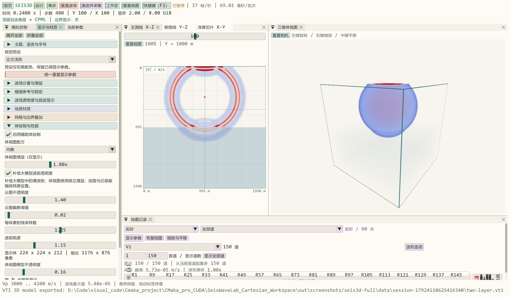

<!-- pagebreak -->

## 3 快速运行一个示例

首次使用可直接采用初始的 300×50×300 网格。GRID / RESOLUTION 中已取消 96³ 和 160³ 按钮，替换为 **500×20×500** 与 **200×200×200**；保留 300³ 和 300×300×400。两套新预设分别为 500 万和 800 万物理节点，默认网格为 450 万。预设只修改待应用尺寸，点击重建后生效。自定义尺寸仍按总量而非固定单边上限约束，界面显示 3600 万总节点限制与固定其余两轴时的动态单轴上限，实际分配还需满足显存和纹理限制。

| 参数 | 入门示例 | 说明 |
| --- | --- | --- |
| Nodes X / Y / Z | 300 / 50 / 300 | 默认物理网格节点数 |
| Grid spacing | 10 m | 三方向使用相同间距 |
| CPML cells | 12 | 吸收层厚度 |
| Traction-free top z=0 | 开启 | 顶部 Z 为 0 的平面自由表面 |
| Procedural model | Two layers | 双层介质 |
| Ricker f0 | 20 Hz | 主频 |
| CFL safety factor | 0.85 | 自动安全时步的系数 |
| Solver time step | Automatic CFL | 默认自动；可在安全上限内手动指定整数微秒步长 |
| Receiver mesh | 100 × 5 | X 向每排 100 道、Y 向 5 排，共 500 个接收点；默认单炮 |
| Samples per shot | 1000 | 每道默认样点数，采样步数间隔 2 |
| Component / Visual preset / Wave palette | Vz / Paper scientific / Coolwarm | 初始波场分量和配色，显示增益 1.8 |
| Hold observed peak | 关闭 | 按当前幅值参考映射颜色 |

1. 在首页进入三维工作区，打开 **Simulation** 标签。
2. 展开 **GRID / RESOLUTION** 与 **MODEL / MATERIAL**，保留 300 / 50 / 300 和 **Two layers**；在边界组确认 12 格 CPML，保留 10 m 间距。
3. 点击 **Initialize 3D**。已有会话时按钮显示 **Rebuild 3D session**。检查底部没有错误提示。
4. 打开 **Display / materials**，初始为 **Paper scientific + Coolwarm + Vz**，显示增益 1.8。界面主题可选 **Paper Sand**；若要复现本文截图，请另按截图条件设置 200³ 模型、0.5 ms 时步和 50×3 接收排列。
5. 点击 **Run**。程序发射震源，并在底部生成真实接收点的实时波形；也可点击 Step 单步推进。
6. 点击 Pause 暂停观察，使用剖面滑块、滚轮和中键探索波场。
7. 需要正式道集时点击 **Fire + capture**。普通 Run 的实时预览与正式采集分别保存。

图3　顶部运行与采集控制。达到停止步数后，Run 会变为 Replay，用于重新发射震源。

自动模式会根据最大 Vp 同步安全步长，该双层模型上限约0.908 ms；截图演示手动选择0.5 ms。截图计算阶段使用每帧8步，正式记录完成后恢复为2步；软件普通默认值仍为每帧2步。

### 3.1 手动设置整齐的时间步长

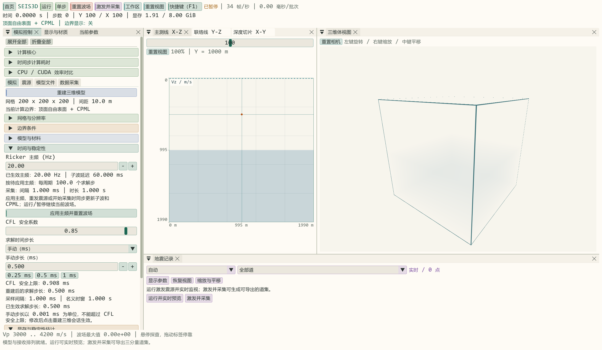

在 **Simulation → TIME / STABILITY → Solver time step** 选择 **Manual (ms)**，输入如 **0.5 ms**，再点击 **Rebuild 3D session**。提供 0.25、0.5、1 ms 快捷值；所有输入仍须满足当前模型的 CFL 安全上限，1 ms 对默认双层模型并不安全。默认继续使用 **Automatic CFL**，不会自动改为 0.5 ms。

步长必须为整数微秒，即 0.001 ms 的整数倍。界面分别显示 CFL 上限、重建后步长和当前已生效步长，修改输入框后，Run 或 Capture 继续使用当前已生效值。重建会重新初始化波场、接收排列和吸收边界系数，保留显示增益、调色板与视觉设置；旧道集的采样信息保留在其自身快照中。采集中不能重建。

修改间距、材料、CFL 或导入新模型时，会重新检查手动步长。超限或不合法的值会明确拒绝，且在替换当前会话之前完成检查；请减小步长或切回自动模式后重建。

| 求解步长 | Sample stride | 记录采样间隔 | 1000 样点的名义时窗 |
| --- | --- | --- | --- |
| 0.5 ms | 2 | 1 ms | 1 s |
| 0.5 ms | 1 | 0.5 ms | 0.5 s |
| 0.25 ms | 4 | 1 ms | 1 s |

名义时窗为 `样点数 × 采样间隔`，实际首末样点之间的跨度为 `(样点数−1) × 采样间隔`。速度位于半时间步：首样本时间为 `(stride−0.5) × 求解步长`。例如 0.5 ms、stride=2、1000 样点时，样本从 **0.75 ms** 到 **999.75 ms**，不人为平移到 0 s；CSV 与记录查看器使用实际时间。整数微秒间隔会准确写入 SEG-Y。每炮间隔仍须不超过 32.767 ms。

减小求解步长能获得更整齐的采样间隔，但覆盖相同物理时长需要更多求解步；同时留意 Stop after steps 和每炮样点数。子波主频修改不重置手动步长，仍需按网格间距和频率核对空间、时间分辨率。

<!-- pagebreak -->

## 4 模型参数与震源

图4　Simulation 参数区与全部视图同屏展示，200³网格和双层物性清楚可见。正式采集中模型与震源参数锁定。

**Simulation** 设置网格、间距、CPML、自由表面和材料。Vp 与 Vs 的单位为 m/s，密度单位为 kg/m³；Layer / sphere material 可设置第二层或球形异常体的物性。模型参数变更后需要重新初始化会话。

### 4.1 常见预设模型

在 **MODEL / MATERIAL → Model preset** 中选择预设。切换预设会载入相应的材料与几何默认值，保留当前网格和边界选择；点击 **Rebuild 3D session** 后生效。

| 预设 | 几何与用途 |
| --- | --- |
| Uniform | 均匀介质，适合波前和边界对照 |
| Two layers | 水平双层，界面深度可调 |
| Sphere anomaly | 中心异常体；半径按各轴尺寸归一化，非立方网格中为椭球 |
| Three layers | 等厚三层，中间层物性为上下端点的均值 |
| Dipping interface | 沿 X 方向倾斜的平面界面 |
| Low-velocity interbed | 高速围岩内的低速夹层，深度和厚度可调 |
| Faulted interface | 倾斜界面在 X 中面处错断，垂直断距可调 |
| Depth velocity gradient | Vp、Vs、密度在上下端点间随深度线性变化 |
| Salt dome | 从模型底部向上延伸的合成高速盐丘，横向半径可调 |

这些是教学与算法探索用合成模型。背景物性在主输入区设置，第二介质或底部端点在 **Secondary / bottom material** 中设置。几何参数位于 **Model geometry (domain fractions)**，数值表示相对物理模型尺寸的比例。

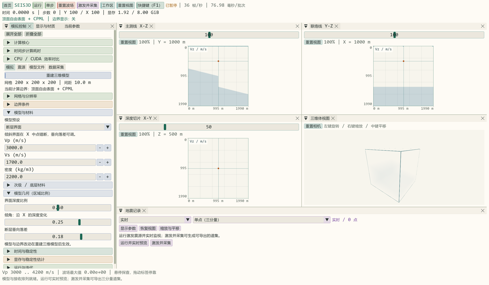

### 4.2 边界模式

在 **BOUNDARY CONDITIONS → Boundary mode** 中选择：

| 模式 | 实际计算条件 |
| --- | --- |
| Free top + CPML | 顶面 z=0 为零牵引力自由表面，其余五面吸收 |
| All absorbing (6-face CPML) | 六面均为 CPML，顶部也吸收 |
| All reflecting (slip walls) | 六面滑移反射壁，法向速度为零、切向牵引力为零；不分配 CPML |

全反射用于观察边界回波和驻波，不等同于六面自由表面，也不等同于三分量速度全部固定的无滑移边界。壁面位于最外物理节点外半格处，幽灵层依据速度和应力的交错位置做镜像延拓。全吸收是有限厚度 CPML，不表示反射误差严格为零。

CPML 厚度在吸收模式下可调；反射模式保留该设置供切回吸收时使用，但不参与反射计算。修改模式或厚度后需要重建会话，顶部与参数区的 Live boundary 显示当前真正运行的边界。

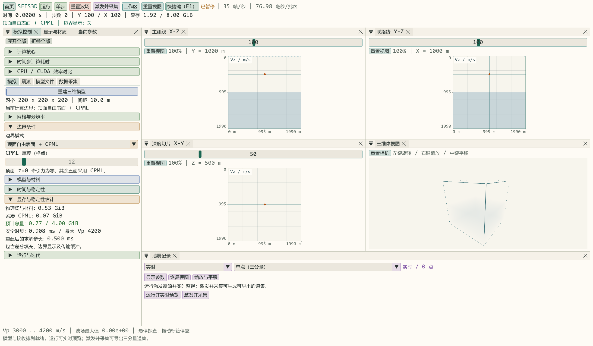

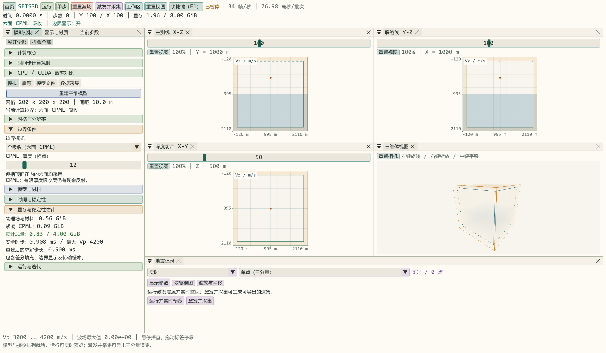

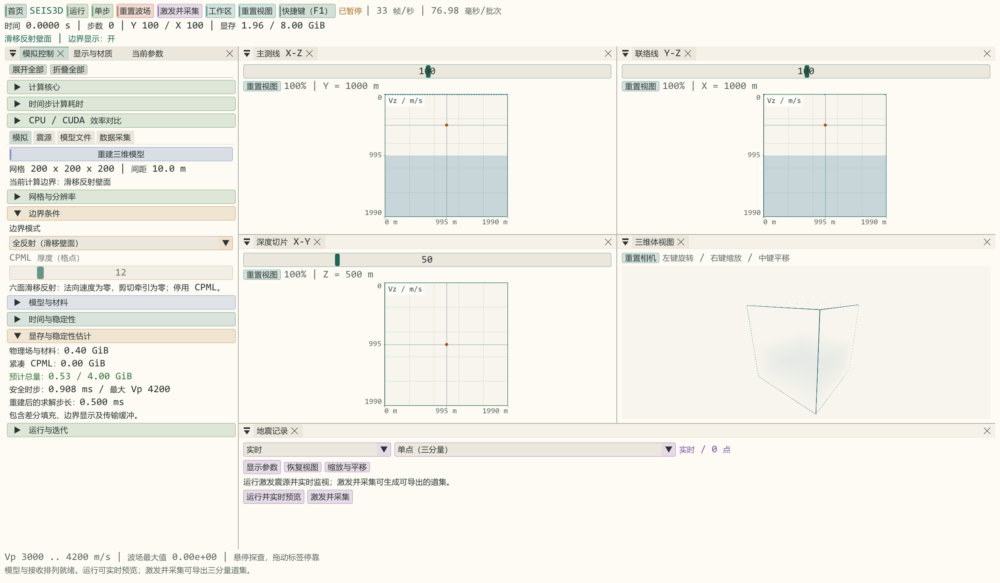

这三张完整窗口展示实际初始化后的边界模式与范围，不作为吸收反射误差的定量比较。

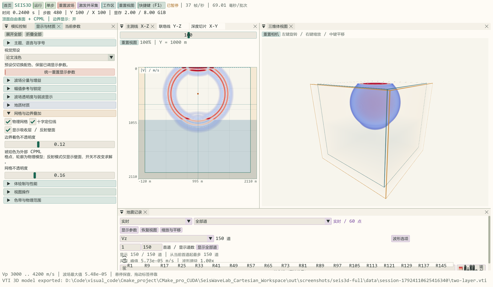

### 4.3 震源

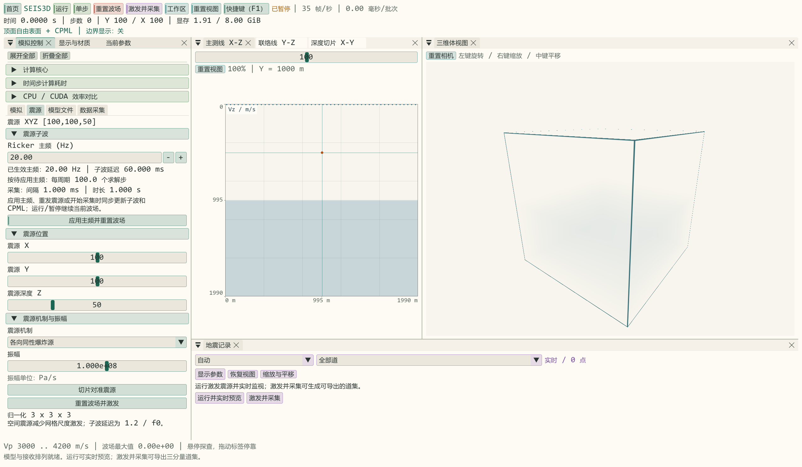

**Source** 设置震源格点 XYZ、机制和幅值。爆炸源的幅值单位为 Pa/s，定向体力源为 N/m³；体力源可设置方向并使用 Normalize direction 归一化。Center slices on source 将三个剖面移到震源处，Reset wavefield + fire 从新波场开始发射。

震源波形为 Ricker 子波，延迟为 `1.2/f0` 秒。**Simulation → TIME / STABILITY** 与 **Source → SOURCE WAVELET** 共用待应用主频。界面显示实际生效值和待应用提示，修改输入框不会让传播中的波场突然改变频率。

以下操作同步更新源主频和频率相关 CPML 系数，并从零动态场开始：

- **Apply frequency + reset fields / 应用主频并重置波场**：应用后暂停；Run 开始新子波。
- **Reset wavefield + fire**：应用并立即重发。
- **Capture current source / Fire + capture**：应用后冻结本炮参数再采集，避免导出清单仍记录旧主频。

主频应用保留当前模型（包括导入物性）、源位置、接收排列、原有冻结炮集及波场/体视图/道集增益。网格、物性、CFL 等其他待应用编辑仍需重建，不随主频按钮偷偷生效。采集中禁止应用不同主频。Run/Pause 恢复当前波场；单纯主频变更不改变由速度和网格确定的 CFL 时步。

界面依据当前求解 dt、采样步数和每炮样点数，显示主频每周期求解步数、采样间隔和总时长，并提示低时间分辨率、记录奈奎斯特上限或子波峰值超出时间窗。Ricker 是宽带子波，这些提示不是完整频散精度验收；提高主频仍应核对最短波长与网格间距。初始短时间尚无明显波前属于子波起振过程，可推进到子波峰值附近观察。

<!-- pagebreak -->

## 5 正交剖面与坐标拾取

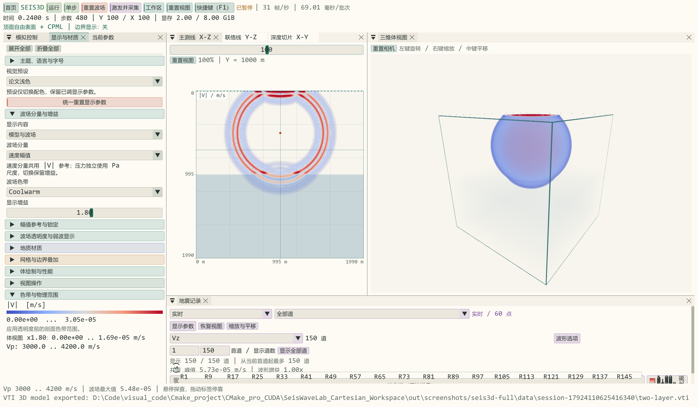

图5　浅色双层材料上的速度幅值波场。标尺单位为米，交叉线指示联动的剖面位置。

| 剖面 | 固定方向 | 图像坐标 |
| --- | --- | --- |
| Inline X Z | Y | 水平 X，垂直 Z |
| Crossline Y Z | X | 水平 Y，垂直 Z |
| Depth X Y | Z | 水平 X，垂直 Y |

| 输入 | 操作效果 |
| --- | --- |
| 滚轮 | 以剖面中心整体缩放，范围 100% 至 3200%；保持物理比例，先扩大显示区域，填满面板后裁切 |
| 中键拖动 | 平移当前剖面 |
| 左键单击 | 拾取格点并联动三个剖面位置 |
| Reset view | 恢复当前剖面全景 |
| Reset views 或 R | 重置三个剖面与轨道相机 |

各剖面独立保存缩放与平移。标尺、交叉线、震源与接收点标记共用同一坐标变换，放大后仍按真实模型格点拾取。Z 为深度方向，向下增大。

**显示边界层：** 在 **Display / materials** 或顶部 **Workspace** 勾选 **Show boundary layers / walls**。剖面显示实际外部 CPML 网格及其波场，琥珀色薄罩标识吸收区域，青绿色描边标出物理模型。体视图同时显示 CPML 外盒与内部物理模型盒。自由表面模式顶部没有吸收层，反射模式只显示壁面边框。

关闭此开关后，视图裁切回物理模型；不会关闭 CPML 计算，也不会改变网格、时步或接收记录。切换显示时重置剖面视图，随后仍支持滚轮缩放和平移。CPML 区域的标尺允许负坐标，悬停显示边界提示，不允许在吸收区布设源检或联动到域外格点。Boundary tint opacity 仅控制边界颜色透明度。

本次截图每轴200个物理节点、10 m间距，节点中心坐标为0至1990 m。深度切片位置为700 m。差分保护层与模型外部CPML不属于导出模型的物理节点。

<!-- pagebreak -->

## 6 显示样式与模型材质

图6　Paper Sand与Paper scientific配套设置，完整窗口展示分量、色带、增益、材料选项及实际波场。

推荐组合为 **Paper Sand + Paper scientific**。该预设的完整重置值使用Scientific White浅色材料、Coolwarm色带和浅色体视图背景，分量为速度幅值；本次演示在重置后选回Vz，便于对照正负极性。Display gain 为 1.8，Wave opacity 为 1.0，Weak wave visibility 为 0.50，材料背景亮度为 1.0。

**Visual preset 切换现在只改变波场和模型色带**，保留当前分量、组合模式、波场/体视图增益、自动或手动尺度、透明度、阈值、材料范围、体视图配方及其他已调参数；顶部 Workspace 菜单中的同名选项行为一致。需要预设的完整默认效果时，点击下方红色 **Reset display parameters**，按当前选中的预设统一恢复显示参数。上述 Paper 参数为点击重置后的默认值。此操作不改变物理模型、运行步数或采集数据；显示边界层会被关闭，如此前开启则剖面重新适配物理区。字体、主题和轨道相机保持当前选择。

在 **Display** 中，Model + wavefield 将波场叠加在材料上；Wavefield only 隐藏材料；Material only 单独检查物性分层。材料可以选择 Vp、Vs 或 Density，自动范围依据当前可见数据计算。比较不同位置时，可用 Freeze visible material range 固定范围。

速度幅值的蓝红色带表示非负幅值大小。分析极性时应改为 Vx、Vy 或 Vz，并查看对应的带符号图例。单个速度分量可能在对称剖面上接近零，检查全部波前时宜先选择 Velocity magnitude。

Weak wave visibility 数值越小，弱波越明显；Wave cutoff 过滤低幅值区域。自动尺度默认关闭 **Hold observed peak (stable colors)**，使用当前幅值参考；开启后保持已抽取视图的历史参考峰值，避免波场衰减后把 CPML 尾波和浮点噪声不断放大。Vx、Vy、Vz 和 Velocity magnitude 共用速度幅值参考，切换时保留峰值和增益；压力使用独立的 Pa 参考，并分别记忆速度与压力的手动尺度。**Reset observed peak** 重新统计当前单位的峰值；重发震源、重建模型会清空旧波场的历史峰值。显示 CPML 时，吸收区纳入共同振幅统计。不同分量的真实振幅与极性仍会不同；共同参考不会把弱分量强行放大成同样亮。跨运行比较振幅应使用相同手动尺度。增益、透明度和颜色属于显示映射，采集记录仍使用物理单位。

**显示增益与幅值尺度：** 初始化、重建或导入模型、修改边界/频率后重建、重发震源和开始采集均保留已调显示参数。但新波场的最大值与历史峰值需要重新统计，自动模式下显示强度可能随新峰值变化。若要保持相同显示基准，先在已有波场时点击 **Lock current amplitude scale**，将当前参考值复制到手动尺度；随后重建模型仍使用该参考值。取消 Automatic common scale 也会保留当前有效尺度；无波场或分量统计尚未更新时保留原手动值。显示归一化近似为 `振幅 × Display gain / Amplitude scale`，体视图还乘以 Volume gain。色带、阈值、透明度、gamma 和体积分也会影响观感，颜色不是直接的振幅读数。

**体视图清晰度：** 辅助显示体每轴最多 256 点；大网格按体素中心三线性重采样，三正交剖面仍使用完整格点。输出随停靠窗口尺寸和显示缩放调整，最长边不超过 1536 像素，并保持窗口宽高比。射线根据穿过的体素距离自动使用 192–1024 个采样点。**Ray samples / voxel** 增加射线采样密度，**Wavefront sharpness** 提高波前与弱背景的分离度，**Cloud cutoff / opacity** 调整云图阈值与透明度。面板显示实际显示体和输出像素尺寸。增加显示采样不能补回物理网格中不存在的细节。

<!-- pagebreak -->

### 同一波场的六种色带

以下完整窗口使用相同物理场、Vz分量、1.8倍显示增益与材料背景，均暂停于第480步（0.240s）。这里只改变波场色带，采集数据不随颜色变化。发散色带适合辨认正负极性；顺序色带用于观察强弱分布时应结合图例。

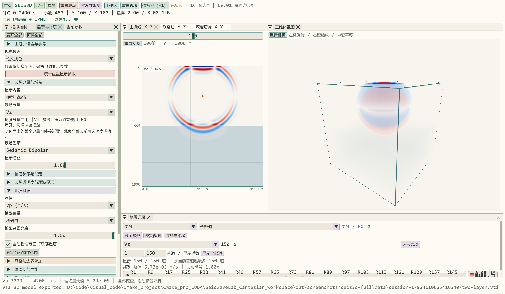

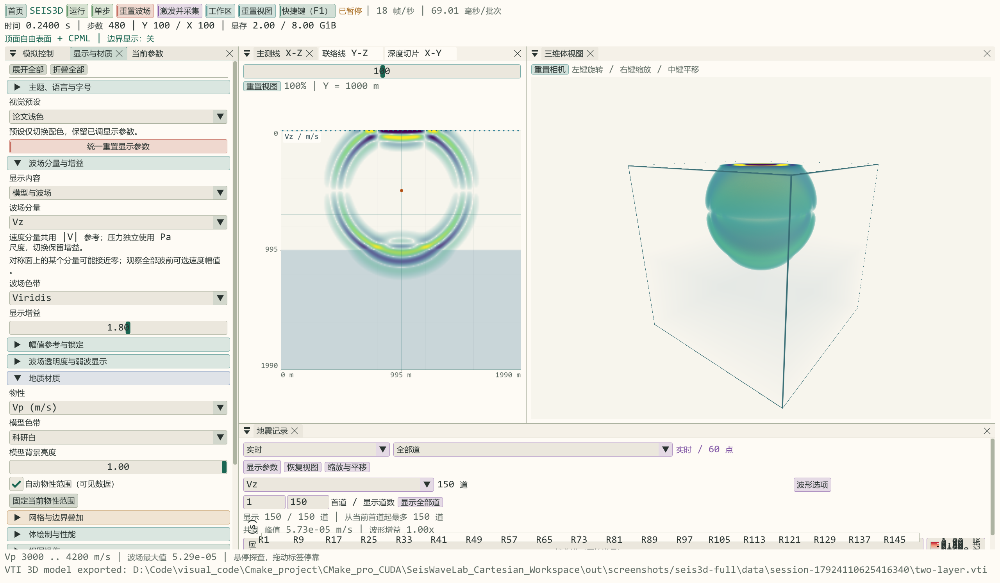

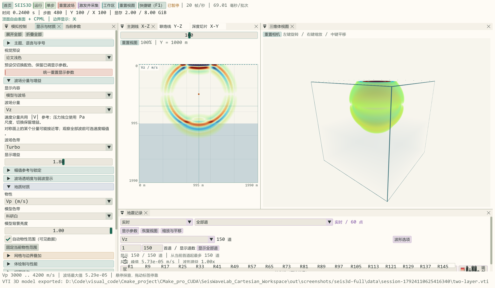

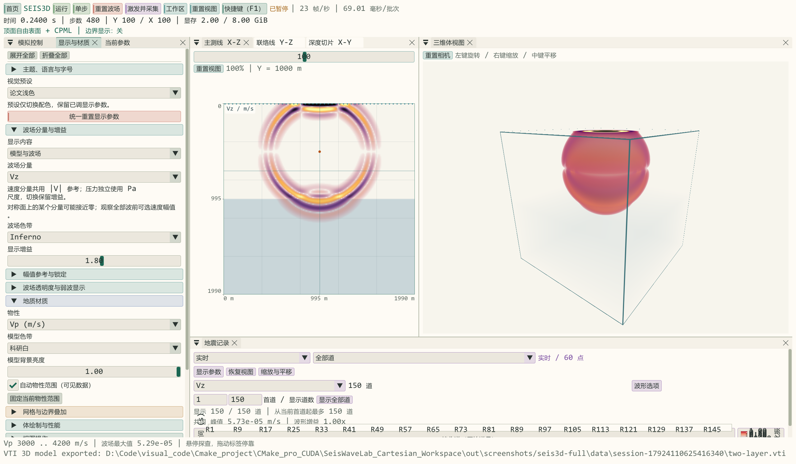

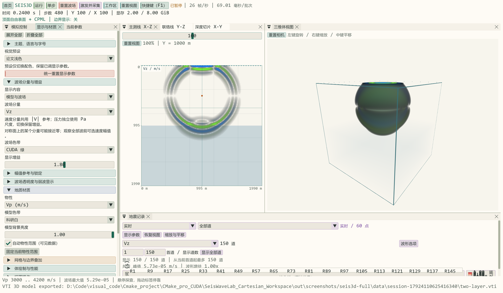

## 7 体视图与停靠布局

图7　浅色背景上的半透明三维波场。青灰色包围盒表示物理模型范围。

| 输入或按钮 | 体视图操作 |
| --- | --- |
| 左键拖动 | 围绕模型旋转 |
| 右键拖动或滚轮 | 缩放轨道相机 |
| 中键拖动 | 平移观察中心 |
| Reset camera | 恢复默认相机 |

| 工作区预设 | 使用场景 |
| --- | --- |
| Four views | 同时比较三个剖面与体视图 |
| Volume focus | 放大体视图，以标签页切换剖面 |
| Compact / tabbed | 较小窗口中使用合并标签页 |
| Receiver focus | 放大多道记录，顶部以标签切换剖面和体视图 |

体绘制使用每轴最多 256 点的辅助显示体；三剖面使用完整物理网格。体图适合观察整体传播形态，薄层、细小波前和定量振幅应结合剖面与采集曲线判断。

Auxiliary volume raymarch 可关闭体绘制，Cloud opacity 与 Cloud cutoff 控制云图透明度和阈值。Display every N steps 调整显示更新频率；大型网格可减少显示更新次数以降低渲染开销。

**大模型颜色偏淡时：** 默认开启 **Size-consistent wave opacity**，补偿模型增大后固定厚度波前在归一化盒子中的透明度下降；该补偿只作用于波场，材料背景不随模型尺寸变得更厚重。仍偏淡时，可提高 **Volume gain (display only)**，默认 1.8 倍；它只调整体视图，剖面增益、物理波场、采集和导出数据保持独立。

**Volume recipe** 提供 Balanced（均衡）、Vivid wavefronts（鲜明波前）和 Soft cloud（柔和云图）。选择配方会恢复体视图增益、透明度、阈值、锐度与采样密度，不重置相机和模型。Paper scientific 仍使用配套的浅色参数。体视图图例单独显示其增益和幅值范围；透明度和沿射线叠加使体图颜色不能直接用作定量振幅读数。暂停时调整这些参数也会即时重绘。

<!-- pagebreak -->

## 8 接收采集与 SEG Y 导出

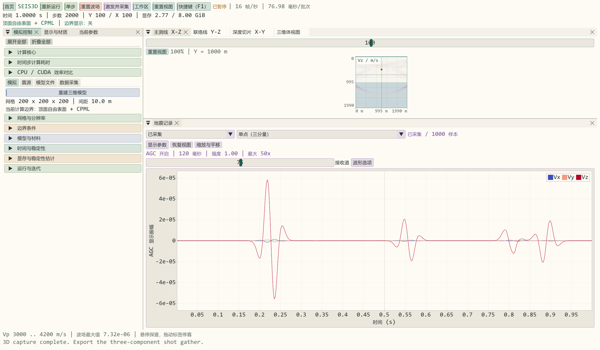

图8　同一接收点的Vx、Vy、Vz曲线。图中已开启AGC，横轴为秒，纵轴为AGC显示振幅；关闭AGC后才按m/s物理振幅显示。

1. 初始化模型后，打开 **Acquisition** 标签。
2. 初始为 **100×5** 的地表面阵，共500道，达到当前接收上限；也可选择50×3、50×6、10×10、单排X/Y测线。总道数等于X点数乘Y排数，默认单炮激发。
3. 设置接收点原点、XY 间距及深度 Z；地表接收可使用 Z 为 0。
4. 需要自动适配模型范围时点击 **Fit spread to model**，再点击 **Deploy mesh** 应用。
5. 设置 Samples per shot，在 Sampling clock 中选择等时间间隔（ms），输入采样间隔或点击 0.5 ms / 1 ms。也可选择计算步距（步）使用旧的步数采样。通过 **Browse export folder** 选择文件夹，通过 **Shot file prefix** 或 **Choose export name / location** 选择文件名前缀和位置。
6. 点击 **Capture current source** 或顶部 **Fire + capture**，等待当前炮采集完成。
7. 点击 **Export captured 3-C SEG-Y** 导出三分量道集。

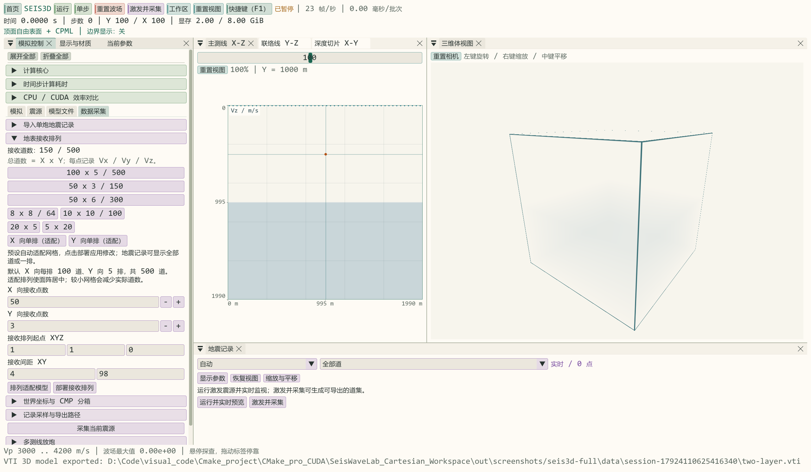

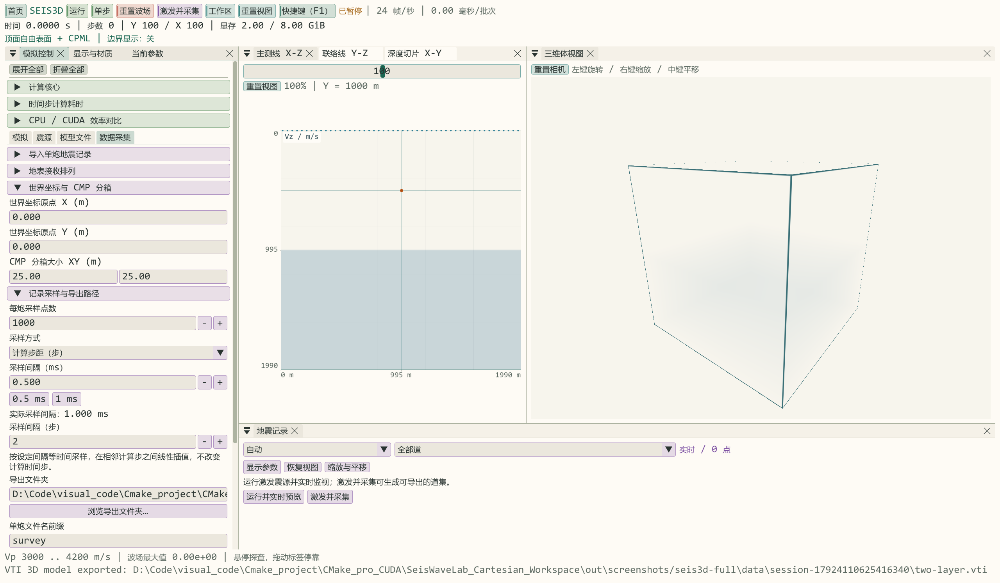

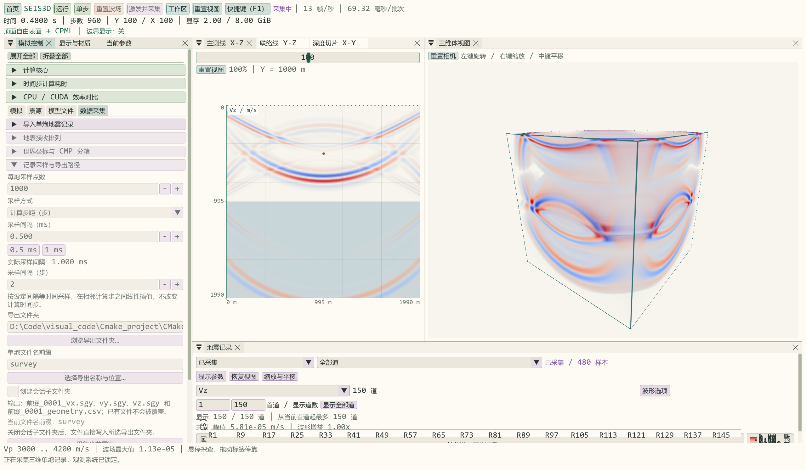

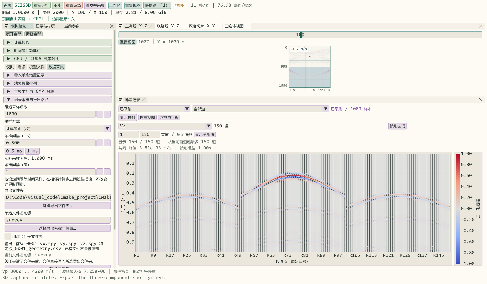

### 导出位置与文件命名

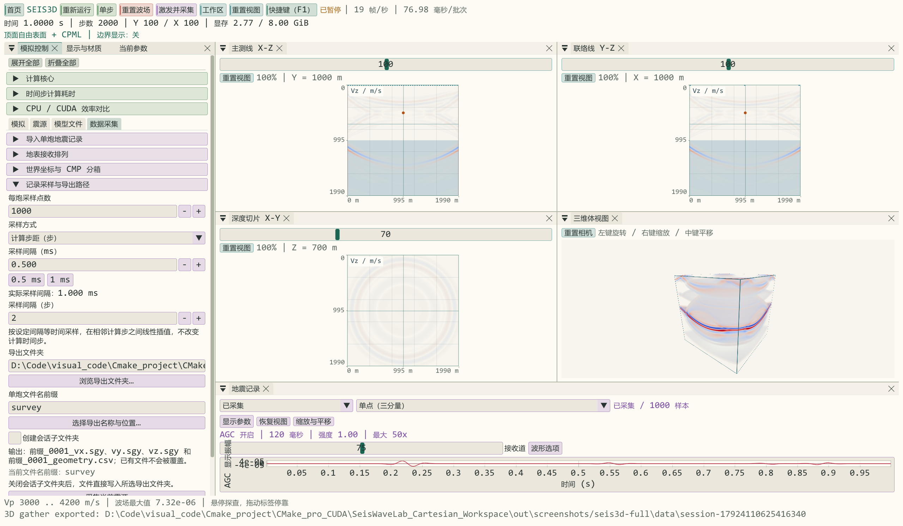

默认前缀为 `shot`，第一炮生成 `shot_0001_vx.sgy`、`shot_0001_vy.sgy`、`shot_0001_vz.sgy` 和 `shot_0001_geometry.csv`。选择名称对话框用于设置这组文件的共同前缀，程序追加炮号及分量后缀，支持中文文件夹与中文前缀。

**Create session subfolder / 创建会话子文件夹** 默认开启：单炮位于所选目录的 `capture_<时间戳>` 中，多炮位于 `survey_<时间戳>` 中。关闭后直接写入选中的文件夹。任一目标已存在时，导出会在写入前拒绝覆盖；可更换前缀或开启新的会话子文件夹。

| 预览类型 | 数据来源 | 保存方式 |
| --- | --- | --- |
| Live monitor | 普通 Run 每个计算批次抽取 | 每道最近 1000 个预览点的环形缓存 |
| Captured gather | 按指定采样步距正式采集 | 独立的 CPU 道集快照 |
| Auto preview | 依据运行或采集状态自动选择 | 不改变两类数据的采样方式 |

界面数据来源选择器为 **Auto / Live / Capture / Imported**。右侧显示当前实际数据来源及样本数；Imported 使用独立的外部文件记录。

### 导入已有单炮 SEG-Y 记录

1. 打开 **Acquisition → IMPORT SHOT RECORD**，点击 **Browse SEG-Y**，或在路径栏输入 `.sgy` / `.segy` 文件位置。
2. 点击 **Import shot for display**。导入成功后，Receiver traces 自动切换到 **Imported**，显示文件名、炮号、分量、单位和样本数。
3. 选择 **Single trace** 查看单道，或选择 **All traces / X row (fixed Y) / Y row (fixed X)** 查看多道及指定排列。导入文件只显示实际存储的分量；当前程序导出的 `_vx.sgy`、`_vy.sgy`、`_vz.sgy` 分别加载。
4. 使用 **Trace options / 波形选项** 调整 Trace gain、自动增益补偿、正振幅填充、归一化和图形适配。**All traces / 全部道** 默认显示当前数据的全部道数，不再固定限制为 128 道：150 道显示 150 道，500 道显示 500 道，导入记录按其实际总道数更新。

**First / visible traces / 首道与显示道数** 可手动截取范围，最大显示数量为从当前首道起剩余的道数；**Show all traces / 显示全部道** 恢复首道 1 并随数据总道数自动更新。选择 X/Y 排时，上限按该排实际道数计算，默认面阵第 2 个 X 排为中间 50 道。选范围、换排列或数据来源保留增益和原始记录。大量导入道同时绘制会增加绘图开销，可手动缩小显示范围；每道仍最多保留 2048 个预览点，原始采样不变。

**Display Parameters / 显示参数** 与二维查看器采用相同控件，提供六种样式：波形线、变面积、密度图、密度图与波形、正负极性填充、密度图与极性填充。手动组合显示开关后标为自定义。Wave palette 使用与波场相同的十四套色带，默认 Coolwarm；Heatmap range 调节归一化色阶，Density opacity 调节密度层透明度。密度模式附带归一化振幅色标，颜色与增益仅影响显示副本。切换样式/色带不重置增益或 AGC。

图内滚轮缩放两轴；时间轴或地震道轴上滚轮只缩放该轴；左键拖动平移。手动操作时自动退出 Auto fit，视图保持到 Reset View 或显式重新开启自动适配。单道时间轴也支持此操作。Navigation 显示手势提示，Reset viewer display 显式恢复显示默认值并保留记录；单道图使用配色和极性填充，密度层用于多道图。

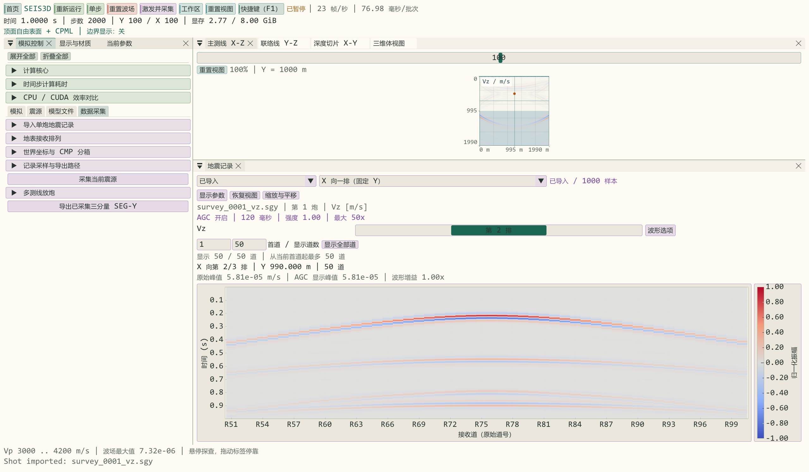

此图来自本次200³模型的真实采集记录导出后重新导入：Paper Sand主题，文件包含150道×1000样点；固定Y的中间第2排显示50道Vz。导入不要求初始化 GPU 模型，不覆盖本次采集结果，也不重置波场增益或运行状态。文件无效时保留此前成功导入的记录，并在底部提示原因。

当前支持大端 SEG-Y rev0/rev1 的 IBM/IEEE 32 位浮点与 32/16/8 位有符号整数样本。每个文件必须为单炮、单分量、统一采样间隔与样本数；上限为 4096 道、每道 32767 样本和 256 MiB CPU 样本缓冲。保留道号、坐标比例及每道起始延迟；米/英尺坐标统一为米，角度坐标显示文件单位，不进行投影转换。rev2、小端、变长道和多炮混合文件会明确拒绝。字段依据见 [SEG-Y rev1 标准](https://seg.org/wp-content/uploads/2025/11/seg_y_rev1.pdf)。

### 只显示一排接收点的多道记录

1. 默认 **100 × 5 / 500**，同时提供对应的一键布设按钮；保留 **50 × 3 / 150、50 × 6 / 300、10 × 10 / 100、20 × 5、5 × 20、X line (fit)、Y line (fit)**。总上限 500 道，较小网格按可布点空间减少实际数量。预设只是编辑布设，需点击 **Deploy mesh** 或开始采集才能应用。
2. 选择 **Workspace → Receiver focus** 放大道集区域。
3. 在 **Receiver traces** 中选择 **Capture** 查看正式记录，或 **Live** 查看当前监视数据。
4. 视图选择 **X row (fixed Y)**，拖动 **Row** 只显示固定 Y 的一排；选择 **Y row (fixed X)** 则显示固定 X 的一列。Row 从 1 开始，行数与坐标来自实际接收点。也可选择 **All traces** 查看全部道，**Single (3C)** 返回原单接收点三分量图。
5. 选择 Vx、Vy、Vz 或 Velocity magnitude。横轴显示原始接收道号，纵轴为向下递增的时间。波形按所选行的空间顺序排列。
6. **Trace options / 波形选项** 可调整独立 Trace gain、自动增益补偿、正振幅填充和自动适配。默认使用所选道的共同峰值归一化；勾选 Normalize each trace 后每道独立归一化，不能再直接比较相对振幅。关闭 Auto fit traces 后可使用 ImPlot 的缩放和平移；Fit traces now 恢复适配。

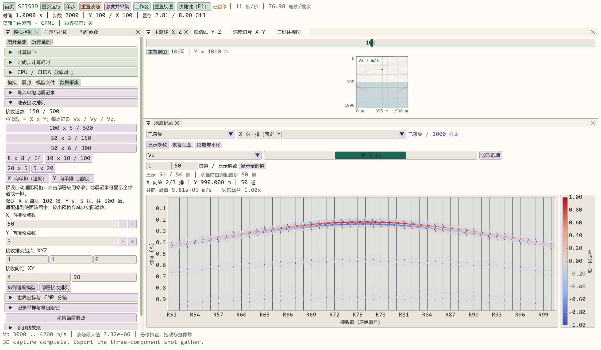

本图来自200³双层模型的真实150道×1000样点采集；选择中间第2排的R51–R100，显示Vz。完整记录间隔1 ms、首末时间0.75～999.75 ms。Trace gain只影响预览，Display gain和Volume gain不改变记录；波场统计峰值与时间记录峰值不必相等。

多道和单道预览最多保留每道 2048 个点，长记录按区间保留极值和起止点，减少窄到达被跳点遗漏。完整原始记录仍用于 SEG-Y 导出。正式道集使用采集时冻结的坐标与时间信息；后来编辑或部署另一种排列不会改变已有道集的选行。Live 始终使用当前已部署的接收点，环形数据按时间顺序显示。

### 自动增益补偿（AGC）

在 **Receiver traces / 地震记录** 中，单道三分量图和多道剖面图均可打开 **Trace options / 波形选项**，勾选 **Automatic gain compensation / 自动增益补偿**。默认关闭，开启后记录上方会显示 **AGC ON** 及当前时间窗、强度和最大倍数。参数修改会立即重绘预览，不需要重新初始化模型或采集。

| 控件 | 默认值 | 作用与调整建议 |
| --- | --- | --- |
| AGC window | 120 ms | 以每个样本为中心计算局部 RMS；短窗更容易突出短暂弱到达，长窗使包络变化更平缓。可调 5–2000 ms |
| AGC strength | 1.00 | 0 表示不补偿，1 表示完整补偿，中间值连续过渡 |
| Maximum AGC boost | 50× | 单样本最大增益上限；噪声被抬高时先降低此值。可调 1–200× |
| Noise floor | 峰值的 0.01% | 低于门限时不放大，接近门限逐渐放大；背景噪声太明显时提高此值。可调 0–2% |
| Reset AGC parameters | — | 只恢复上述 AGC 参数，保留开启状态、波形增益及其他显示设置 |

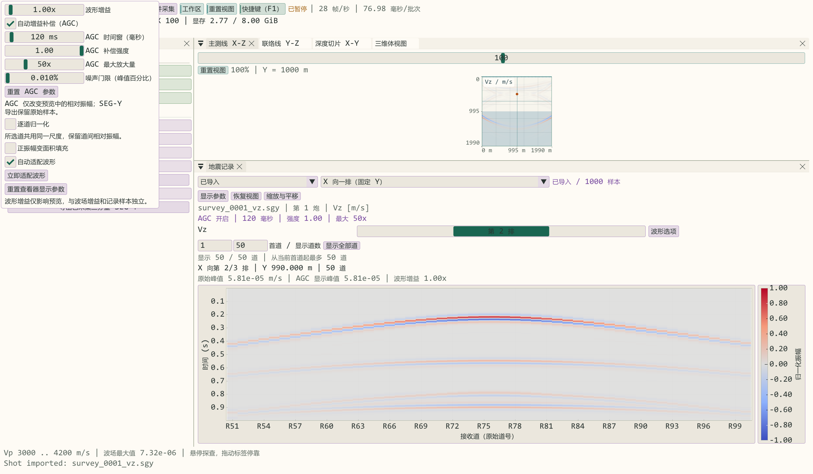

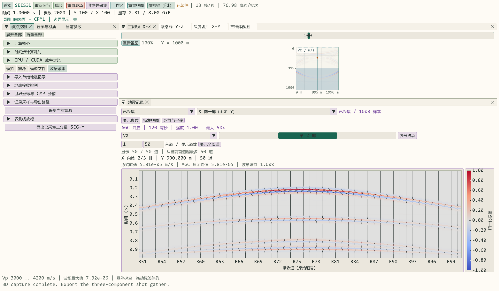

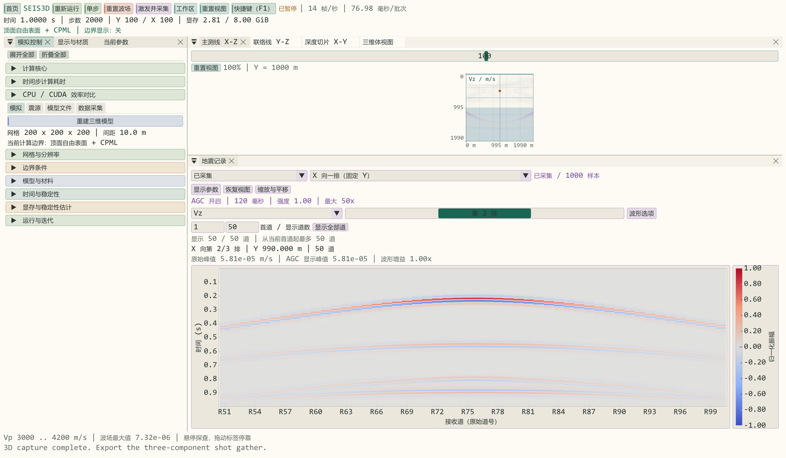

每道或每个分量依据自身完整时间序列的全局 RMS 与局部 RMS 计算补偿，增益限于 1 到设定的最大倍数，并通过噪声门限平滑抑制静默区放大。补偿在最多 2048 点的显示抽稀之前执行。**AGC 只改变预览的相对振幅**：开启时单道纵轴标为“AGC 显示振幅”，多道状态同时报告原始峰值和补偿后的显示峰值。比较真实道间振幅、进行定量分析或导出 SEG-Y 时应关闭 AGC；导出始终使用未处理的采集样本。Trace gain 仅控制可见高度，多道逐道归一化属于另一项独立显示设置。

建议先完成采集，在 **X row (fixed Y)** 或 **Y row (fixed X)** 中选一排，再开启 AGC；先用 120 ms、强度 0.5–1、最大 20–50× 观察晚到弱信号。若波形呈现连续噪声带，增大 Noise floor 或缩短最大放大量。单道三分量图也使用同一组 AGC 参数；切换单道和多道时不会重置。

等时间间隔（ms）模式按输入值生成均匀输出时间轴，从 0 秒开始，在相邻速度半时间步之间做线性插值。0.5 ms、1 ms 不再取整为计算步距；间隔以整数微秒表示，范围为 0.001–32.767 ms。输出间隔小于计算步长时，插值不会增加求解器的时间分辨率。计算步距模式仍按 Sample stride × 当前求解时步采样，并保留速度半时间步起点。两种模式均冻结本炮采样设置，SEG-Y 文件头和几何 CSV 写入实际输出间隔。Live 预览按计算批次记录，正式采集参数不改变 Live 曲线的采样节奏。

左侧与“模拟控制”“显示与材质”同组的“当前参数”面板显示生效网格、间距、计算步长、时间、边界、材料、震源、接收点及下次采集间隔；已有记录的冻结间隔单独显示。可直接修改采集参数；模型与时间步参数编辑后，点击“应用参数并重建”生效，重建会重新初始化波场。采集期间更新控件锁定。

每炮输出 `_vx.sgy`、`_vy.sgy`、`_vz.sgy` 和 `_geometry.csv`，每个分量文件最多包含 500 道。默认每道 1000 样点；三个分量各有相同的接收位置，不将其计成三倍空间道数。默认单炮，多测线放炮的 Shots per line 和 Source line count 均为 1；需要多炮时再修改这两项及 Shot spacing，通过 Start spread + auto export 自动逐炮采集与导出。

<!-- pagebreak -->

## 9 模型文件与计算边界

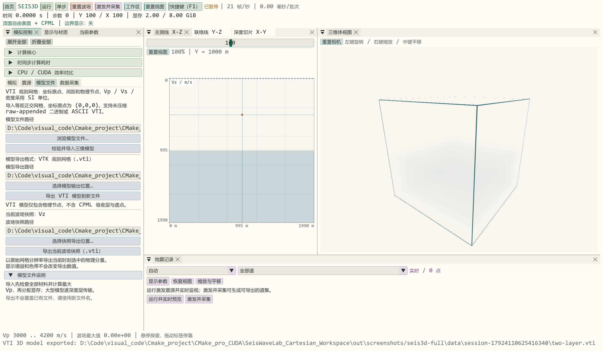

**Model I/O** 统一使用 `.vti` 三维模型。文件保存Origin / Spacing 和物理维度及 Vp、Vs、Density，X 方向连续；CPML 和 ghost 由程序重建。导入前检查几何与全部材料、最大 Vp、CFL 和预算；当前要求原点为零的正向等距正交网格，曲网格需先重采样。导出为未压缩 raw-appended Float32；导入支持未压缩 raw-appended 或 ASCII Float32/Float64。

**Model path + Browse model file** 选择 `.vti`，点击校验导入。**Model export path + Choose model output** 选择独立的 `.vti` 新文件名，再点击“导出 VTI 模型到新文件”。模型格式不再提供选择器，S3DM 模式已移除，物性模型和波场快照各自使用独立文件。浏览文件本身不重建或导出。 导入使用后台任务，弹窗显示旋转动画、阶段、百分比和已用时间；校验/读取阶段可取消，初始化阶段等待完成，期间相关控制禁用。校验失败保留原模型。

模型包含当前已生效物理网格、SI 物性和边界元数据，不保存波场、震源、观测系统或完整续算状态。单位、曲网格兼容范围和独立 Python 读取示例见 [VTI 统一格式](VTI_Model_Format.md)。已有文件不会覆盖；采集期间不能操作模型文件。

同一页面还可将当前选中的 `Vz`、`Vx`、`Vy`、速度大小或压力导出为 `.vti` 三维标量快照，并记录模拟时刻与分量单位。波场快照与显示增益无关；详见上述 VTI 导出说明。

| 物理网格 | 代码估算的总显存预算 | 适用起点 |
| --- | --- | --- |
| 300×50×300 | 0.554 GiB | 当前默认网格 |
| 500×20×500 | 0.873 GiB | 薄横向模型 |
| 200³ | 0.771 GiB | 本次截图与流程示例 |
| 300³ | 1.987 GiB | 较大三维模型 |
| 300 × 300 × 400 | 2.516 GiB | 达到物理节点总量上限 |

预算对应 12 格 CPML、自由表面开启，包含物理场、材料、CPML 与显示缓冲。驱动、CUDA 模块和其他应用另有占用，顶部 VRAM 数值通常大于本表预算。单次预算上限为 4 GiB，分配时还会预留设备显存余量。

物理 X/Y/Z 每轴至少 16 点，总乘积不超过 **36,000,000（300 × 300 × 400）**，不再锁定单边 512 点。输入区显示总节点预算和其余两轴固定时的轴上限，例如 600 × 200 × 200 满足总量约束。超过总量的输入或模型文件会被拒绝，不会静默改变模型尺寸。实际可初始化尺寸还受 4 GiB 预算、设备空闲显存和 OpenGL 最大纹理边长约束；CPML 不计入物理节点总量，但计入显存预算。

求解器采用三维各向同性一阶速度应力方程，包含 3 个速度分量和 6 个独立应力分量。内部空间为八阶交错差分，时间为二阶交错推进，吸收边界采用薄层记忆变量 CPML。平面自由表面的离散闭合为二阶，当前不支持起伏地形。

正式单炮最多 32767 个样本，实际采样间隔最多 32767 微秒，三分量 CPU 道集缓冲上限为 512 MiB。SEG-Y 导出记录源检坐标、CMP Inline 与 Crossline 分箱标号；当前未实现 CMP 叠加、偏移成像或投影坐标转换。

当前已有显示、采集、交互和资源释放的集成检查。用于定量地震研究前，仍需完成 P/S 到时、收敛性、自由表面、CPML 反射和长期稳定性验证。详细实现和文件格式见三维实现说明。

历史六面吸收审查使用96³均匀介质与浅震源双层模型，检查条件、真实量级和适用范围见[体绘制与六面吸收检查](../reviews/SEIS3D_VOLUME_BOUNDARY_REVIEW.md)。本轮图片用于操作展示，不将模式初始化截图写成新的反射误差测试结果。

<!-- pagebreak -->

## 10 常见问题与文档位置

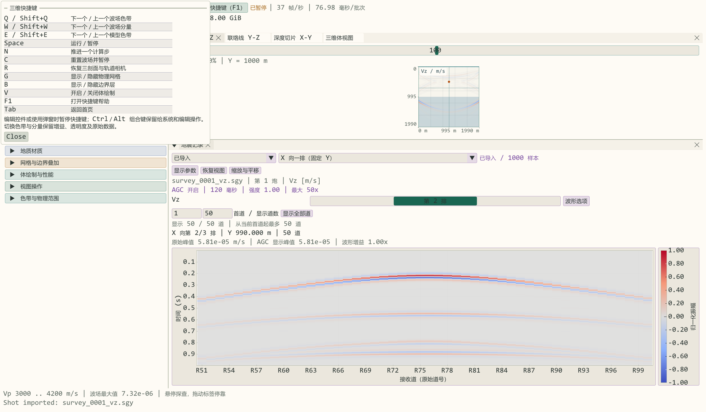

| 现象 | 检查与处理 |
| --- | --- |
| 只有网格，没有材料或波场 | 先初始化模型；切换 Material only 检查材料，再选择 Paper scientific 和 Run。旧发布版可按构建说明完整重建 |
| 某个剖面波场接近空白 | 单分量可能处于对称面；先改为 Velocity magnitude，并将剖面移到震源附近 |
| 底部没有波形或暂时为零 | Run 生成 Live 预览，正式数据使用 Fire + capture；允许传播时间，并选择较近接收点 |
| 运行到终止后再次点击没有新波前 | 使用 Replay 重新发射，或 Reset fields 后 Run |
| 改了模型但显示仍是旧材料 | 重新初始化会话；采集中先停止采集再编辑 |
| 模型较大时初始化失败 | 查看底部错误和实际空闲显存，先使用较小网格 |
| 窗口布局混乱或窗口关闭 | Workspace 重新应用 Four views，或重新打开对应窗口 |

| 快捷键 | 操作 |
| --- | --- |
| Space | 运行或暂停 |
| Q / Shift+Q | 下一个／上一个波场色带，循环全部 14 种 |
| W / Shift+W | 下一个／上一个波场分量：Vz、Vx、Vy、速度模、压力 |
| E / Shift+E | 下一个／上一个模型色带，循环全部 5 种 |
| N | 推进一个求解步并暂停连续运行，可逐步推进正式采集 |
| C | 重置波场并暂停 |
| R | 恢复三剖面与轨道相机 |
| G | 显示／隐藏物理网格 |
| B | 显示／隐藏边界层或反射墙，调整视图适配范围 |
| V | 开启／关闭辅助体绘制 |
| F1 | 打开快捷键帮助，也可点击顶部 Shortcuts (F1) |
| Tab | 返回首页并执行模式资源释放 |

Q/W/E 与二维工作区保持相同顺序。切换色带不会应用视觉预设默认值；分量切换调用控件同一逻辑，保持增益、透明度和同单位的幅值参考，压力使用独立的 Pa 参考。边界显示只改变可见范围，体绘制开关只改变显示，均不更改求解边界或原始接收数据。

文本输入、拖动/编辑控件和打开弹窗时，工作区快捷键暂停；按住 Ctrl、Alt 或系统修饰键时也不触发，例如 Ctrl+C 仍用于复制。除 Q/W/E 的反向切换外，其他工作区快捷键不接受 Shift 修饰。按住按键不会连续轮转。正式采集或多炮序列中 C 被禁用，以避免清空正在记录的波场；显示项仍可调整。

本指南的 Markdown 位于 `docs/user`，实际截图位于 `docs/assets/seis3d`，可编辑 Word 位于外层 `out/docs`。运行程序和资源统一位于外层 `out/bin`。

- [文档导航](../README.md)
- [构建与输出说明](../build/BUILDING.md)
- [三维实现和格式说明](../development/SEIS3D_IMPLEMENTATION.md)
- [二维稳定性历史审查](../reviews/NUMERICAL_STABILITY_REVIEW.md)

本说明书采用当前版本的完整窗口原始PNG，位于docs/assets/seis3d/full；全部33张图片、分辨率、时间步和样式条件见[完整窗口截图集](Seis3D_Screenshot_Gallery.md)与capture-manifest.json。图中波场、物性和记录来自真实CUDA计算，不裁切、不拉伸、不重新着色。此前视频保留录制时的设置，当前截图以本次参数为准。

## 2026-10-19：CPU 并行与性能对比

控制面板新增“计算核心”“时间步计算耗时”“CPU / CUDA 效率对比”。选择自动、CPU/OpenMP 或 CUDA，设置线程数后应用核心；自动检测失败及 CUDA/OpenGL 互操作失败会回退 CPU。应用核心重建会话，采集中不可切换。CPU 支持当前三维 CPML、自由表面、反射边界、接收器采集、剖面/体显示与原有模型/波场导出。

当前参数面板上方并列显示当前和待应用参数，差异着色，下方继续编辑并通过重建按钮生效。三维性能面板按批次显示墙钟耗时；标准效率对比使用独立 32³ 网格、CPML 8，预热 4 步和计时 20 步，报告耗时比与 Vz 相对 L2 误差。该标准对比不会清空当前数据，也不代表当前大模型的加速比。

构建与运行依赖、目录分工见 [代码架构](../development/CODE_ARCHITECTURE.md)。

### 参数分组与全部展开／折叠

参数按职责折叠分组：计算核心、时间步耗时、CPU/CUDA 对比、模型/网格与边界、震源/子波、物性/预设/画笔、SEG-Y 导入导出、采样/检波器/采集/多炮、回放、波场/物性/网格显示。当前参数页分为当前与待应用参数、采集（二维集中在采集页）和参数更新。

面板顶部“全部展开”“全部折叠”影响该面板所有组，包括暂未打开的页签；切换页签后仍保持该命令。每组也可单独点击标题展开/折叠，语言切换保留状态。折叠不会应用参数、改变波场或清空记录。
